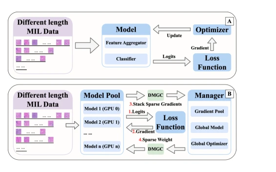

## Distributed Parallel Gradient Stacking(DPGS): Solving Whole Slide Image Stacking Challenge in Multi-Instance Learning

> data: CAMELYON16 多尺度/ImageNet 特征、TCGA-Lung 多尺度/UNI2 特征
>
> ICML 2025 · [论文](https://proceedings.mlr.press/v267/wu25ae.html)

#### 引言

面向实例数不一致导致的 MIL 批次堆叠难题，结合分布式梯度堆叠与模型、梯度压缩，提高训练效率并降低通信开销。

#### 方法

（1）梯度堆叠：在保留不同长度包信息的同时组织并行计算。

（2）分布式管理：协调多个工作模型的梯度与参数更新。

（3）DMGC：压缩模型和梯度通信，降低分布式训练开销。

原文Figure 1，PDF 第 1 页。

#### 实验

##### 实验设置

比较原始训练、padding、固定采样与 DPGS；同时记录 ACC、收敛时间和通信开销。

##### 主要结果

TCGA-Lung 上 ABMIL 的 ACC 从 92.38% 到 93.90%，收敛时间从 636.3s 到 20.0s；该加速属于对应实现与硬件设置。

##### 消融与讨论

单独检查 DPGS 堆叠和 DMGC 压缩，区分数据使用方式、训练并行性与压缩近似带来的变化。

#### 参考文献

> Distributed Parallel Gradient Stacking(DPGS): Solving Whole Slide Image Stacking Challenge in Multi-Instance Learning
>
> ICML 2025 · [论文](https://proceedings.mlr.press/v267/wu25ae.html)
