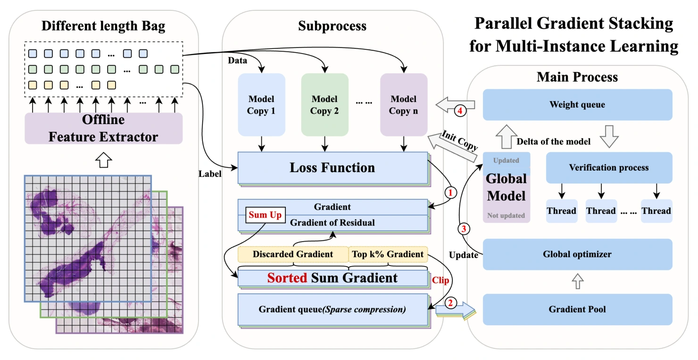
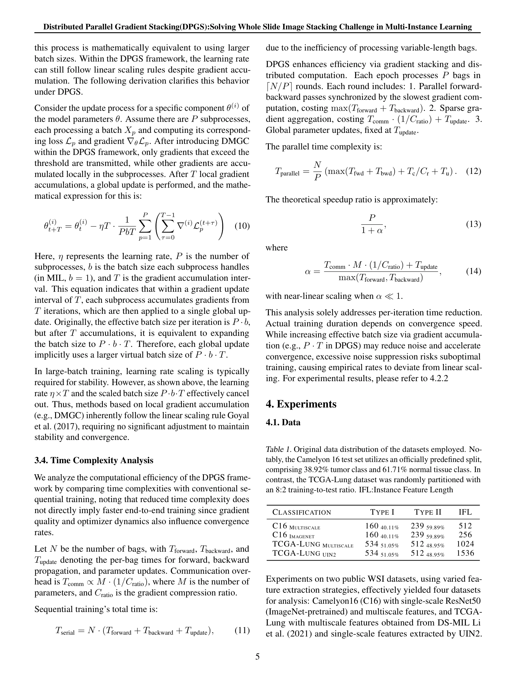
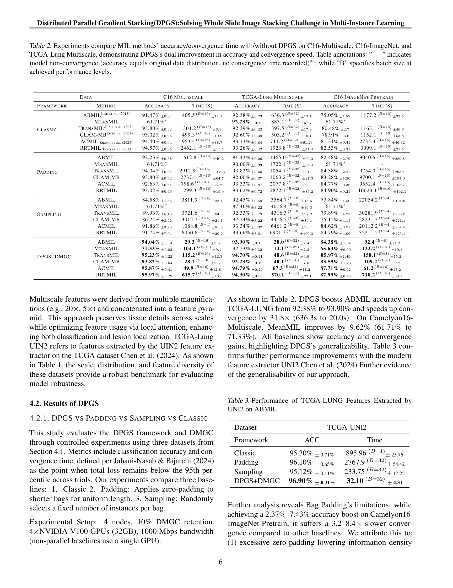
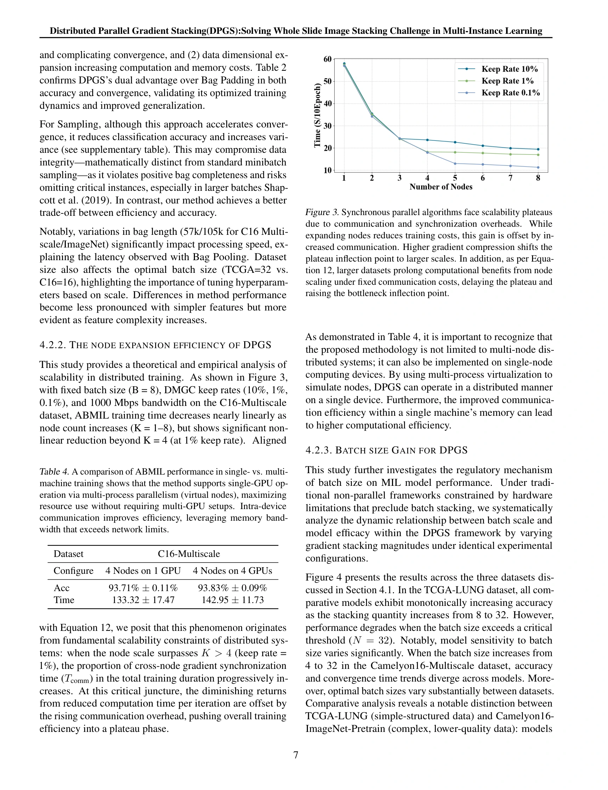
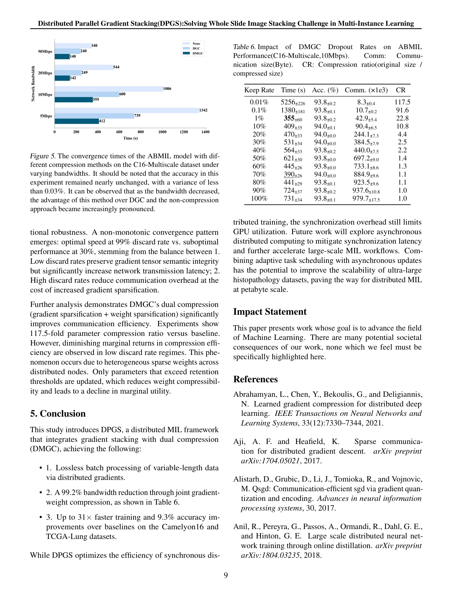
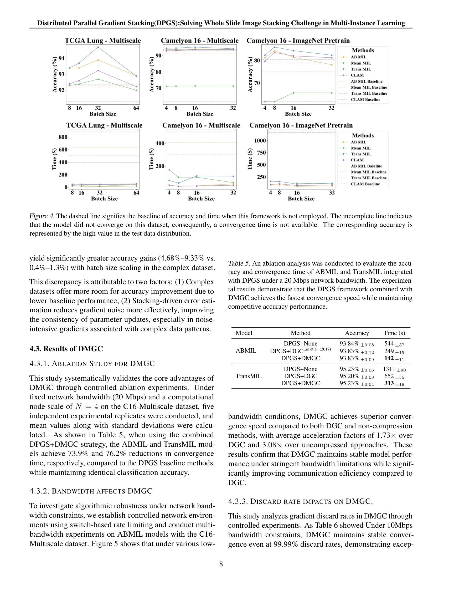

## Distributed Parallel Gradient Stacking(DPGS): Solving Whole Slide Image Stacking Challenge in Multi-Instance Learning

> data: CAMELYON16 多尺度/ImageNet 特征、TCGA-Lung 多尺度/UNI2 特征
>
> ICML 2025 · [论文](https://proceedings.mlr.press/v267/wu25ae.html)

#### 引言

面向实例数不一致导致的 MIL 批次堆叠难题，结合分布式梯度堆叠与模型、梯度压缩，提高训练效率并降低通信开销。

#### 方法

（1）梯度堆叠：在保留不同长度包信息的同时组织并行计算。

（2）分布式管理：协调多个工作模型的梯度与参数更新。

（3）DMGC：压缩模型和梯度通信，降低分布式训练开销。

<!-- wsi-complete-model -->
##### 模型结构图

**图 2 · 模型结构**（PDF 第 3 页）

> 原文图注：Figure 2. The proposed DPGS framework begins by parallelizing models and feeding variable-length data packets for gradient computation. Gradients from parallel models undergo DMGC compression prior to transmission to the master server. The master server aggregates gradients, updates models, applies DMGC compression to weights, and returns them to training servers. Red-numbered annotations in the figure depict the training loop process, with model replication occurring solely during initialization. Multi-threaded validation runs concurrently with the master process.

[查看原尺寸](assest/DPGS-DMGC/figure-2-complete.webp)

<!-- /wsi-complete-model -->

#### 实验

##### 实验设置

比较原始训练、padding、固定采样与 DPGS；同时记录 ACC、收敛时间和通信开销。

##### 主要结果

TCGA-Lung 上 ABMIL 的 ACC 从 92.38% 到 93.90%，收敛时间从 636.3s 到 20.0s；该加速属于对应实现与硬件设置。

<!-- wsi-complete-results -->
##### 完整实验指标与对照

下列实验原页保留表头、全部行列、子图、误差说明和脚注，点击可查看原尺寸。比较时请对应相同的数据集、特征编码器和训练设置；`±`、置信区间、百分比和小数均保留原文的单位与统计口径。

| 原表/图中指标 | 读取方式 |
| --- | --- |
| ACC / Accuracy | 越高越好；平衡准确率、平均准确率以原表标注为准 |
| 时间 / FLOPs / 参数量 | 结合硬件、包长度和计时范围比较；小模型不一定推理更快 |

| 原文页 | 阅读内容 | 图表及正文引用 |
| --- | --- | --- |
| PDF 第 5 页 | 实验结果 | Table 1 |
| PDF 第 6 页 | 实验结果 | Table 2、Table 3 |
| PDF 第 7 页 | 实验结果 | Table 4 |
| PDF 第 8 页 | 消融与参数分析 | Figure 4、Table 5 |
| PDF 第 9 页 | 实验结果 | Figure 5、Table 6 |

**实验原页 · PDF 第 5 页**（图表及正文引用：Table 1）

[查看原尺寸](assest/DPGS-DMGC/experiment-page-05.webp)

**实验原页 · PDF 第 6 页**（图表及正文引用：Table 2、Table 3）

[查看原尺寸](assest/DPGS-DMGC/experiment-page-06.webp)

**实验原页 · PDF 第 7 页**（图表及正文引用：Table 4）

[查看原尺寸](assest/DPGS-DMGC/experiment-page-07.webp)

**实验原页 · PDF 第 9 页**（图表及正文引用：Figure 5、Table 6）

[查看原尺寸](assest/DPGS-DMGC/experiment-page-09.webp)

展开消融、参数、数据设置及效率原页

**实验原页 · PDF 第 8 页**（图表及正文引用：Figure 4、Table 5）

[查看原尺寸](assest/DPGS-DMGC/experiment-page-08.webp)

<!-- /wsi-complete-results -->

##### 消融与讨论

单独检查 DPGS 堆叠和 DMGC 压缩，区分数据使用方式、训练并行性与压缩近似带来的变化。

#### 参考文献

> Distributed Parallel Gradient Stacking(DPGS): Solving Whole Slide Image Stacking Challenge in Multi-Instance Learning
>
> ICML 2025 · [论文](https://proceedings.mlr.press/v267/wu25ae.html)
