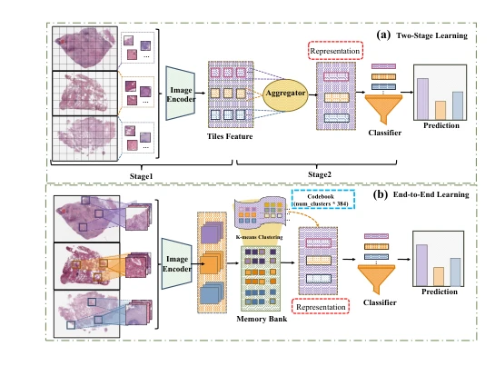
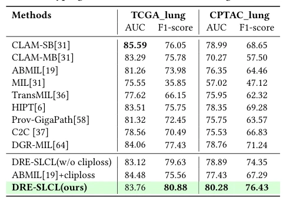

## Dynamic Residual Encoding with Slide-Level Contrastive Learning for End-to-End Whole Slide Image Representation

> data: TCGA-LUAD/LUSC，CPTAC-LUAD/LSCC/CCRCC/PDA
>
> Proceedings of the 33rd ACM International Conference on Multimedia 2025 · [论文](https://doi.org/10.1145/3746027.3755469)

#### 引言

以记忆库保存 patch 特征，将当前采样特征和历史特征进行动态残差编码，再用切片级对比学习支持端到端训练。

#### 方法

（1）全局记忆库：存储各切片 tile 的历史特征。

（2）动态残差编码：融合当前采样的新特征与未采样的历史特征。

（3）切片对比：利用切片表示及病理报告构造监督，联合训练编码器。

原文Figure 1，PDF 第 2 页。

#### 实验

##### 实验设置

覆盖亚型、癌识别和基因突变预测；训练 batch 为 64 张切片，每张随机取 10 个 tile 并更新记忆库。

##### 主要结果

在有限当前采样下，历史特征使端到端切片表示可计算；主表分别报告不同任务的 AUC 和加权 F1。

原文Table 2，PDF 第 6 页。

##### 消融与讨论

比较动态残差编码、记忆库及切片级对比学习，分析采样 tile 数量；不同突变预测不能合并为一个分类任务。

#### 参考文献

> Dynamic Residual Encoding with Slide-Level Contrastive Learning for End-to-End Whole Slide Image Representation
>
> Proceedings of the 33rd ACM International Conference on Multimedia 2025 · [论文](https://doi.org/10.1145/3746027.3755469)
