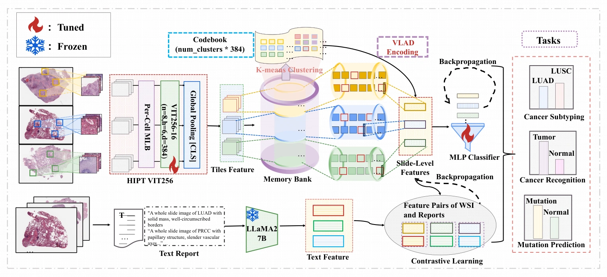
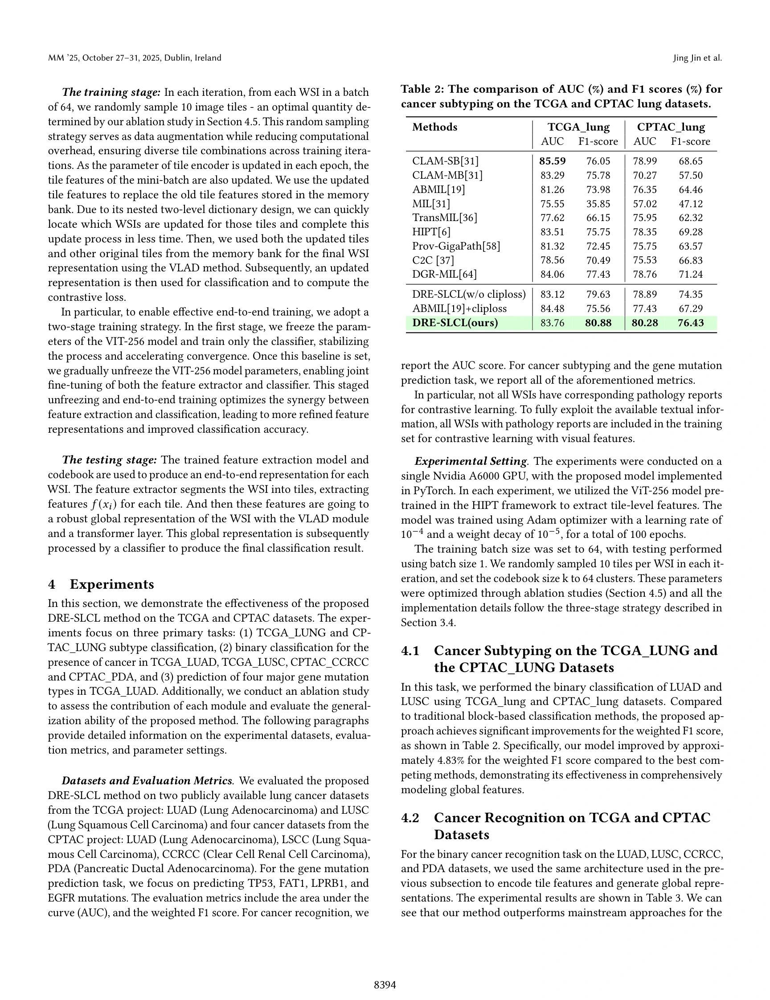
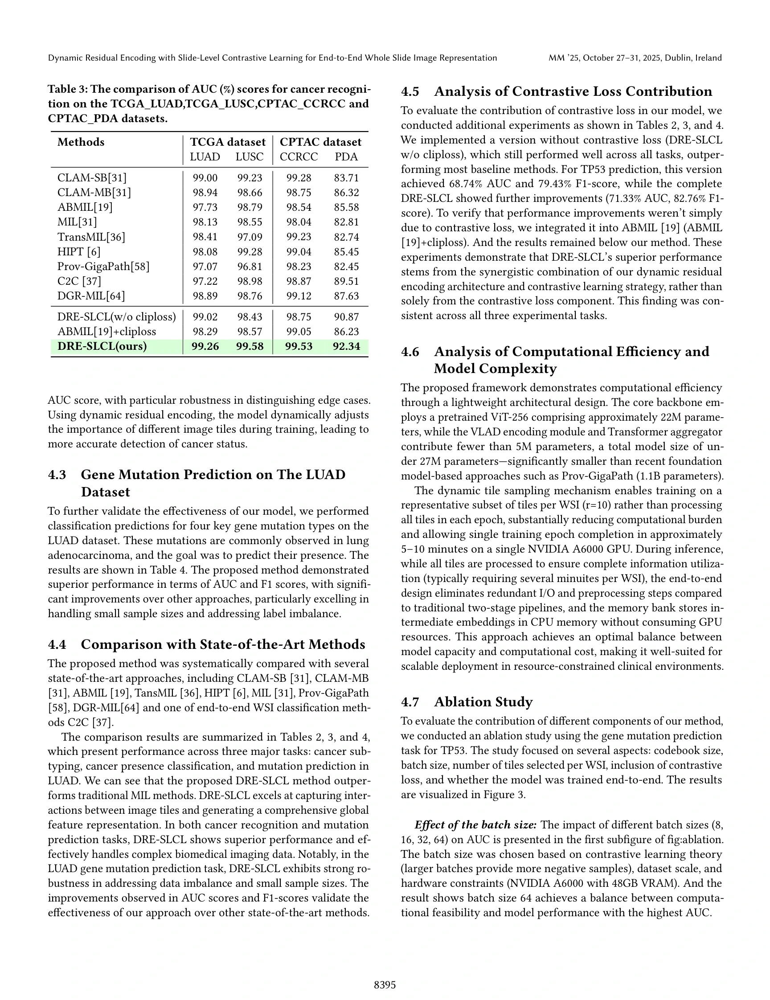
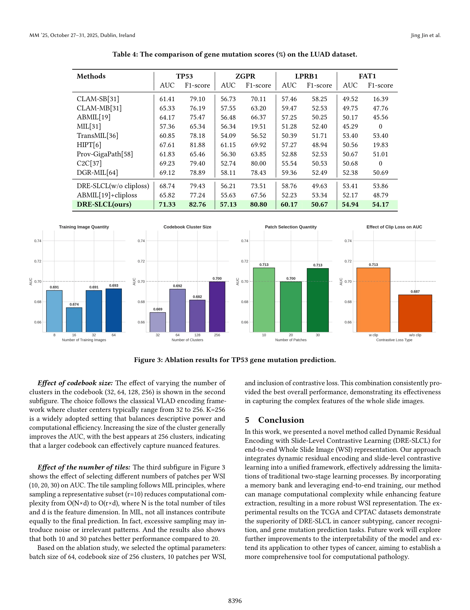
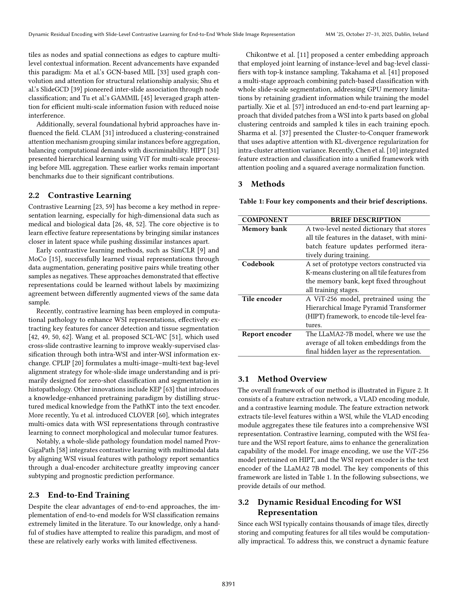

## Dynamic Residual Encoding with Slide-Level Contrastive Learning for End-to-End Whole Slide Image Representation

> data: TCGA-LUAD/LUSC，CPTAC-LUAD/LSCC/CCRCC/PDA
>
> Proceedings of the 33rd ACM International Conference on Multimedia 2025 · [论文](https://doi.org/10.1145/3746027.3755469)

#### 引言

以记忆库保存 patch 特征，将当前采样特征和历史特征进行动态残差编码，再用切片级对比学习支持端到端训练。

#### 方法

（1）全局记忆库：存储各切片 tile 的历史特征。

（2）动态残差编码：融合当前采样的新特征与未采样的历史特征。

（3）切片对比：利用切片表示及病理报告构造监督，联合训练编码器。

<!-- wsi-complete-model -->
##### 模型结构图

**图 2 · 模型结构**（PDF 第 4 页）

> 原文图注：Figure 2: The end-to-end whole slide image representation framework with the proposed dynamic residual encoding with slide-level contrastive learning (DRE-SLCL).

[查看原尺寸](assest/DRE-SLCL/figure-2-complete.webp)

<!-- /wsi-complete-model -->

#### 实验

##### 实验设置

覆盖亚型、癌识别和基因突变预测；训练 batch 为 64 张切片，每张随机取 10 个 tile 并更新记忆库。

##### 主要结果

在有限当前采样下，历史特征使端到端切片表示可计算；主表分别报告不同任务的 AUC 和加权 F1。

<!-- wsi-complete-results -->
##### 完整实验指标与对照

下列实验原页保留表头、全部行列、子图、误差说明和脚注，点击可查看原尺寸。比较时请对应相同的数据集、特征编码器和训练设置；`±`、置信区间、百分比和小数均保留原文的单位与统计口径。

| 原表/图中指标 | 读取方式 |
| --- | --- |
| ROC-AUC / AUROC | 越高越好；若原表明确为 PR-AUC，则按 PR 曲线面积读取 |
| F1 | 越高越好；保留 macro / weighted / micro 等平均方式 |

| 原文页 | 阅读内容 | 图表及正文引用 |
| --- | --- | --- |
| PDF 第 3 页 | 消融与参数分析 | Table 1 |
| PDF 第 6 页 | 实验结果 | Table 2 |
| PDF 第 7 页 | 实验结果 | Table 3 |
| PDF 第 8 页 | 实验结果 | Table 4、Figure 3 |

**实验原页 · PDF 第 6 页**（图表及正文引用：Table 2）

[查看原尺寸](assest/DRE-SLCL/experiment-page-06.webp)

**实验原页 · PDF 第 7 页**（图表及正文引用：Table 3）

[查看原尺寸](assest/DRE-SLCL/experiment-page-07.webp)

**实验原页 · PDF 第 8 页**（图表及正文引用：Table 4、Figure 3）

[查看原尺寸](assest/DRE-SLCL/experiment-page-08.webp)

展开消融、参数、数据设置及效率原页

**实验原页 · PDF 第 3 页**（图表及正文引用：Table 1）

[查看原尺寸](assest/DRE-SLCL/experiment-page-03.webp)

<!-- /wsi-complete-results -->

##### 消融与讨论

比较动态残差编码、记忆库及切片级对比学习，分析采样 tile 数量；不同突变预测不能合并为一个分类任务。

#### 参考文献

> Dynamic Residual Encoding with Slide-Level Contrastive Learning for End-to-End Whole Slide Image Representation
>
> Proceedings of the 33rd ACM International Conference on Multimedia 2025 · [论文](https://doi.org/10.1145/3746027.3755469)
