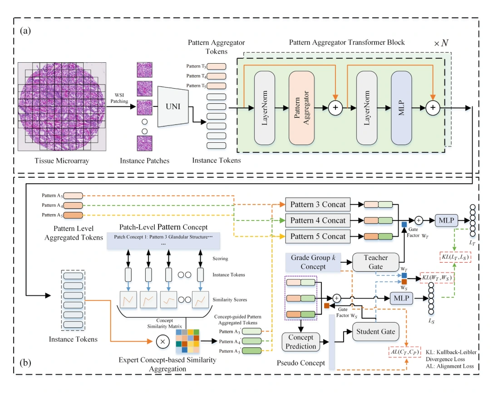

## Dual Selective Gleason Pattern-Aware Multiple Instance Learning for Grade Group Prediction in Histopathology Images

> data: Karolinska、Radboud、TCGA-PRAD、SICAPv2、Zurich/Vancouver TMA
>
> MICCAI 2025 · [论文](https://doi.org/10.1007/978-3-032-05182-0_19) · [作者代码](https://github.com/AlexNmSED/DSPA-MIL)

#### 引言

引入 Gleason Pattern 专家概念，通过双选择实例聚合和师生蒸馏预测患者级 Grade Group，显式利用不同组织模式的共同贡献。

#### 方法

（1）模式 token：用不同学习式聚合 token 描述 Gleason Patterns。

（2）专家概念：根据实例与病理概念的相似度形成另一组模式表示。

（3）知识蒸馏：由教师的模式知识指导学生预测患者 Grade Group。

##### 模型结构图

图 1（PDF 第 4 页）

#### 实验

##### 实验设置

以 QWK 为主要指标、AUC 为辅助；训练部分五折，AdamW、50 epochs 与早停，兼顾 WSI/TMA 外测。

##### 关键指标 { #key-results }

| 数据集 | AUC（%） | QWK（%） |
| --- | --- | --- |
| Radboud | 84.5 ± 0.9 | 80.8 ± 1.2 |
| TCGA-PRAD | 83.0 ± 1.8 | 74.2 ± 3.7 |
| SICAPv2 | 84.6 ± 2.3 | 73.3 ± 0.5 |
| Vancouver | 72.0 ± 1.8 | 69.5 ± 0.4 |

数据来源为原文表 2，PDF 第 8 页，Gleason Grade Group。

##### 结果解读

Grade Group 的顺序一致性由 QWK 体现，不能只用分类 AUC 概括；不同来源与不同基线的提升幅度不同。

##### 消融与讨论

比较学习式 GP token、专家概念聚合和蒸馏；会议版与后续 DSPA-U-MIL 扩展版分别归档。

#### 参考文献

> Dual Selective Gleason Pattern-Aware Multiple Instance Learning for Grade Group Prediction in Histopathology Images
>
> MICCAI 2025 · [论文](https://doi.org/10.1007/978-3-032-05182-0_19) · [作者代码](https://github.com/AlexNmSED/DSPA-MIL)
