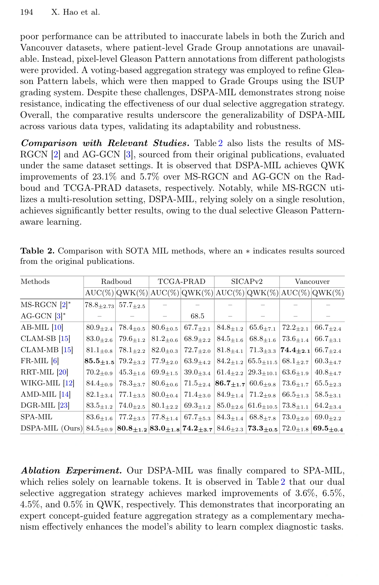
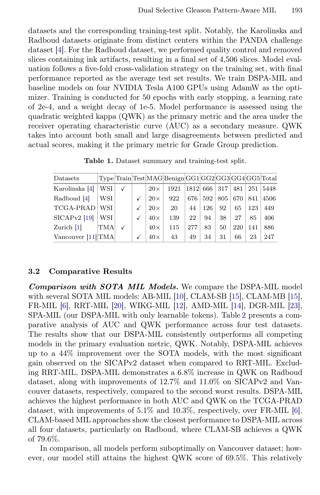

## Dual Selective Gleason Pattern-Aware Multiple Instance Learning for Grade Group Prediction in Histopathology Images

> data: Karolinska、Radboud、TCGA-PRAD、SICAPv2、Zurich/Vancouver TMA
>
> MICCAI 2025 · [论文](https://doi.org/10.1007/978-3-032-05182-0_19) · [作者代码](https://github.com/AlexNmSED/DSPA-MIL)

#### 引言

引入 Gleason Pattern 专家概念，通过双选择实例聚合和师生蒸馏预测患者级 Grade Group，显式利用不同组织模式的共同贡献。

#### 方法

（1）模式 token：用不同学习式聚合 token 描述 Gleason Patterns。

（2）专家概念：根据实例与病理概念的相似度形成另一组模式表示。

（3）知识蒸馏：由教师的模式知识指导学生预测患者 Grade Group。

<!-- wsi-complete-model -->
##### 模型结构图

**图 1 · 模型结构**（PDF 第 4 页）

> 原文图注：Fig. 1. Overview of our proposed DSPA-MIL framework. (a) Selective Gleason Pat- tern aggregation. (b) Expert concept-based s imilarity aggregation, and knowledge- distillation-based Grade Group prediction.

[查看原尺寸](assest/DSPA-MIL/figure-1-complete.webp)

<!-- /wsi-complete-model -->

#### 实验

##### 实验设置

以 QWK 为主要指标、AUC 为辅助；训练部分五折，AdamW、50 epochs 与早停，兼顾 WSI/TMA 外测。

##### 主要结果

Grade Group 的顺序一致性由 QWK 体现，不能只用分类 AUC 概括；不同来源与不同基线的提升幅度不同。

<!-- wsi-complete-results -->
##### 完整实验指标与对照

下列实验原页保留表头、全部行列、子图、误差说明和脚注，点击可查看原尺寸。比较时请对应相同的数据集、特征编码器和训练设置；`±`、置信区间、百分比和小数均保留原文的单位与统计口径。

| 原表/图中指标 | 读取方式 |
| --- | --- |
| ROC-AUC / AUROC | 越高越好；若原表明确为 PR-AUC，则按 PR 曲线面积读取 |
| Kappa / QWK | 越高越好；加权方式与类别顺序以原表为准 |

| 原文页 | 阅读内容 | 图表及正文引用 |
| --- | --- | --- |
| PDF 第 7 页 | 数据与实验设置 | Table 1 |
| PDF 第 8 页 | 实验结果 | Table 2 |

**实验原页 · PDF 第 8 页**（图表及正文引用：Table 2）

[查看原尺寸](assest/DSPA-MIL/experiment-page-08.webp)

展开消融、参数、数据设置及效率原页

**实验原页 · PDF 第 7 页**（图表及正文引用：Table 1）

[查看原尺寸](assest/DSPA-MIL/experiment-page-07.webp)

<!-- /wsi-complete-results -->

##### 消融与讨论

比较学习式 GP token、专家概念聚合和蒸馏；会议版与后续 DSPA-U-MIL 扩展版分别归档。

#### 参考文献

> Dual Selective Gleason Pattern-Aware Multiple Instance Learning for Grade Group Prediction in Histopathology Images
>
> MICCAI 2025 · [论文](https://doi.org/10.1007/978-3-032-05182-0_19) · [作者代码](https://github.com/AlexNmSED/DSPA-MIL)
