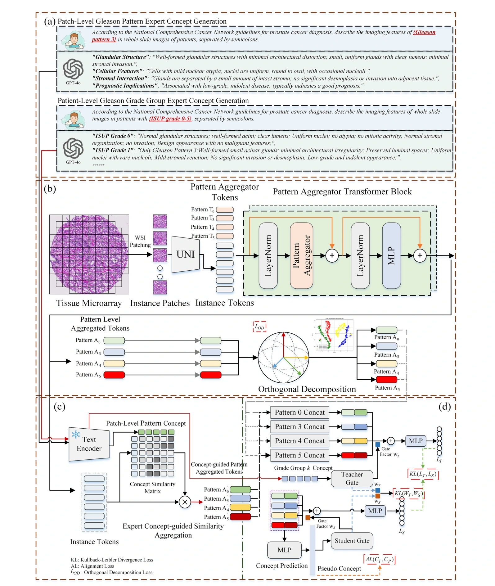
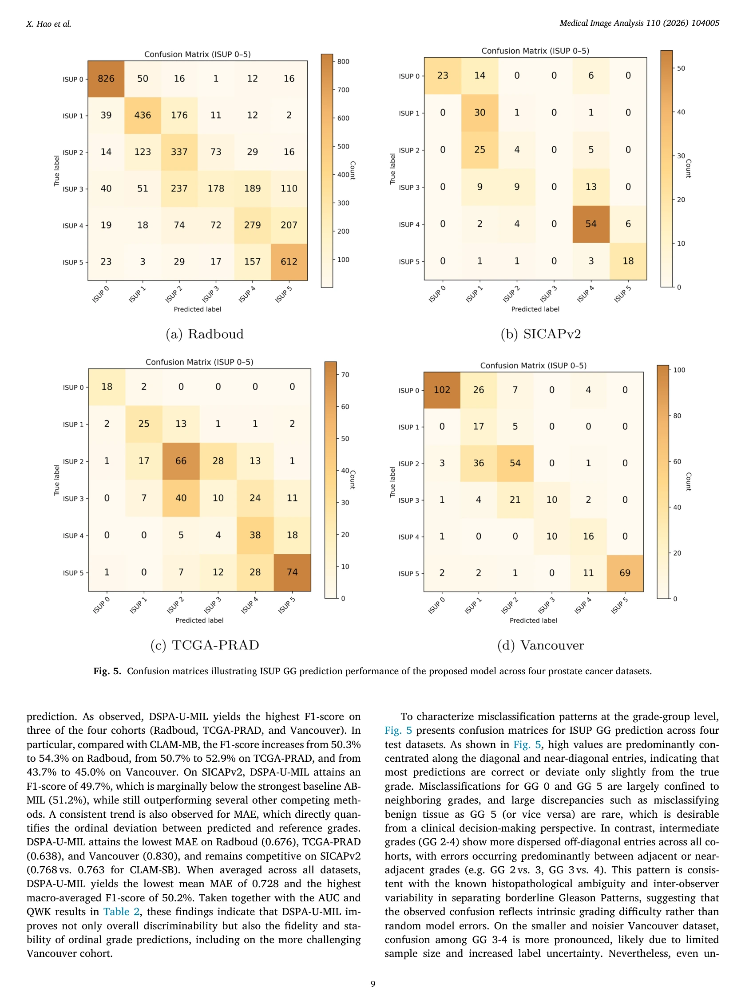
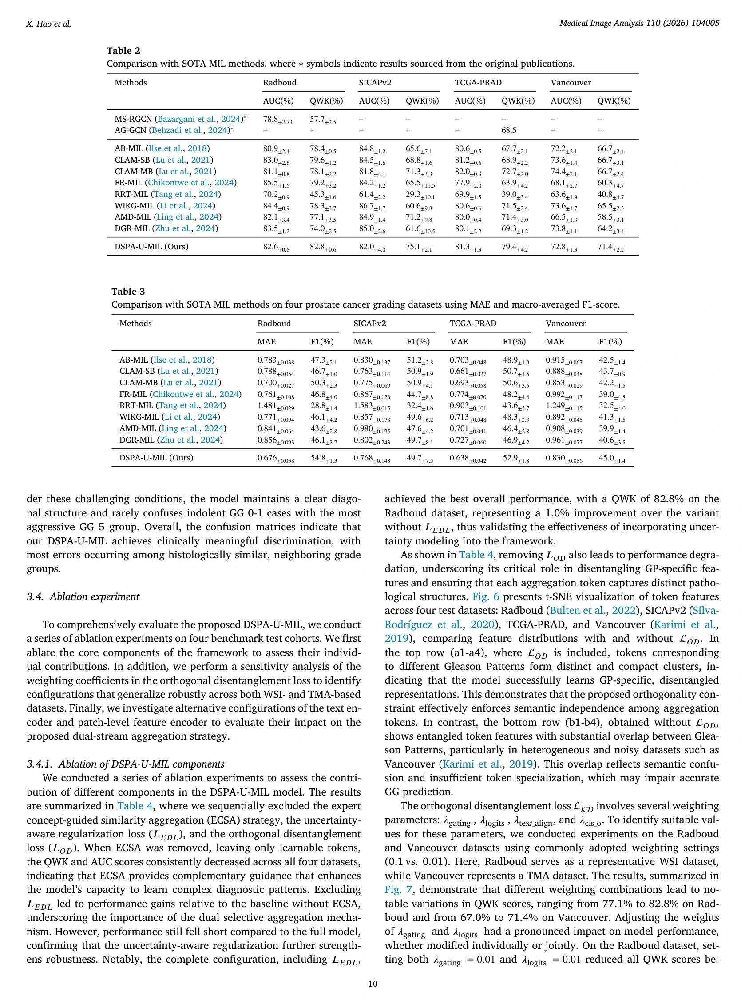
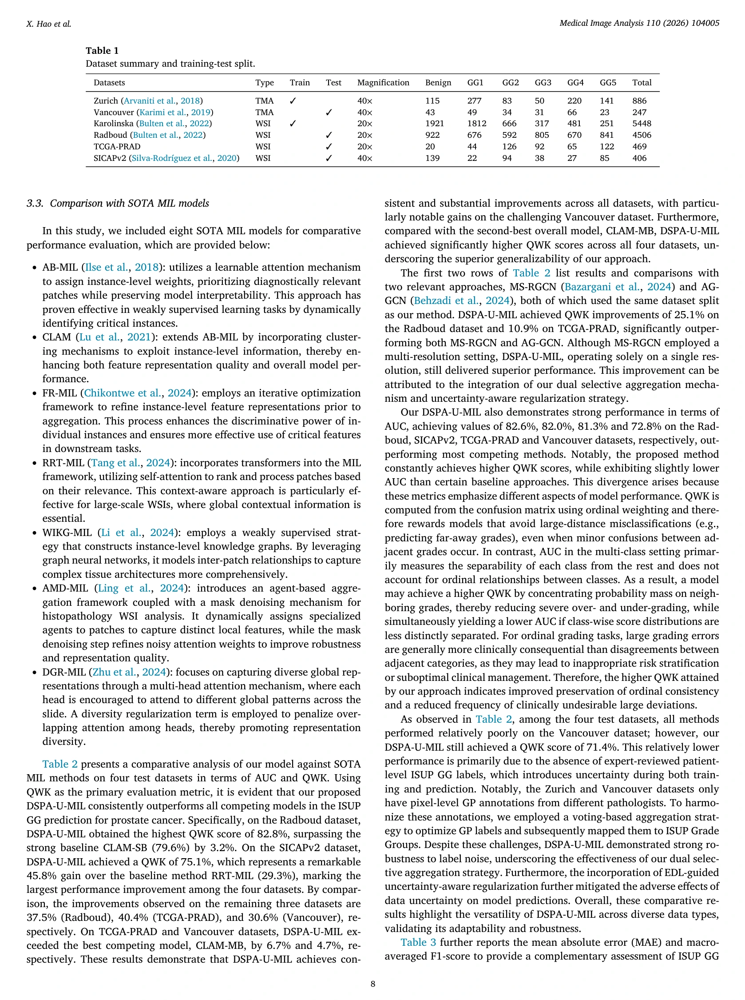
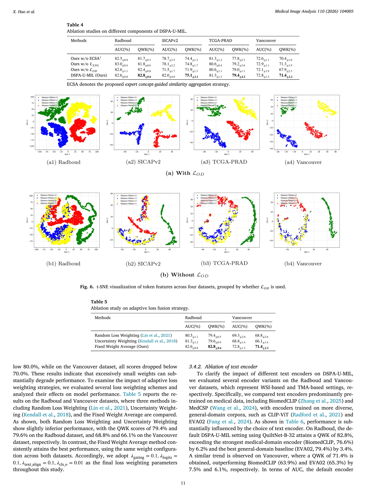
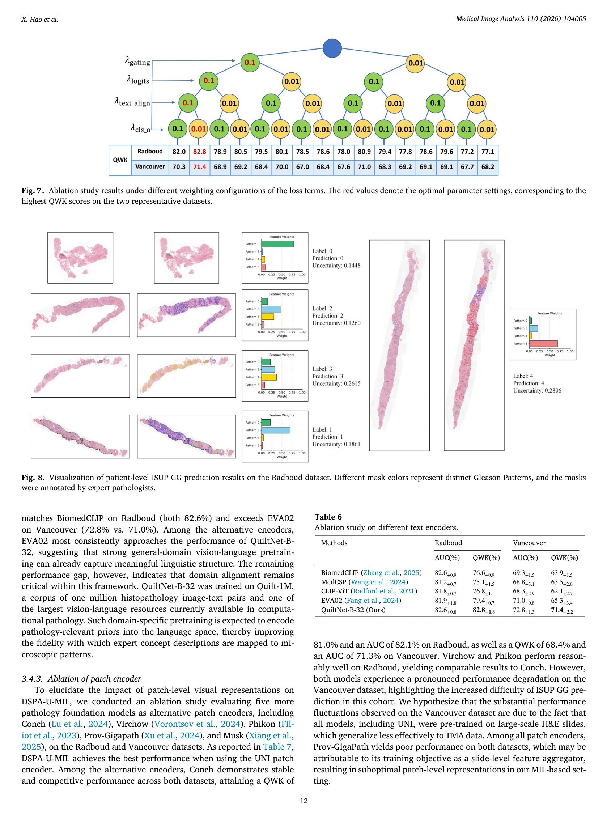
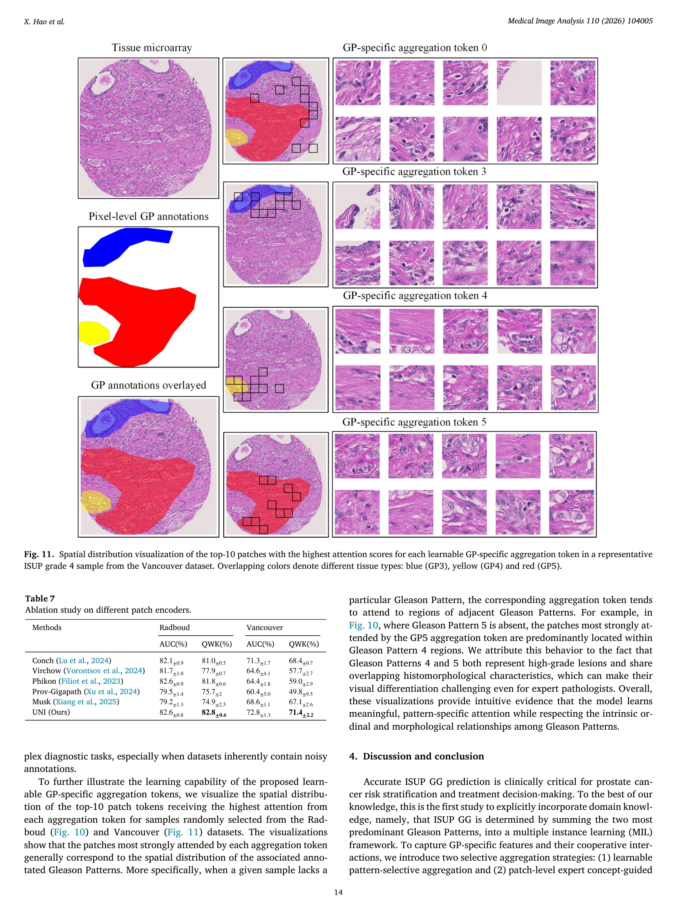

## Dual selective gleason pattern-aware multiple instance learning with uncertainty regularization for grade group prediction in histopathology images

> data: Karolinska、Radboud、TCGA-PRAD、SICAPv2、Zurich/Vancouver
>
> Medical Image Analysis 2026 · [论文](https://doi.org/10.1016/j.media.2026.104005) · [作者代码](https://github.com/AlexNmSED/DSPA-MIL)

#### 引言

在双选择 Gleason Pattern 聚合和师生蒸馏基础上增加不确定性约束，减轻标签噪声对患者级 Grade Group 预测的影响。

#### 方法

（1）选择式模式 token：更合理地表示不同 Gleason Patterns。

（2）正交分解：增强模式表征之间的区分。

（3）EDL 正则与蒸馏：降低标签噪声并保持专家概念引导的患者分级。

<!-- wsi-complete-model -->
##### 模型结构图

**图 3 · 模型结构**（PDF 第 5 页）

> 原文图注：Fig. 3. Overview of our proposed DSPA-U-MIL framework. (a) Expert concept induction with a Large Language Model (LLM). (b) Selective GP aggregation with an orthogonal decomposition constraint. (c) Expert concept-guided similarity aggregation, and (d) Knowledge distillation-based GG prediction.

[查看原尺寸](assest/DSPA-U-MIL/figure-3-complete.webp)

<!-- /wsi-complete-model -->

#### 实验

##### 实验设置

同时含 WSI 和 TMA，以 QWK 为主；比较会议版和加入扩展模块后的分级。

##### 主要结果

Radboud 与 Vancouver 的损失权重改变会明显影响 QWK，不能把单一默认权重视为跨来源通用最优。

<!-- wsi-complete-results -->
##### 完整实验指标与对照

下列实验原页保留表头、全部行列、子图、误差说明和脚注，点击可查看原尺寸。比较时请对应相同的数据集、特征编码器和训练设置；`±`、置信区间、百分比和小数均保留原文的单位与统计口径。

| 原表/图中指标 | 读取方式 |
| --- | --- |
| F1 | 越高越好；保留 macro / weighted / micro 等平均方式 |
| Kappa / QWK | 越高越好；加权方式与类别顺序以原表为准 |

| 原文页 | 阅读内容 | 图表及正文引用 |
| --- | --- | --- |
| PDF 第 8 页 | 数据与实验设置 | Table 1 |
| PDF 第 9 页 | 实验结果 | Figure 5 |
| PDF 第 10 页 | 实验结果 | Table 2、Table 3 |
| PDF 第 11 页 | 消融与参数分析 | Table 4、Table 5 |
| PDF 第 12 页 | 消融与参数分析 | Figure 7、Table 6 |
| PDF 第 14 页 | 消融与参数分析 | Table 7 |

**实验原页 · PDF 第 9 页**（图表及正文引用：Figure 5）

[查看原尺寸](assest/DSPA-U-MIL/experiment-page-09.webp)

**实验原页 · PDF 第 10 页**（图表及正文引用：Table 2、Table 3）

[查看原尺寸](assest/DSPA-U-MIL/experiment-page-10.webp)

展开消融、参数、数据设置及效率原页

**实验原页 · PDF 第 8 页**（图表及正文引用：Table 1）

[查看原尺寸](assest/DSPA-U-MIL/experiment-page-08.webp)

**实验原页 · PDF 第 11 页**（图表及正文引用：Table 4、Table 5）

[查看原尺寸](assest/DSPA-U-MIL/experiment-page-11.webp)

**实验原页 · PDF 第 12 页**（图表及正文引用：Figure 7、Table 6）

[查看原尺寸](assest/DSPA-U-MIL/experiment-page-12.webp)

**实验原页 · PDF 第 14 页**（图表及正文引用：Table 7）

[查看原尺寸](assest/DSPA-U-MIL/experiment-page-14.webp)

<!-- /wsi-complete-results -->

##### 消融与讨论

新增选择式 GP token、正交分解约束和 EDL 不确定性正则；与 DSPA-MIL 的区别不只是一项正则。

#### 参考文献

> Dual selective gleason pattern-aware multiple instance learning with uncertainty regularization for grade group prediction in histopathology images
>
> Medical Image Analysis 2026 · [论文](https://doi.org/10.1016/j.media.2026.104005) · [作者代码](https://github.com/AlexNmSED/DSPA-MIL)
