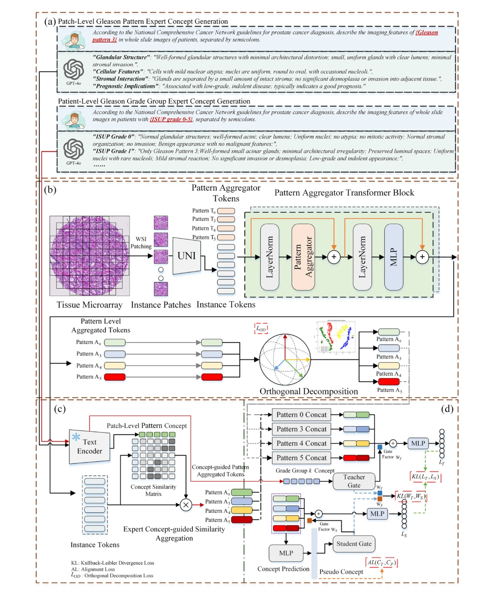
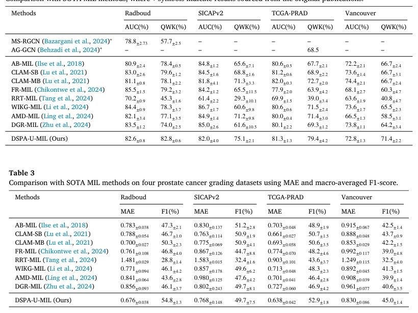

## Dual selective gleason pattern-aware multiple instance learning with uncertainty regularization for grade group prediction in histopathology images

> data: Karolinska、Radboud、TCGA-PRAD、SICAPv2、Zurich/Vancouver
>
> Medical Image Analysis 2026 · [论文](https://doi.org/10.1016/j.media.2026.104005) · [作者代码](https://github.com/AlexNmSED/DSPA-MIL)

#### 引言

在双选择 Gleason Pattern 聚合和师生蒸馏基础上增加不确定性约束，减轻标签噪声对患者级 Grade Group 预测的影响。

#### 方法

（1）选择式模式 token：更合理地表示不同 Gleason Patterns。

（2）正交分解：增强模式表征之间的区分。

（3）EDL 正则与蒸馏：降低标签噪声并保持专家概念引导的患者分级。

原文Fig. 3，PDF 第 5 页。

#### 实验

##### 实验设置

同时含 WSI 和 TMA，以 QWK 为主；比较会议版和加入扩展模块后的分级。

##### 主要结果

Radboud 与 Vancouver 的损失权重改变会明显影响 QWK，不能把单一默认权重视为跨来源通用最优。

原文Table 2，PDF 第 10 页。

##### 消融与讨论

新增选择式 GP token、正交分解约束和 EDL 不确定性正则；与 DSPA-MIL 的区别不只是一项正则。

#### 参考文献

> Dual selective gleason pattern-aware multiple instance learning with uncertainty regularization for grade group prediction in histopathology images
>
> Medical Image Analysis 2026 · [论文](https://doi.org/10.1016/j.media.2026.104005) · [作者代码](https://github.com/AlexNmSED/DSPA-MIL)
