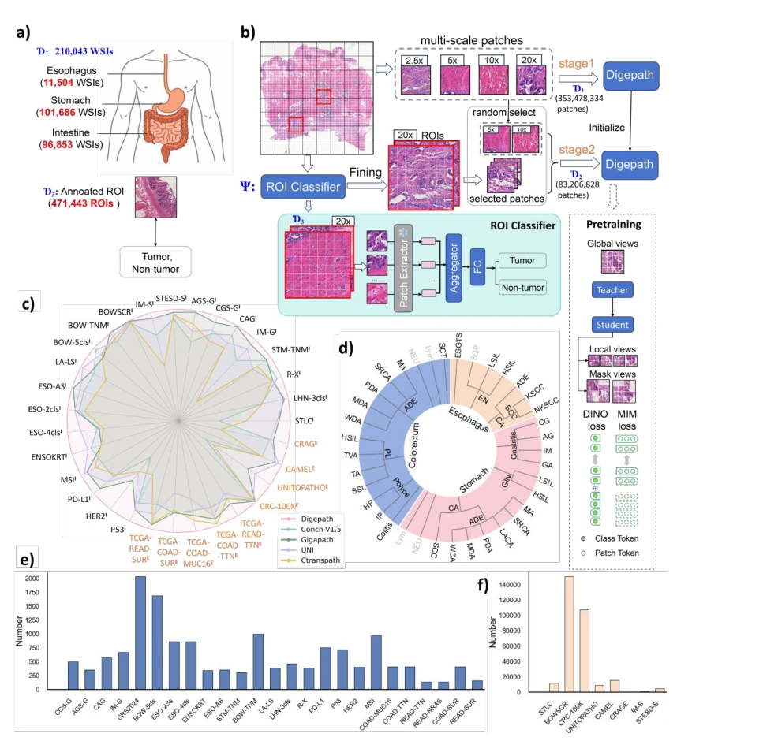

## Subspecialty-specific foundation model for intelligent gastrointestinal pathology

> data: 胃肠专科病理预训练与 33 项下游任务
>
> npj Digital Medicine 2026 · [论文](https://doi.org/10.1038/s41746-026-02684-5)

#### 引言

面向胃肠专科开展多尺度自监督预训练与专家标注区域微调，学习用于诊断、分子预测和预后任务的专科基础表征。

#### 方法

（1）专科预训练：在胃肠组织中学习多尺度基础表征。

（2）区域微调：用专家标注的肿瘤/非肿瘤区域增强病灶感知。

（3）下游适配：在诊断、分子、预后及推理任务中检验专科知识。

原文Figure 1，PDF 第 7 页。

#### 实验

##### 实验设置

预训练用 210,043 张 H&E 切片和多尺度 patch，再用 471,443 个专家区域进行任务相关微调。

##### 主要结果

作者报告在 33 项下游任务中的 32 项达到所比较最佳，覆盖诊断、分子和预后；不可写成每项均领先。

##### 消融与讨论

区分自监督预训练、区域微调和临床推理集成，注意专科模型与通用模型的训练数据边界。

#### 参考文献

> Subspecialty-specific foundation model for intelligent gastrointestinal pathology
>
> npj Digital Medicine 2026 · [论文](https://doi.org/10.1038/s41746-026-02684-5)
