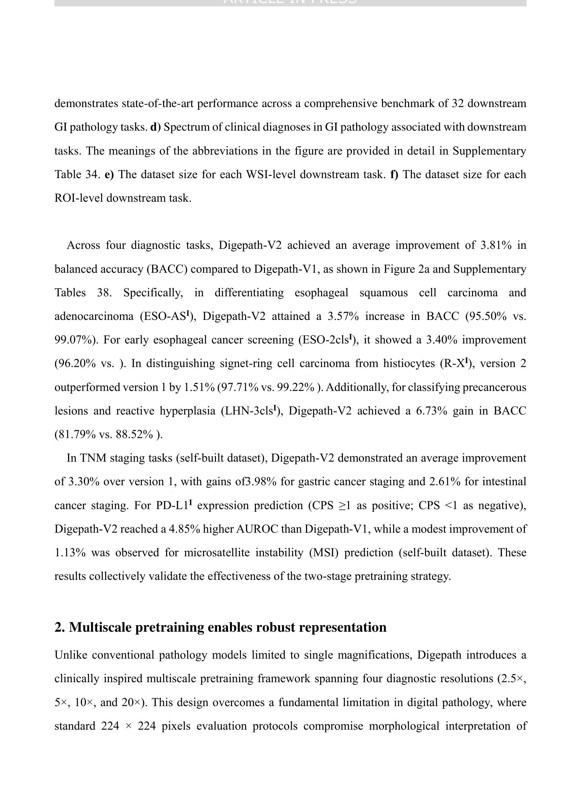
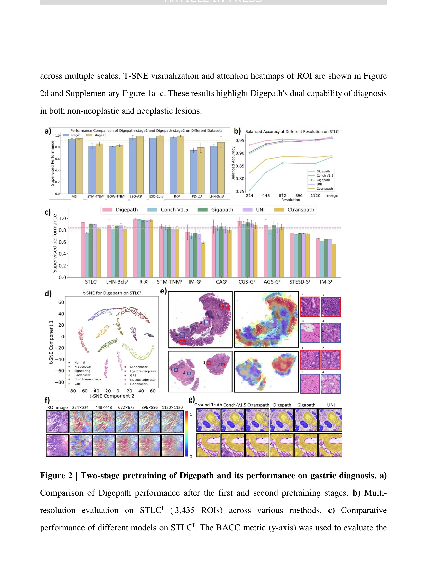
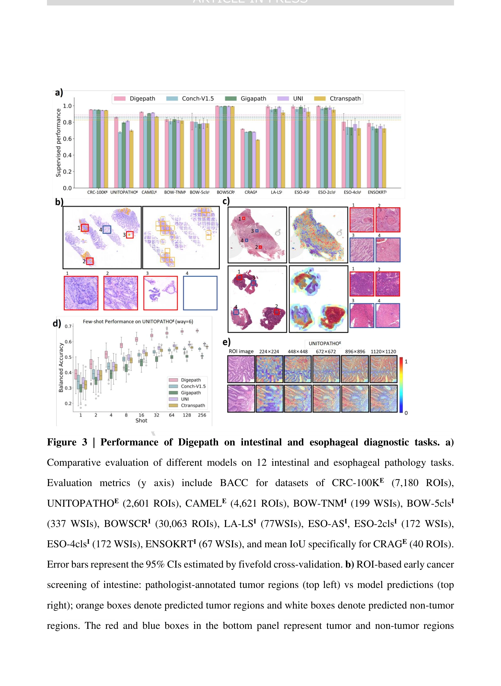

## Subspecialty-specific foundation model for intelligent gastrointestinal pathology

> data: 胃肠专科病理预训练与 33 项下游任务
>
> npj Digital Medicine 2026 · [论文](https://doi.org/10.1038/s41746-026-02684-5)

#### 引言

面向胃肠专科开展多尺度自监督预训练与专家标注区域微调，学习用于诊断、分子预测和预后任务的专科基础表征。

#### 方法

（1）专科预训练：在胃肠组织中学习多尺度基础表征。

（2）区域微调：用专家标注的肿瘤/非肿瘤区域增强病灶感知。

（3）下游适配：在诊断、分子、预后及推理任务中检验专科知识。

<!-- wsi-complete-model -->
##### 模型结构图

**图 1 · 模型结构**（PDF 第 7 页）

> 原文图注：Figure 1 | Overview of Digepath. Digepath is a visual foundation model pretrained in two stages

[查看原尺寸](assest/Digepath/figure-1-complete.webp)

<!-- /wsi-complete-model -->

#### 实验

##### 实验设置

预训练用 210,043 张 H&E 切片和多尺度 patch，再用 471,443 个专家区域进行任务相关微调。

##### 主要结果

作者报告在 33 项下游任务中的 32 项达到所比较最佳，覆盖诊断、分子和预后；不可写成每项均领先。

<!-- wsi-complete-results -->
##### 完整实验指标与对照

下列实验原页保留表头、全部行列、子图、误差说明和脚注，点击可查看原尺寸。比较时请对应相同的数据集、特征编码器和训练设置；`±`、置信区间、百分比和小数均保留原文的单位与统计口径。

| 原文页 | 阅读内容 | 图表及正文引用 |
| --- | --- | --- |
| PDF 第 8 页 | 实验结果 | Table 34 |
| PDF 第 11 页 | 实验结果 | Figure 2 |
| PDF 第 14 页 | 实验结果 | Figure 3 |

**实验原页 · PDF 第 8 页**（图表及正文引用：Table 34）

[查看原尺寸](assest/Digepath/experiment-page-08.webp)

**实验原页 · PDF 第 11 页**（图表及正文引用：Figure 2）

[查看原尺寸](assest/Digepath/experiment-page-11.webp)

**实验原页 · PDF 第 14 页**（图表及正文引用：Figure 3）

[查看原尺寸](assest/Digepath/experiment-page-14.webp)

<!-- /wsi-complete-results -->

##### 消融与讨论

区分自监督预训练、区域微调和临床推理集成，注意专科模型与通用模型的训练数据边界。

#### 参考文献

> Subspecialty-specific foundation model for intelligent gastrointestinal pathology
>
> npj Digital Medicine 2026 · [论文](https://doi.org/10.1038/s41746-026-02684-5)
