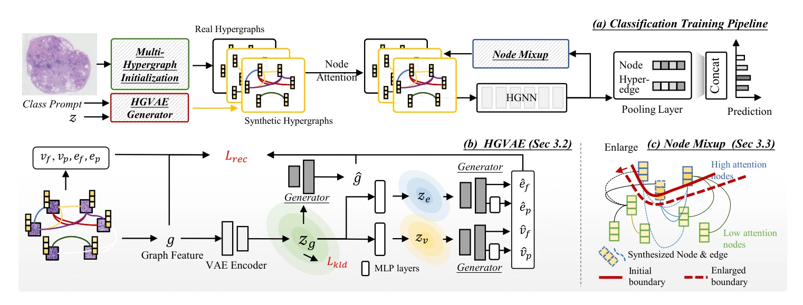
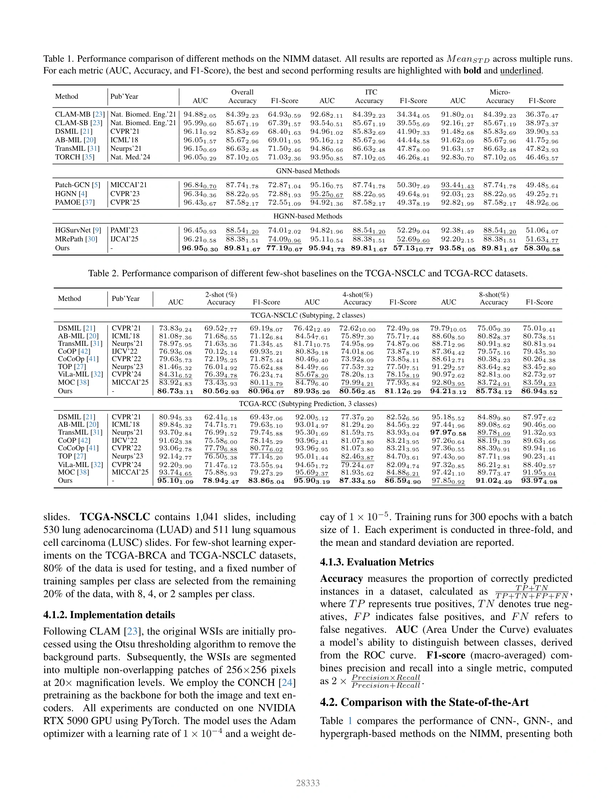
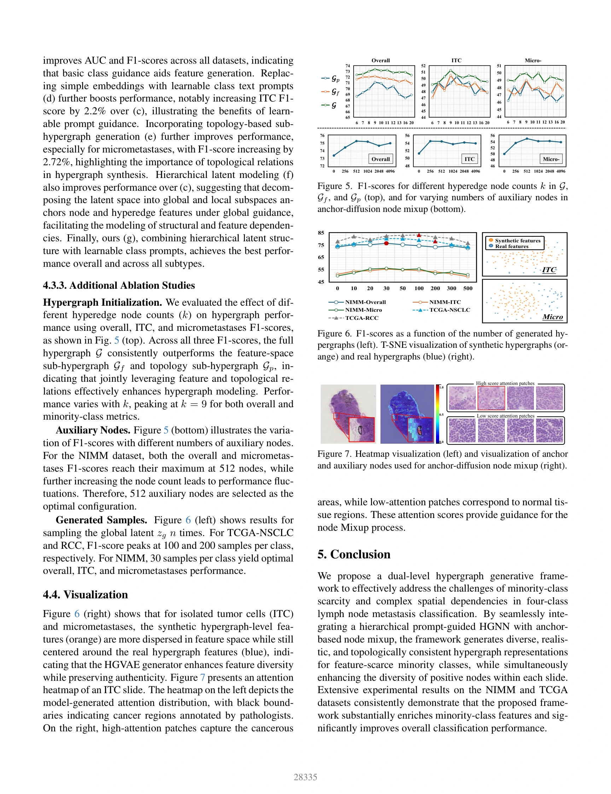
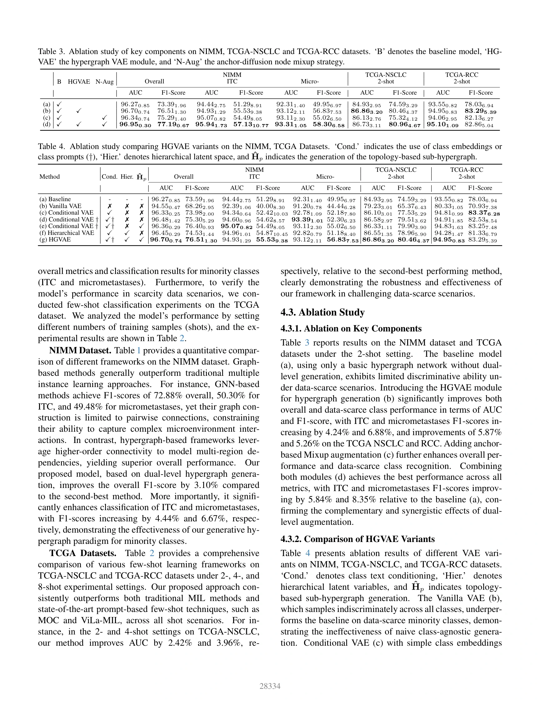

## Dual-Level Hypergraph Generation for Addressing Feature Scarcity in Whole-Slide Image Classification

> data: 内部 NIMM、TCGA-NSCLC、TCGA-RCC
>
> CVPR 2026 · [论文](https://openaccess.thecvf.com/content/CVPR2026/papers/Yao_Dual-Level_Hypergraph_Generation_for_Addressing_Feature_Scarcity_in_Whole-Slide_Image_CVPR_2026_paper.pdf) · [作者代码](https://github.com/YAOSL98/Dual-HG)

#### 引言

在超图级使用提示引导的变分生成，在节点级使用锚点扩散 Mixup，补充稀缺类别特征，用于淋巴结转移等不平衡分类。

#### 方法

（1）提示超图生成：用类别先验引导分层超图变分自编码器。

（2）锚点扩散：围绕高注意力阳性节点生成和混合特征。

（3）双层补充：同时缓解少数类拓扑结构和节点表征不足。

<!-- wsi-complete-model -->
##### 模型结构图

**图 2 · 模型结构**（PDF 第 4 页）

> 原文图注：Figure 2. Dual-HGNet overview. WSIs are modeled as hypergraphs, and minority-hypergraphs are augmented via a prompt-guided hierarchical HGVAE generator, while node-level mixup further enhances node feature diversity during classification.

[查看原尺寸](assest/Dual-HG/figure-2-complete.webp)

<!-- /wsi-complete-model -->

#### 实验

##### 实验设置

NIMM 含 629 张切片，其中 ITC 40、微转移 76；按 4:3:3 划分，TCGA 另做少样本实验。

##### 主要结果

主要关注 ITC/微转移少数类，而非只看总体准确率；NIMM 与 TCGA few-shot 为不同评估条件。

<!-- wsi-complete-results -->
##### 完整实验指标与对照

下列实验原页保留表头、全部行列、子图、误差说明和脚注，点击可查看原尺寸。比较时请对应相同的数据集、特征编码器和训练设置；`±`、置信区间、百分比和小数均保留原文的单位与统计口径。

| 原表/图中指标 | 读取方式 |
| --- | --- |
| ROC-AUC / AUROC | 越高越好；若原表明确为 PR-AUC，则按 PR 曲线面积读取 |
| ACC / Accuracy | 越高越好；平衡准确率、平均准确率以原表标注为准 |
| F1 | 越高越好；保留 macro / weighted / micro 等平均方式 |

| 原文页 | 阅读内容 | 图表及正文引用 |
| --- | --- | --- |
| PDF 第 6 页 | 实验结果 | Table 1、Table 2 |
| PDF 第 7 页 | 消融与参数分析 | Table 3、Table 4 |
| PDF 第 8 页 | 实验结果 | Figure 5、Figure 6 |

**实验原页 · PDF 第 6 页**（图表及正文引用：Table 1、Table 2）

[查看原尺寸](assest/Dual-HG/experiment-page-06.webp)

**实验原页 · PDF 第 8 页**（图表及正文引用：Figure 5、Figure 6）

[查看原尺寸](assest/Dual-HG/experiment-page-08.webp)

展开消融、参数、数据设置及效率原页

**实验原页 · PDF 第 7 页**（图表及正文引用：Table 3、Table 4）

[查看原尺寸](assest/Dual-HG/experiment-page-07.webp)

<!-- /wsi-complete-results -->

##### 消融与讨论

分别检验超图级变分生成和节点级扩散 Mixup，观察高阶结构及特征补充的贡献。

#### 参考文献

> Dual-Level Hypergraph Generation for Addressing Feature Scarcity in Whole-Slide Image Classification
>
> CVPR 2026 · [论文](https://openaccess.thecvf.com/content/CVPR2026/papers/Yao_Dual-Level_Hypergraph_Generation_for_Addressing_Feature_Scarcity_in_Whole-Slide_Image_CVPR_2026_paper.pdf) · [作者代码](https://github.com/YAOSL98/Dual-HG)
