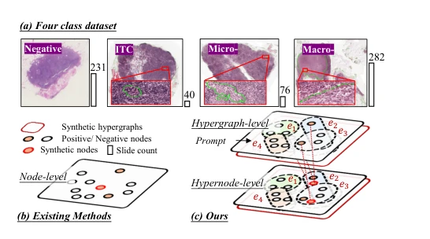

## Dual-Level Hypergraph Generation for Addressing Feature Scarcity in Whole-Slide Image Classification

> data: 内部 NIMM、TCGA-NSCLC、TCGA-RCC
>
> CVPR 2026 · [论文](https://openaccess.thecvf.com/content/CVPR2026/papers/Yao_Dual-Level_Hypergraph_Generation_for_Addressing_Feature_Scarcity_in_Whole-Slide_Image_CVPR_2026_paper.pdf) · [作者代码](https://github.com/YAOSL98/Dual-HG)

#### 引言

在超图级使用提示引导的变分生成，在节点级使用锚点扩散 Mixup，补充稀缺类别特征，用于淋巴结转移等不平衡分类。

#### 方法

（1）提示超图生成：用类别先验引导分层超图变分自编码器。

（2）锚点扩散：围绕高注意力阳性节点生成和混合特征。

（3）双层补充：同时缓解少数类拓扑结构和节点表征不足。

原文Figure 1，PDF 第 1 页。

#### 实验

##### 实验设置

NIMM 含 629 张切片，其中 ITC 40、微转移 76；按 4:3:3 划分，TCGA 另做少样本实验。

##### 主要结果

主要关注 ITC/微转移少数类，而非只看总体准确率；NIMM 与 TCGA few-shot 为不同评估条件。

##### 消融与讨论

分别检验超图级变分生成和节点级扩散 Mixup，观察高阶结构及特征补充的贡献。

#### 参考文献

> Dual-Level Hypergraph Generation for Addressing Feature Scarcity in Whole-Slide Image Classification
>
> CVPR 2026 · [论文](https://openaccess.thecvf.com/content/CVPR2026/papers/Yao_Dual-Level_Hypergraph_Generation_for_Addressing_Feature_Scarcity_in_Whole-Slide_Image_CVPR_2026_paper.pdf) · [作者代码](https://github.com/YAOSL98/Dual-HG)
