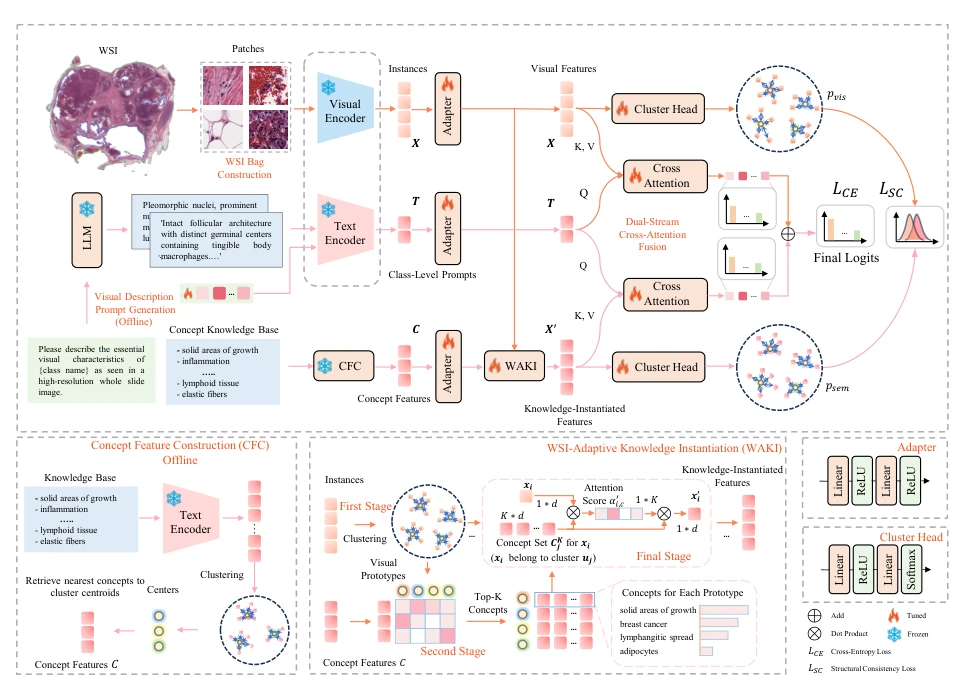
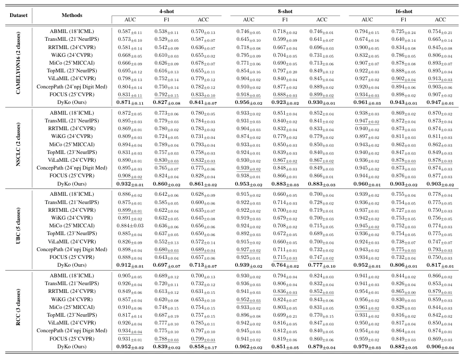

## Universal-to-Specific: Dynamic Knowledge-Guided Multiple Instance Learning for Few-Shot Whole Slide Image Classification

> data: CAMELYON16、NSCLC、UBC-OCEAN、TCGA-RCC
>
> CVPR 2026（PDF 与作者项目标注） · [作者代码](https://github.com/junjianli106/DyKo)

#### 引言

根据单张切片的视觉原型检索病理知识，再构造实例特异的知识引导特征，并用结构一致性约束控制语义漂移，服务少样本分类。

#### 方法

（1）视觉原型：先提取本切片的关键组织模式。

（2）WAKI：检索相关病理概念，为实例生成切片特异知识特征。

（3）结构一致性：约束知识特征与视觉证据对齐，防止语义漂移。

原文Figure 1，PDF 第 3 页。

#### 实验

##### 实验设置

四折、60:15:25 划分；每类 4/8/16 张训练切片，统一 TITAN patch 特征。

##### 主要结果

C16 的 4-shot 中完整模型 AUC 为 0.871；去掉结构一致性为 0.750，去掉 WAKI 为 0.773。

原文Table 1，PDF 第 6 页。

##### 消融与讨论

消融知识实例化与结构一致性，检查少样本下知识引入是否导致语义漂移。

#### 参考文献

> Universal-to-Specific: Dynamic Knowledge-Guided Multiple Instance Learning for Few-Shot Whole Slide Image Classification
>
> CVPR 2026（PDF 与作者项目标注） · [作者代码](https://github.com/junjianli106/DyKo)
