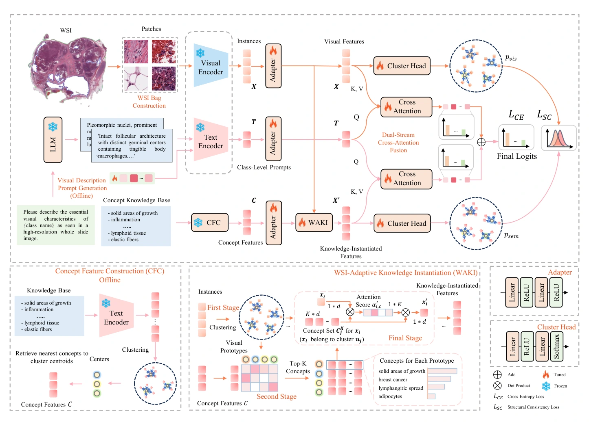
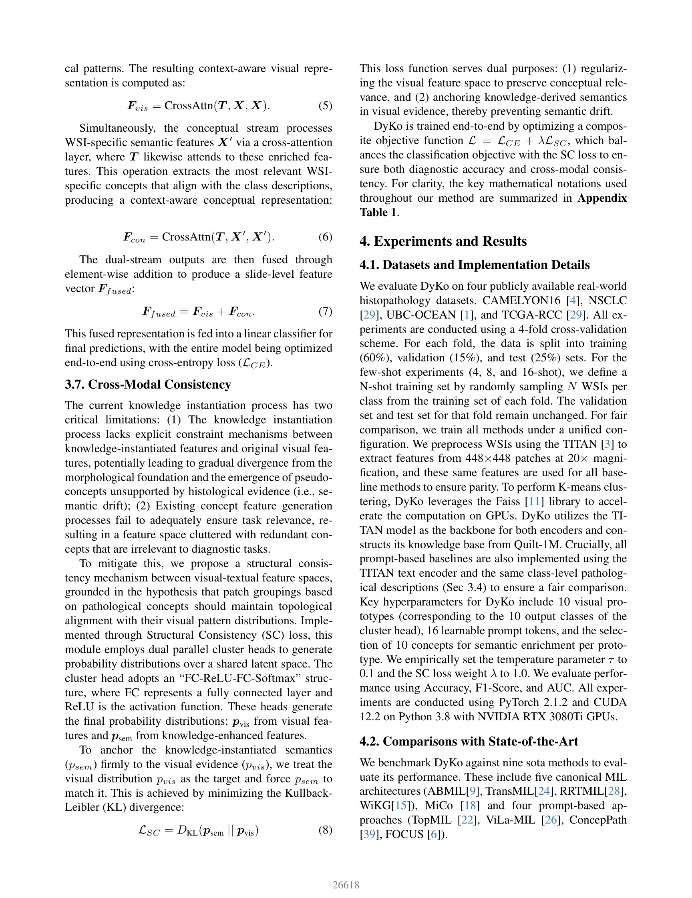
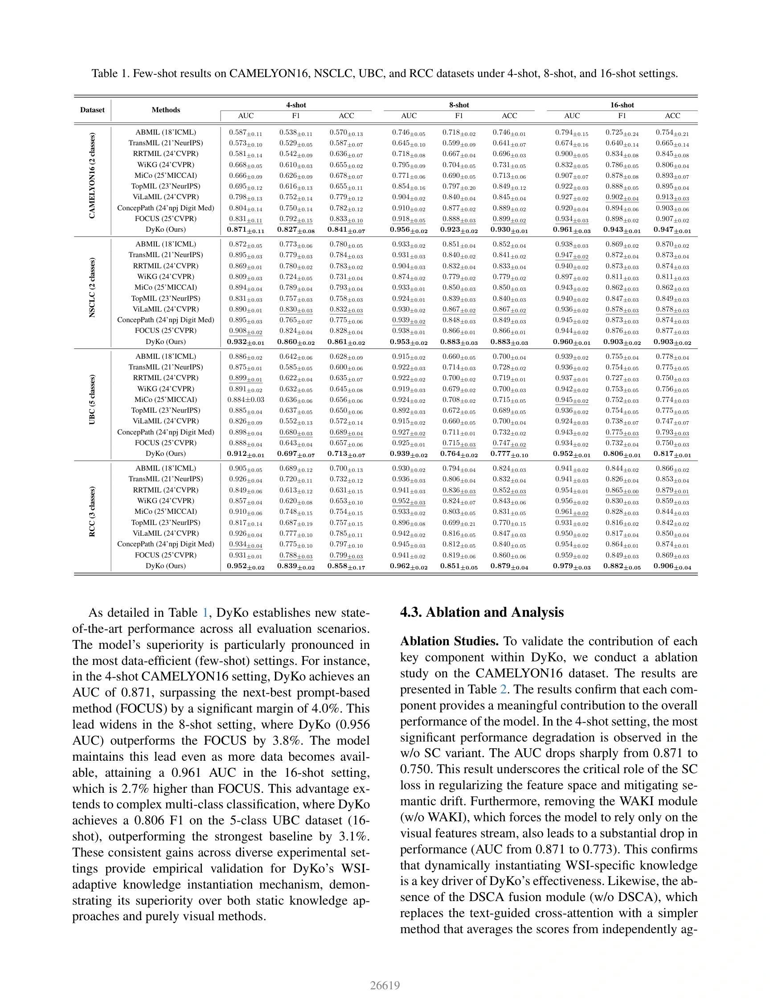
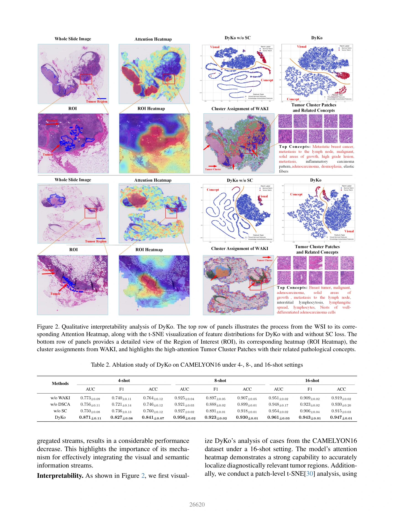

## Universal-to-Specific: Dynamic Knowledge-Guided Multiple Instance Learning for Few-Shot Whole Slide Image Classification

> data: CAMELYON16、NSCLC、UBC-OCEAN、TCGA-RCC
>
> CVPR 2026（PDF 与作者项目标注） · [作者代码](https://github.com/junjianli106/DyKo)

#### 引言

根据单张切片的视觉原型检索病理知识，再构造实例特异的知识引导特征，并用结构一致性约束控制语义漂移，服务少样本分类。

#### 方法

（1）视觉原型：先提取本切片的关键组织模式。

（2）WAKI：检索相关病理概念，为实例生成切片特异知识特征。

（3）结构一致性：约束知识特征与视觉证据对齐，防止语义漂移。

<!-- wsi-complete-model -->
##### 模型结构图

**图 1 · 模型结构**（PDF 第 3 页）

> 原文图注：Figure 1. The overview of DyKo, which consists of three key components: (1) the WSI-Adaptive Knowledge Instantiation mod- ule, which identifies visual prototypes within a WSI and retrieves WSI-specific pathological concepts from a knowledge base to generate knowledge-instantiated features; (2) a Dual-Stream Cross-Attention Fusion module that integrates knowledge-instantiated features with visual features using class-level pathological descriptions to produce context-aware representations; and (3) a Struc- tural Consistency loss to align visual and conceptual spaces, mitigating semantic drift.

[查看原尺寸](assest/DyKo/figure-1-complete.webp)

<!-- /wsi-complete-model -->

#### 实验

##### 实验设置

四折、60:15:25 划分；每类 4/8/16 张训练切片，统一 TITAN patch 特征。

##### 主要结果

C16 的 4-shot 中完整模型 AUC 为 0.871；去掉结构一致性为 0.750，去掉 WAKI 为 0.773。

<!-- wsi-complete-results -->
##### 完整实验指标与对照

下列实验原页保留表头、全部行列、子图、误差说明和脚注，点击可查看原尺寸。比较时请对应相同的数据集、特征编码器和训练设置；`±`、置信区间、百分比和小数均保留原文的单位与统计口径。

| 原表/图中指标 | 读取方式 |
| --- | --- |
| ROC-AUC / AUROC | 越高越好；若原表明确为 PR-AUC，则按 PR 曲线面积读取 |
| AP / AUPRC / mAP | 越高越好；与 ROC-AUC 不同，保留任务和召回定义 |

| 原文页 | 阅读内容 | 图表及正文引用 |
| --- | --- | --- |
| PDF 第 5 页 | 实验结果 | Table 1 |
| PDF 第 6 页 | 实验结果 | Table 1 |
| PDF 第 7 页 | 消融与参数分析 | Figure 2、Table 2 |

**实验原页 · PDF 第 5 页**（图表及正文引用：Table 1）

[查看原尺寸](assest/DyKo/experiment-page-05.webp)

**实验原页 · PDF 第 6 页**（图表及正文引用：Table 1）

[查看原尺寸](assest/DyKo/experiment-page-06.webp)

展开消融、参数、数据设置及效率原页

**实验原页 · PDF 第 7 页**（图表及正文引用：Figure 2、Table 2）

[查看原尺寸](assest/DyKo/experiment-page-07.webp)

<!-- /wsi-complete-results -->

##### 消融与讨论

消融知识实例化与结构一致性，检查少样本下知识引入是否导致语义漂移。

#### 参考文献

> Universal-to-Specific: Dynamic Knowledge-Guided Multiple Instance Learning for Few-Shot Whole Slide Image Classification
>
> CVPR 2026（PDF 与作者项目标注） · [作者代码](https://github.com/junjianli106/DyKo)
