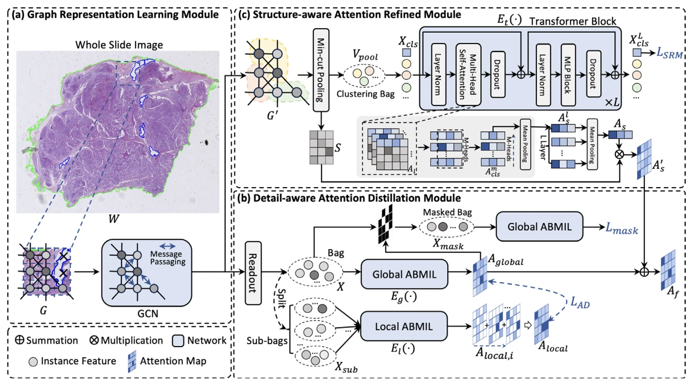
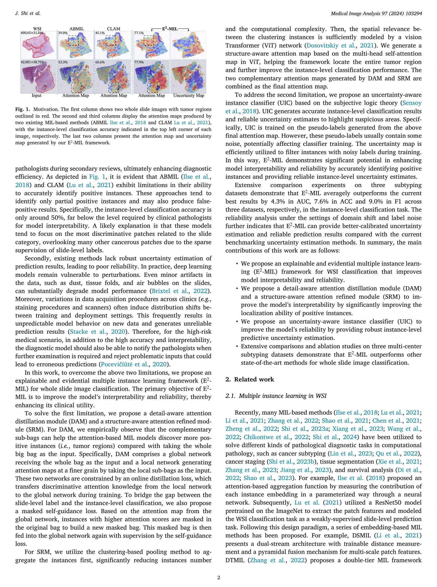
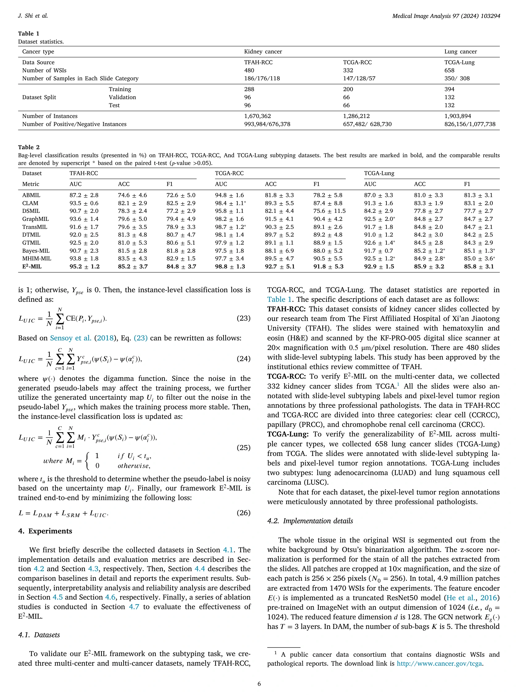
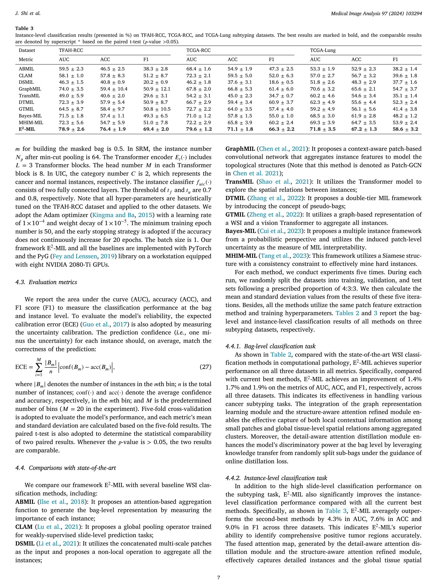
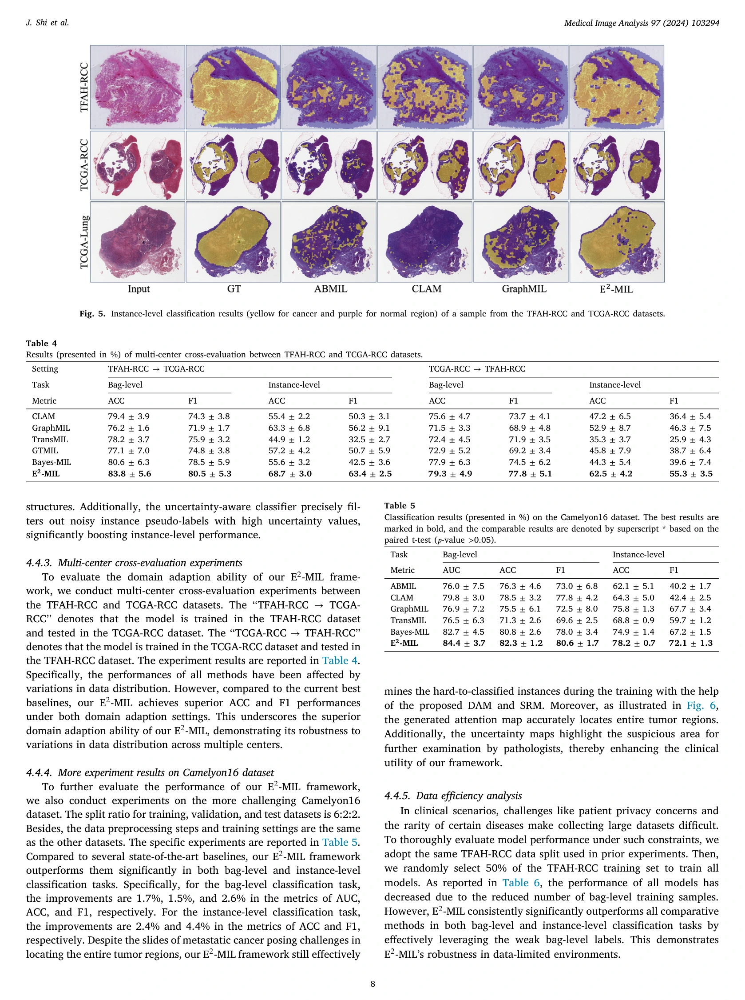
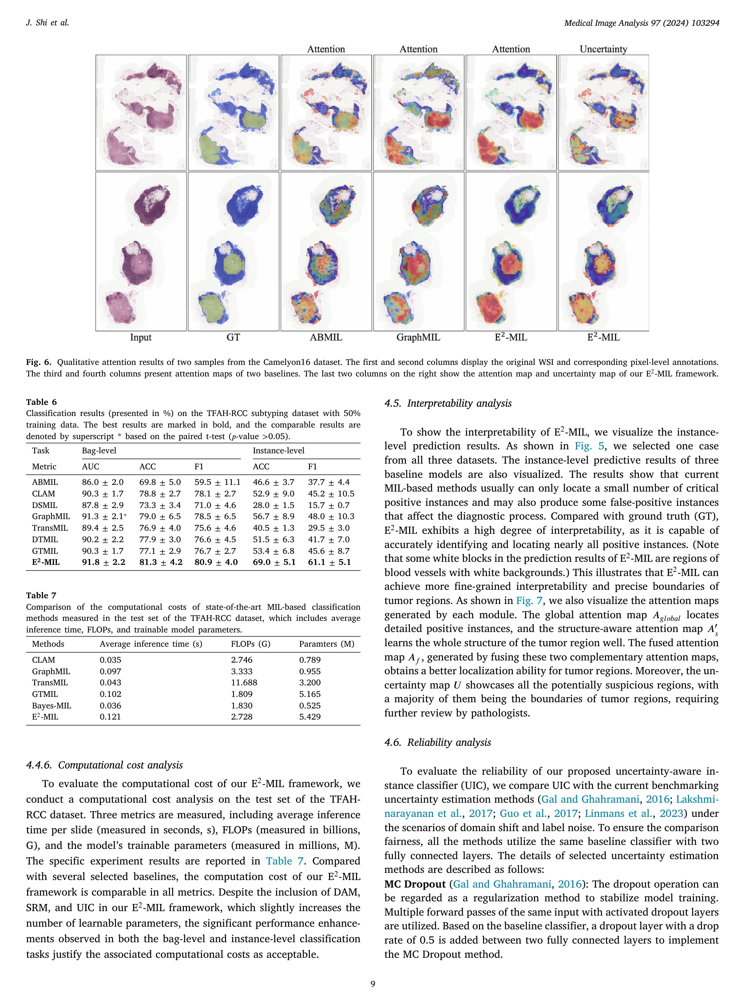
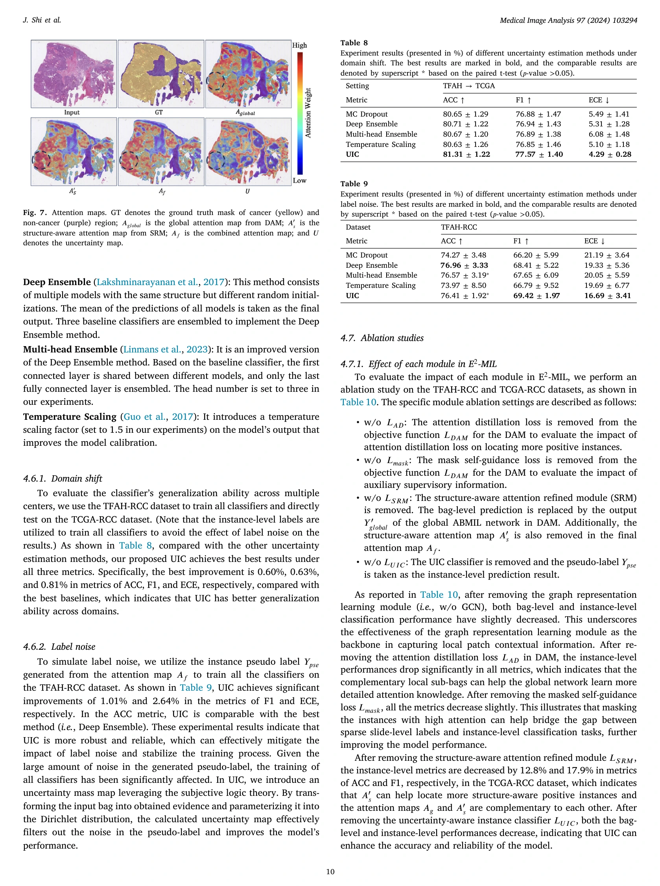
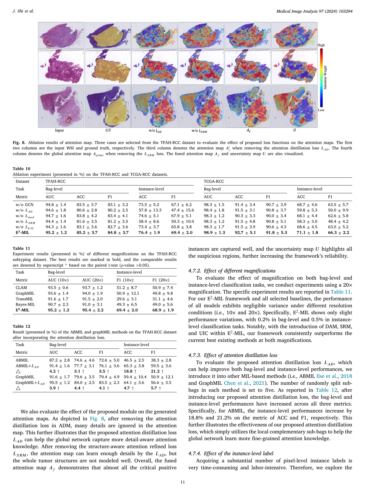
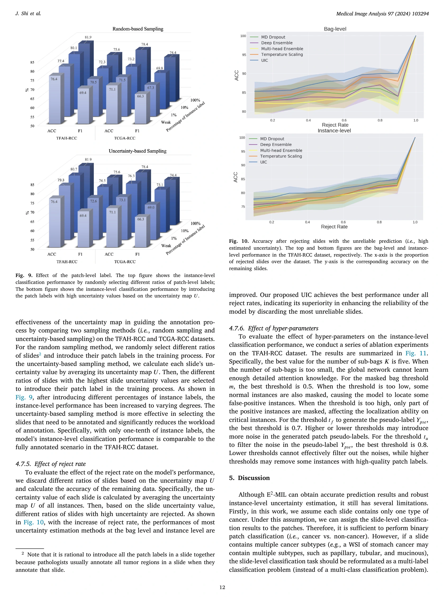

## E²-MIL: An explainable and evidential multiple instance learning framework for whole slide image classification

> data: TCGA-RCC、TFAH-RCC、TCGA-Lung
>
> Medical Image Analysis 2024 · [论文](https://doi.org/10.1016/j.media.2024.103294)

#### 引言

结合细节感知注意力蒸馏、结构感知注意力细化和证据式实例分类，兼顾肿瘤区域定位及预测不确定性估计。

#### 方法

（1）DAM：从互补子包学习细节注意力，并蒸馏给全局网络。

（2）SRM：建模聚类实例的空间关系，补全肿瘤结构覆盖。

（3）UIC：基于证据式预测输出实例类别及不确定性。

<!-- wsi-complete-model -->
##### 模型结构图

**图 2 · 模型结构**（PDF 第 4 页）

> 原文图注：Fig. 2. Overview of the proposed E2-MIL Framework. (a) The graph representation learning module projects the whole slide image into a local contextual tissue graph first; (b) the detail-aware attention distillation module employs a simple and effective attention knowledge transfer method to help the attention map locate more detail-aware instances; (c) the structure-aware attention refined module utilizes the min-cut pooling method (Bianchi et al., 2020) to build the clustering bag and generates the structure-aware attention map by utilizing the long-distance modeling ability of multi-head self-attention. These two kinds of complementary attention maps are further fused to generate the final attention map.

[查看原尺寸](assest/E2-MIL/figure-2-complete.webp)

<!-- /wsi-complete-model -->

#### 实验

##### 实验设置

训练/验证/测试按 4:3:3 划分，重复五次；同时报告包级与实例级分类，并进行肾癌跨中心互测。

##### 主要结果

跨中心两种迁移方向中，E²-MIL 的 ACC、F1 优于所比较基线；可靠性结论另需看不确定性实验。

<!-- wsi-complete-results -->
##### 完整实验指标与对照

下列实验原页保留表头、全部行列、子图、误差说明和脚注，点击可查看原尺寸。比较时请对应相同的数据集、特征编码器和训练设置；`±`、置信区间、百分比和小数均保留原文的单位与统计口径。

| 原表/图中指标 | 读取方式 |
| --- | --- |
| ACC / Accuracy | 越高越好；平衡准确率、平均准确率以原表标注为准 |
| F1 | 越高越好；保留 macro / weighted / micro 等平均方式 |
| AP / AUPRC / mAP | 越高越好；与 ROC-AUC 不同，保留任务和召回定义 |
| 时间 / FLOPs / 参数量 | 结合硬件、包长度和计时范围比较；小模型不一定推理更快 |

| 原文页 | 阅读内容 | 图表及正文引用 |
| --- | --- | --- |
| PDF 第 2 页 | 实验结果 | Figure 1 |
| PDF 第 6 页 | 实验结果 | Table 1、Table 2 |
| PDF 第 7 页 | 实验结果 | Table 3 |
| PDF 第 8 页 | 实验结果 | Table 4、Table 5 |
| PDF 第 9 页 | 实验结果 | Table 6、Table 7 |
| PDF 第 10 页 | 实验结果 | Table 8、Table 9、Table 10 |
| PDF 第 11 页 | 实验结果 | Figure 8、Table 10、Table 11、Table 12 |
| PDF 第 12 页 | 实验结果 | Figure 9、Figure 10 |

**实验原页 · PDF 第 2 页**（图表及正文引用：Figure 1）

[查看原尺寸](assest/E2-MIL/experiment-page-02.webp)

**实验原页 · PDF 第 6 页**（图表及正文引用：Table 1、Table 2）

[查看原尺寸](assest/E2-MIL/experiment-page-06.webp)

**实验原页 · PDF 第 7 页**（图表及正文引用：Table 3）

[查看原尺寸](assest/E2-MIL/experiment-page-07.webp)

**实验原页 · PDF 第 8 页**（图表及正文引用：Table 4、Table 5）

[查看原尺寸](assest/E2-MIL/experiment-page-08.webp)

**实验原页 · PDF 第 9 页**（图表及正文引用：Table 6、Table 7）

[查看原尺寸](assest/E2-MIL/experiment-page-09.webp)

**实验原页 · PDF 第 10 页**（图表及正文引用：Table 8、Table 9、Table 10）

[查看原尺寸](assest/E2-MIL/experiment-page-10.webp)

**实验原页 · PDF 第 11 页**（图表及正文引用：Figure 8、Table 10、Table 11、Table 12）

[查看原尺寸](assest/E2-MIL/experiment-page-11.webp)

**实验原页 · PDF 第 12 页**（图表及正文引用：Figure 9、Figure 10）

[查看原尺寸](assest/E2-MIL/experiment-page-12.webp)

<!-- /wsi-complete-results -->

##### 消融与讨论

分别分析细节蒸馏、结构细化和证据分类器；定位解释和不确定性校准是两种证据。

#### 参考文献

> E²-MIL: An explainable and evidential multiple instance learning framework for whole slide image classification
>
> Medical Image Analysis 2024 · [论文](https://doi.org/10.1016/j.media.2024.103294)
