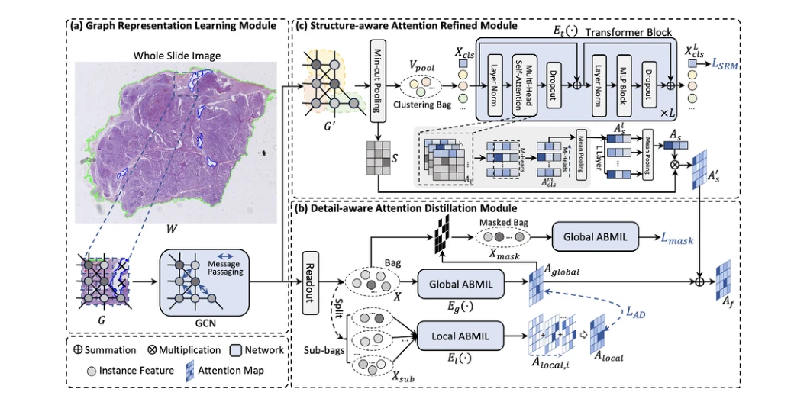
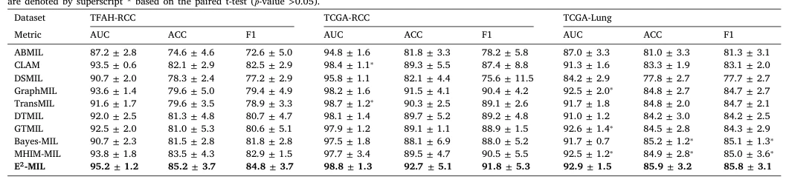

## E²-MIL: An explainable and evidential multiple instance learning framework for whole slide image classification

> data: TCGA-RCC、TFAH-RCC、TCGA-Lung
>
> Medical Image Analysis 2024 · [论文](https://doi.org/10.1016/j.media.2024.103294)

#### 引言

结合细节感知注意力蒸馏、结构感知注意力细化和证据式实例分类，兼顾肿瘤区域定位及预测不确定性估计。

#### 方法

（1）DAM：从互补子包学习细节注意力，并蒸馏给全局网络。

（2）SRM：建模聚类实例的空间关系，补全肿瘤结构覆盖。

（3）UIC：基于证据式预测输出实例类别及不确定性。

原文Fig. 2，PDF 第 4 页。

#### 实验

##### 实验设置

训练/验证/测试按 4:3:3 划分，重复五次；同时报告包级与实例级分类，并进行肾癌跨中心互测。

##### 主要结果

跨中心两种迁移方向中，E²-MIL 的 ACC、F1 优于所比较基线；可靠性结论另需看不确定性实验。

原文Table 2，PDF 第 6 页。

##### 消融与讨论

分别分析细节蒸馏、结构细化和证据分类器；定位解释和不确定性校准是两种证据。

#### 参考文献

> E²-MIL: An explainable and evidential multiple instance learning framework for whole slide image classification
>
> Medical Image Analysis 2024 · [论文](https://doi.org/10.1016/j.media.2024.103294)
