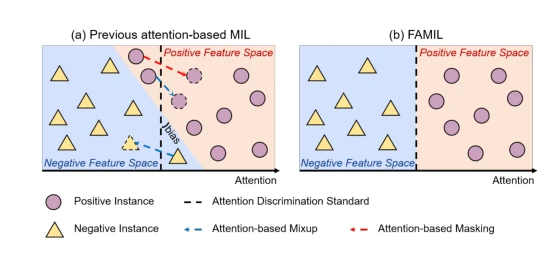

## Focus Your Attention: Multiple Instance Learning with Attention Modification for Whole Slide Pathological Image Classification

> data: CAMELYON16、CAMELYON17、TCGA-NSCLC、TCGA-RCC
>
> IEEE Transactions on Circuits and Systems for Video Technology 2025 · [论文](https://doi.org/10.1109/TCSVT.2025.3528625)

#### 引言

在双分支框架中使用注意力引导的 Mixup 和 Masking，分别突出阳性实例和困难区域，修正弱监督下的注意力定位。

#### 方法

（1）ABMix：按注意力组织实例混合，突出阳性信息。

（2）ABMask：遮蔽显著区域并寻找更困难的阳性线索。

（3）双分支协同：同时从增强样本和原始注意力中学习，更正不准确定位。

原文Fig. 2，PDF 第 2 页。

#### 实验

##### 实验设置

在不同注意力基线中加入在线增强，覆盖二分类、多分类、平衡和不平衡任务。

##### 主要结果

摘要报告 C16 AUC 达 92.61%，NSCLC/RCC 达 93.81%/98.41%；需要保留对应编码器与基线配置。

##### 消融与讨论

消融 ABMix 与 ABMask，另外比较实例比例和合成包质量控制；增强包标签遵循其 MIL 混合规则。

#### 参考文献

> Focus Your Attention: Multiple Instance Learning with Attention Modification for Whole Slide Pathological Image Classification
>
> IEEE Transactions on Circuits and Systems for Video Technology 2025 · [论文](https://doi.org/10.1109/TCSVT.2025.3528625)
