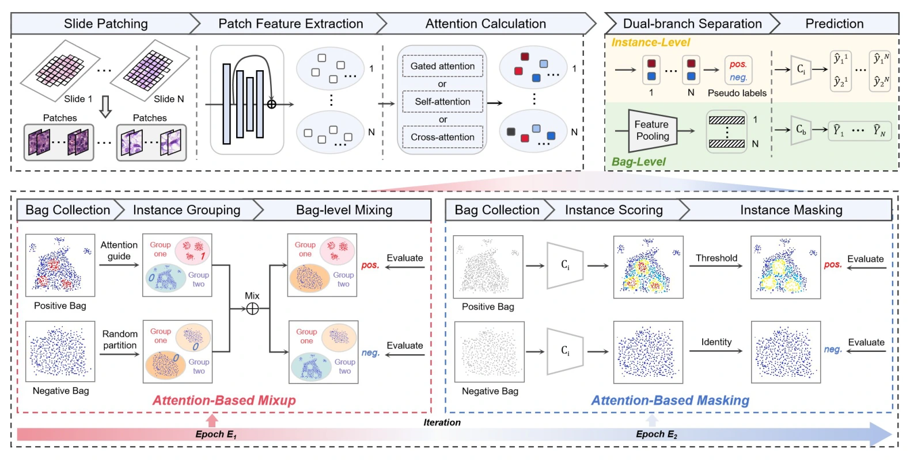
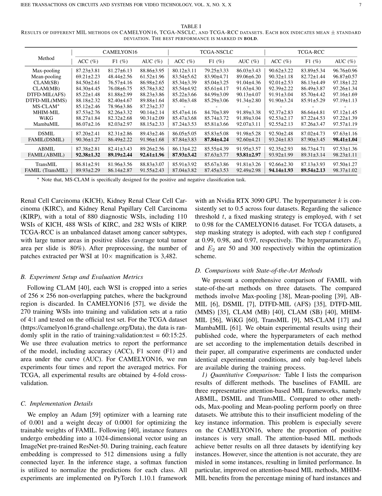
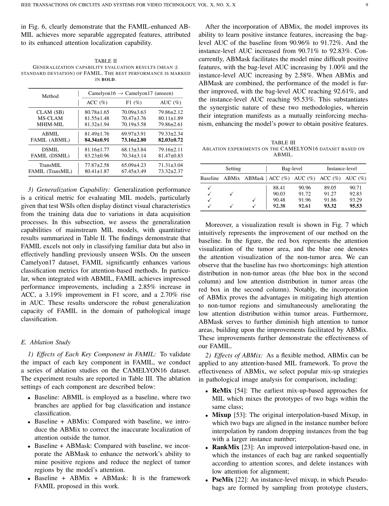
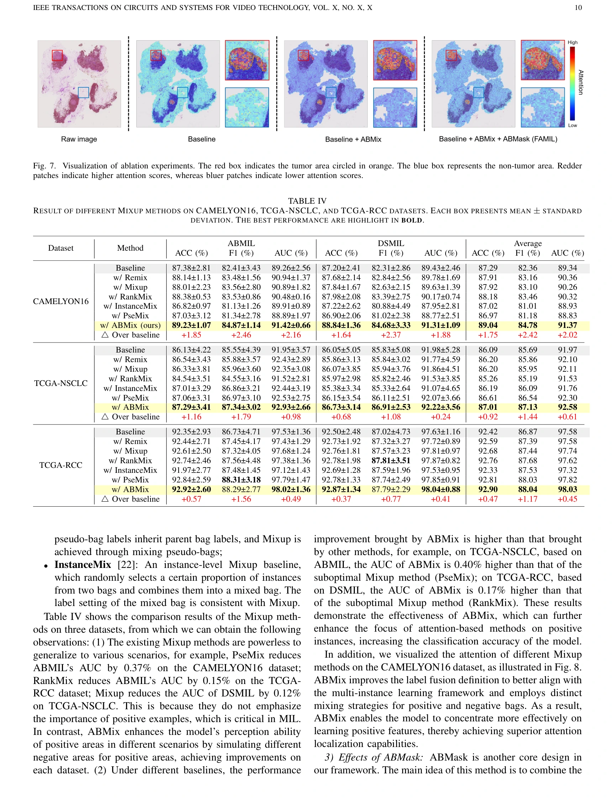
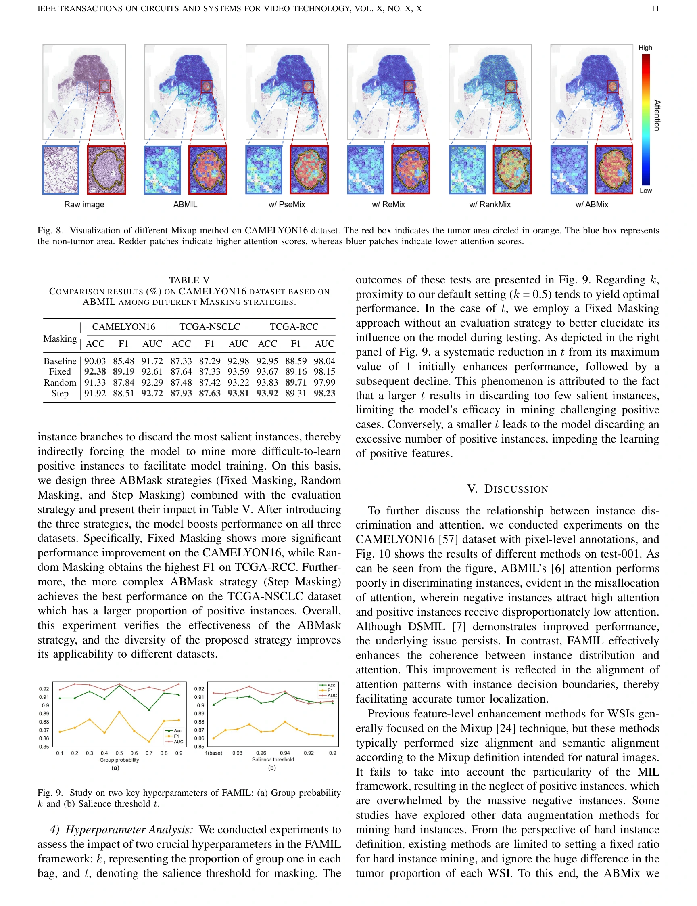

## Focus Your Attention: Multiple Instance Learning with Attention Modification for Whole Slide Pathological Image Classification

> data: CAMELYON16、CAMELYON17、TCGA-NSCLC、TCGA-RCC
>
> IEEE Transactions on Circuits and Systems for Video Technology 2025 · [论文](https://doi.org/10.1109/TCSVT.2025.3528625)

#### 引言

在双分支框架中使用注意力引导的 Mixup 和 Masking，分别突出阳性实例和困难区域，修正弱监督下的注意力定位。

#### 方法

（1）ABMix：按注意力组织实例混合，突出阳性信息。

（2）ABMask：遮蔽显著区域并寻找更困难的阳性线索。

（3）双分支协同：同时从增强样本和原始注意力中学习，更正不准确定位。

<!-- wsi-complete-model -->
##### 模型结构图

**图 3 · 模型结构**（PDF 第 4 页）

> 原文图注：Fig. 3. Overview of our proposed FAMIL. FAMIL contains an instance branch and a bag branch. The red dotted box represents ABMix, and the blue dotted box represents ABMask, with a positive WSI and a negative WSI taken as examples. The solid rectangular box provides a t-SNE [55] visualization of the instances, where the scatter points represent the instance and each color represents a different score for the instance. pos. stands for the abbreviation of positive, and neg. stands for the abbreviation of negative.

[查看原尺寸](assest/FAMIL/figure-3-complete.webp)

<!-- /wsi-complete-model -->

#### 实验

##### 实验设置

在不同注意力基线中加入在线增强，覆盖二分类、多分类、平衡和不平衡任务。

##### 主要结果

摘要报告 C16 AUC 达 92.61%，NSCLC/RCC 达 93.81%/98.41%；需要保留对应编码器与基线配置。

<!-- wsi-complete-results -->
##### 完整实验指标与对照

下列实验原页保留表头、全部行列、子图、误差说明和脚注，点击可查看原尺寸。比较时请对应相同的数据集、特征编码器和训练设置；`±`、置信区间、百分比和小数均保留原文的单位与统计口径。

| 原表/图中指标 | 读取方式 |
| --- | --- |
| ROC-AUC / AUROC | 越高越好；若原表明确为 PR-AUC，则按 PR 曲线面积读取 |

| 原文页 | 阅读内容 | 图表及正文引用 |
| --- | --- | --- |
| PDF 第 7 页 | 实验结果 | Table I |
| PDF 第 9 页 | 实验结果 | Table II、Table III |
| PDF 第 10 页 | 实验结果 | Figure 7、Table IV |
| PDF 第 11 页 | 实验结果 | Table V |

**实验原页 · PDF 第 7 页**（图表及正文引用：Table I）

[查看原尺寸](assest/FAMIL/experiment-page-07.webp)

**实验原页 · PDF 第 9 页**（图表及正文引用：Table II、Table III）

[查看原尺寸](assest/FAMIL/experiment-page-09.webp)

**实验原页 · PDF 第 10 页**（图表及正文引用：Figure 7、Table IV）

[查看原尺寸](assest/FAMIL/experiment-page-10.webp)

**实验原页 · PDF 第 11 页**（图表及正文引用：Table V）

[查看原尺寸](assest/FAMIL/experiment-page-11.webp)

<!-- /wsi-complete-results -->

##### 消融与讨论

消融 ABMix 与 ABMask，另外比较实例比例和合成包质量控制；增强包标签遵循其 MIL 混合规则。

#### 参考文献

> Focus Your Attention: Multiple Instance Learning with Attention Modification for Whole Slide Pathological Image Classification
>
> IEEE Transactions on Circuits and Systems for Video Technology 2025 · [论文](https://doi.org/10.1109/TCSVT.2025.3528625)
