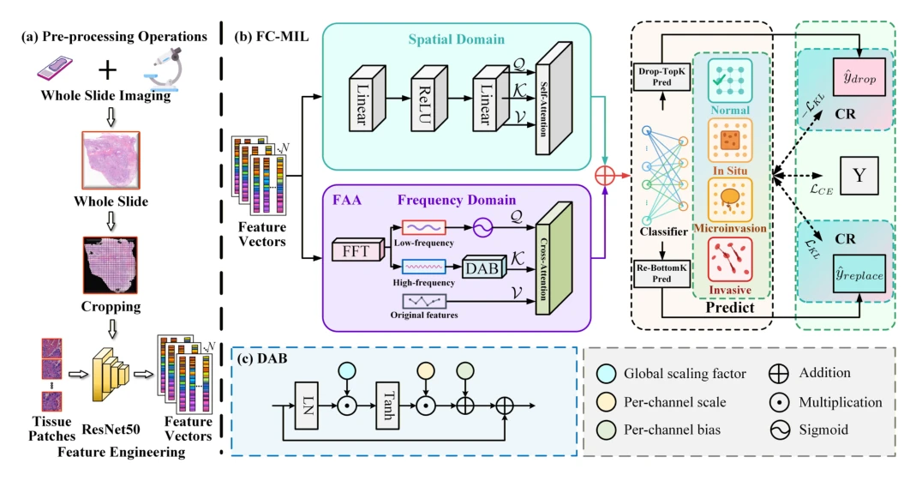
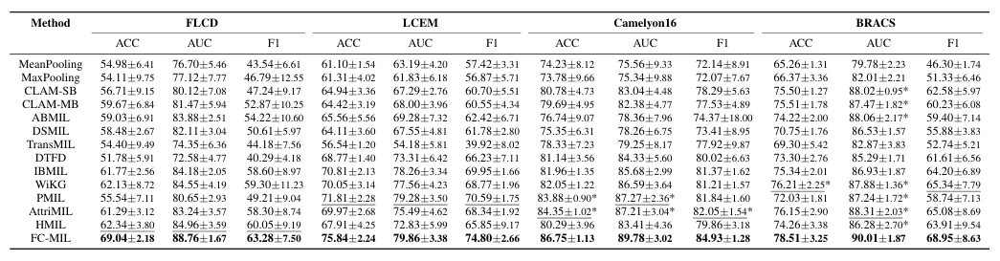

## Frequency-Aware Causal Regularization for Multiple Instance Learning in Whole Slide Image Classification

> data: CAMELYON16、BRACS、内部 FLCD、LCEM
>
> IEEE Transactions on Medical Imaging 2026 · [论文](https://doi.org/10.1109/TMI.2026.3697015) · [作者代码](https://github.com/7FFDW/FCMIL)

#### 引言

联合空间与频域注意力，并在潜在特征中施加反事实扰动式因果正则，鼓励模型减少对伪相关的依赖。

#### 方法

（1）频率注意力：联合空间与频域组织纹理。

（2）反事实扰动：在潜在特征中施加受控变化。

（3）因果正则：促使预测更依赖稳定病理线索，而非训练分布伪相关。

原文Fig. 2，PDF 第 5 页。

#### 实验

##### 实验设置

实验节列四个数据集：FLCD 为四类冷冻肺癌，LCEM 为 EGFR 状态二分类；比较同条件 MIL。

##### 主要结果

正文贡献段写五个数据集，实验设置段写四个；本笔记按实际列明的四个记录，保留这处不一致。

原文TABLE I，PDF 第 8 页。

##### 消融与讨论

分别分析频率注意力和反事实扰动正则，不能把命名为因果正则直接当作已识别真实因果效应。

#### 参考文献

> Frequency-Aware Causal Regularization for Multiple Instance Learning in Whole Slide Image Classification
>
> IEEE Transactions on Medical Imaging 2026 · [论文](https://doi.org/10.1109/TMI.2026.3697015) · [作者代码](https://github.com/7FFDW/FCMIL)
