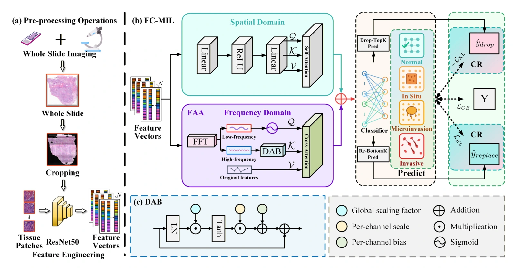

## Frequency-Aware Causal Regularization for Multiple Instance Learning in Whole Slide Image Classification

> data: CAMELYON16、BRACS、内部 FLCD、LCEM
>
> IEEE Transactions on Medical Imaging 2026 · [论文](https://doi.org/10.1109/TMI.2026.3697015) · [作者代码](https://github.com/7FFDW/FCMIL)

#### 引言

联合空间与频域注意力，并在潜在特征中施加反事实扰动式因果正则，鼓励模型减少对伪相关的依赖。

#### 方法

（1）频率注意力：联合空间与频域组织纹理。

（2）反事实扰动：在潜在特征中施加受控变化。

（3）因果正则：促使预测更依赖稳定病理线索，而非训练分布伪相关。

##### 模型结构图

图 2（PDF 第 5 页）

#### 实验

##### 实验设置

实验节列四个数据集：FLCD 为四类冷冻肺癌，LCEM 为 EGFR 状态二分类；比较同条件 MIL。

##### 关键指标 { #key-results }

| 数据集 | ACC（%） | AUC（%） | F1（%） |
| --- | --- | --- | --- |
| CAMELYON16 | 69.04 ± 2.18 | 88.76 ± 1.67 | 63.28 ± 7.50 |
| BRACS | 75.84 ± 2.24 | 79.86 ± 3.38 | 74.80 ± 2.66 |
| FLCD | 86.75 ± 1.13 | 89.78 ± 3.02 | 84.93 ± 1.28 |
| LCEM | 78.51 ± 3.25 | 90.01 ± 1.87 | 68.95 ± 8.63 |

数据来源为原文表 I，PDF 第 8 页。

##### 结果解读

FC-MIL 在内部 LCEM 上报告的 AUC 最高，但 F1 低于内部 FLCD。论文方法概述写五个数据集，主表实际列出四个。

##### 消融与讨论

分别分析频率注意力和反事实扰动正则，不能把命名为因果正则直接当作已识别真实因果效应。

#### 参考文献

> Frequency-Aware Causal Regularization for Multiple Instance Learning in Whole Slide Image Classification
>
> IEEE Transactions on Medical Imaging 2026 · [论文](https://doi.org/10.1109/TMI.2026.3697015) · [作者代码](https://github.com/7FFDW/FCMIL)
