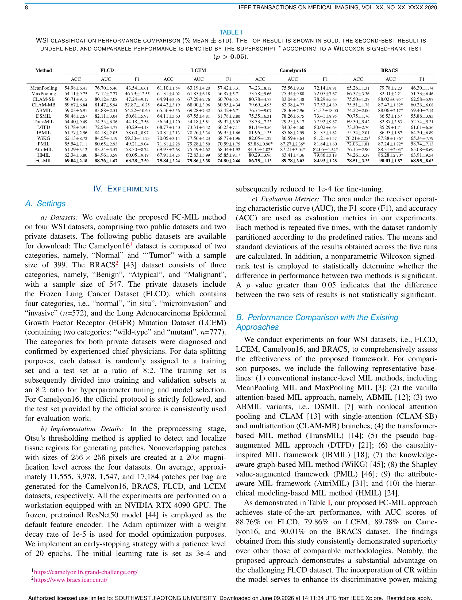
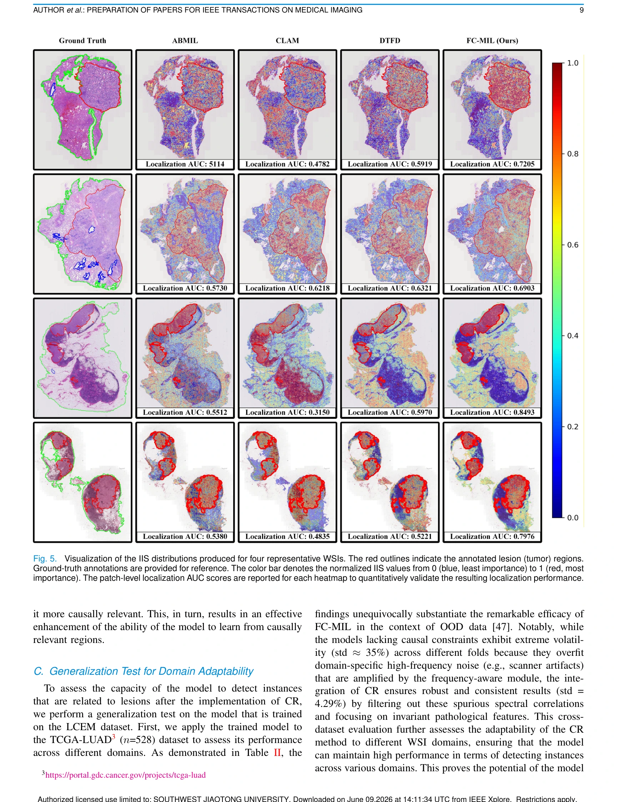
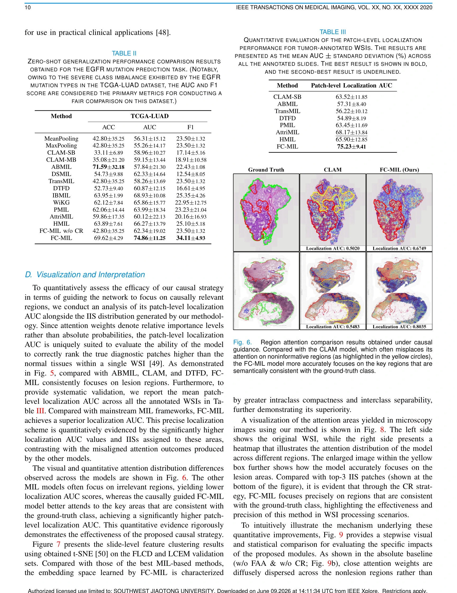
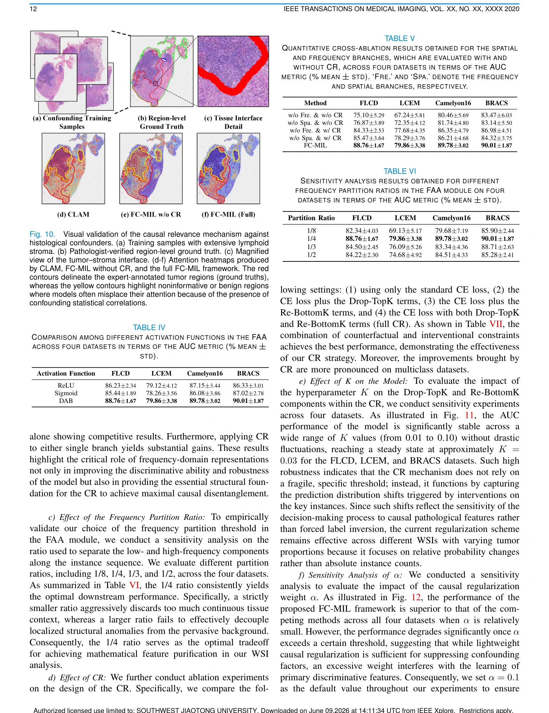
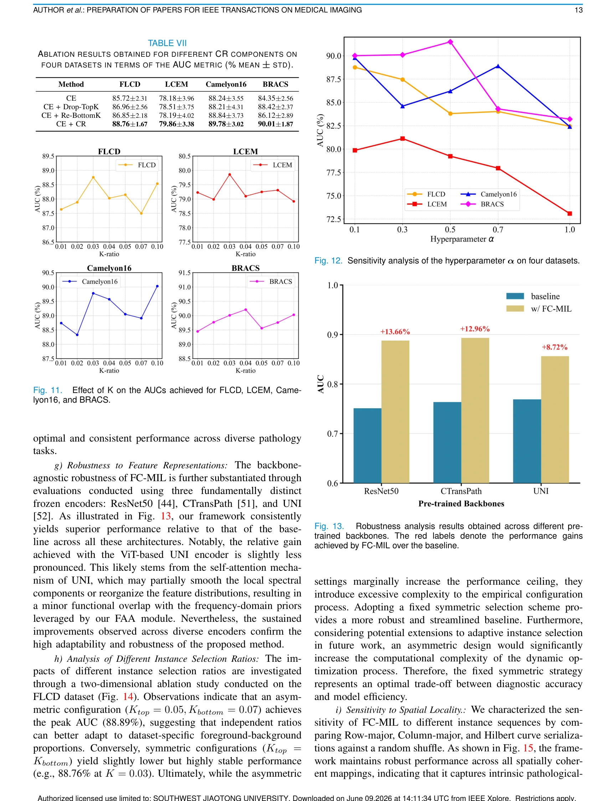
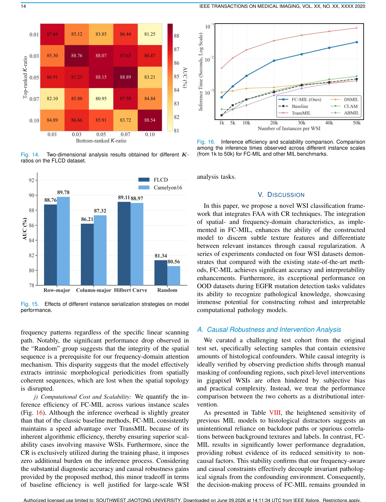
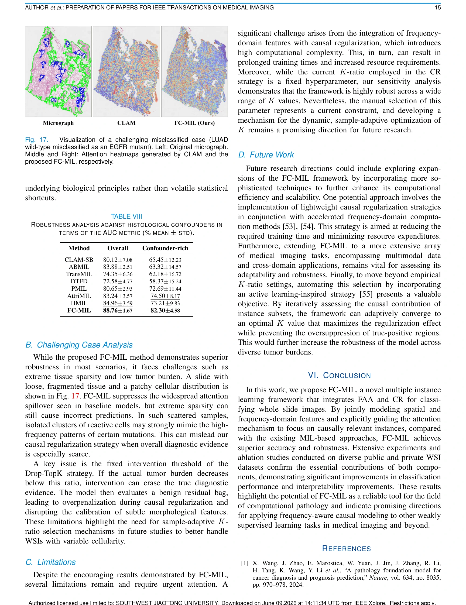
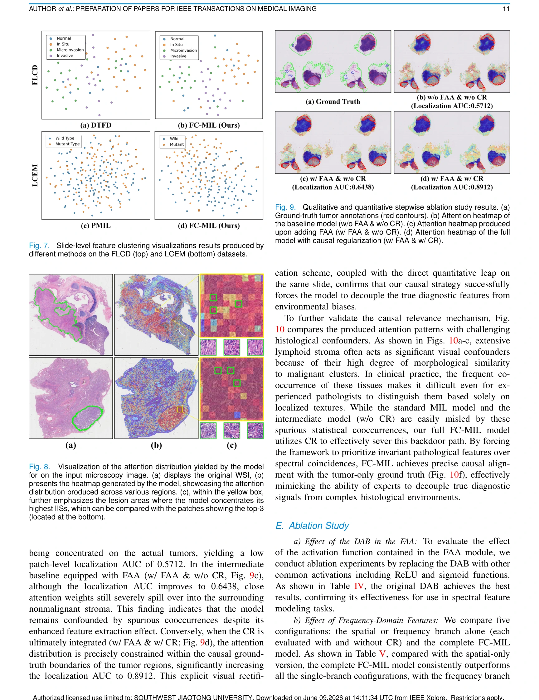

## Frequency-Aware Causal Regularization for Multiple Instance Learning in Whole Slide Image Classification

> data: CAMELYON16、BRACS、内部 FLCD、LCEM
>
> IEEE Transactions on Medical Imaging 2026 · [论文](https://doi.org/10.1109/TMI.2026.3697015) · [作者代码](https://github.com/7FFDW/FCMIL)

#### 引言

联合空间与频域注意力，并在潜在特征中施加反事实扰动式因果正则，鼓励模型减少对伪相关的依赖。

#### 方法

（1）频率注意力：联合空间与频域组织纹理。

（2）反事实扰动：在潜在特征中施加受控变化。

（3）因果正则：促使预测更依赖稳定病理线索，而非训练分布伪相关。

<!-- wsi-complete-model -->
##### 模型结构图

**图 2 · 模型结构**（PDF 第 5 页）

> 原文图注：Fig. 2. Overview of the proposed FC-MIL framework. (a) Pre-processing pipeline for WSI patch extraction and feature computation purposes. (b) FC-MIL architecture with spatial- (top) and frequency-domain branches (bottom). In the frequency branch, features are decomposed via FFT, enhanced with a DAB, and fused for performing multiclass WSI prediction. The total loss combines the cross-entropy and CR losses. (c) Structure of the DAB, which adaptively modulates the feature activations.

[查看原尺寸](assest/FC-MIL/figure-2-complete.webp)

<!-- /wsi-complete-model -->

#### 实验

##### 实验设置

实验节列四个数据集：FLCD 为四类冷冻肺癌，LCEM 为 EGFR 状态二分类；比较同条件 MIL。

##### 主要结果

正文贡献段写五个数据集，实验设置段写四个；本笔记按实际列明的四个记录，保留这处不一致。

<!-- wsi-complete-results -->
##### 完整实验指标与对照

下列实验原页保留表头、全部行列、子图、误差说明和脚注，点击可查看原尺寸。比较时请对应相同的数据集、特征编码器和训练设置；`±`、置信区间、百分比和小数均保留原文的单位与统计口径。

| 原表/图中指标 | 读取方式 |
| --- | --- |
| ROC-AUC / AUROC | 越高越好；若原表明确为 PR-AUC，则按 PR 曲线面积读取 |
| Recall / Sensitivity | 越高越好；与固定敏感度下的特异度区别读取 |

| 原文页 | 阅读内容 | 图表及正文引用 |
| --- | --- | --- |
| PDF 第 8 页 | 实验结果 | Table I |
| PDF 第 9 页 | 实验结果 | Figure 5 |
| PDF 第 10 页 | 实验结果 | Table II、Table III |
| PDF 第 11 页 | 消融与参数分析 | Figure 9 |
| PDF 第 12 页 | 实验结果 | Table IV、Table V、Table VI |
| PDF 第 13 页 | 实验结果 | Table VII、Figure 11、Figure 13 |
| PDF 第 14 页 | 实验结果 | Figure 15 |
| PDF 第 15 页 | 实验结果 | Table VIII |

**实验原页 · PDF 第 8 页**（图表及正文引用：Table I）

[查看原尺寸](assest/FC-MIL/experiment-page-08.webp)

**实验原页 · PDF 第 9 页**（图表及正文引用：Figure 5）

[查看原尺寸](assest/FC-MIL/experiment-page-09.webp)

**实验原页 · PDF 第 10 页**（图表及正文引用：Table II、Table III）

[查看原尺寸](assest/FC-MIL/experiment-page-10.webp)

**实验原页 · PDF 第 12 页**（图表及正文引用：Table IV、Table V、Table VI）

[查看原尺寸](assest/FC-MIL/experiment-page-12.webp)

**实验原页 · PDF 第 13 页**（图表及正文引用：Table VII、Figure 11、Figure 13）

[查看原尺寸](assest/FC-MIL/experiment-page-13.webp)

**实验原页 · PDF 第 14 页**（图表及正文引用：Figure 15）

[查看原尺寸](assest/FC-MIL/experiment-page-14.webp)

**实验原页 · PDF 第 15 页**（图表及正文引用：Table VIII）

[查看原尺寸](assest/FC-MIL/experiment-page-15.webp)

展开消融、参数、数据设置及效率原页

**实验原页 · PDF 第 11 页**（图表及正文引用：Figure 9）

[查看原尺寸](assest/FC-MIL/experiment-page-11.webp)

<!-- /wsi-complete-results -->

##### 消融与讨论

分别分析频率注意力和反事实扰动正则，不能把命名为因果正则直接当作已识别真实因果效应。

#### 参考文献

> Frequency-Aware Causal Regularization for Multiple Instance Learning in Whole Slide Image Classification
>
> IEEE Transactions on Medical Imaging 2026 · [论文](https://doi.org/10.1109/TMI.2026.3697015) · [作者代码](https://github.com/7FFDW/FCMIL)
