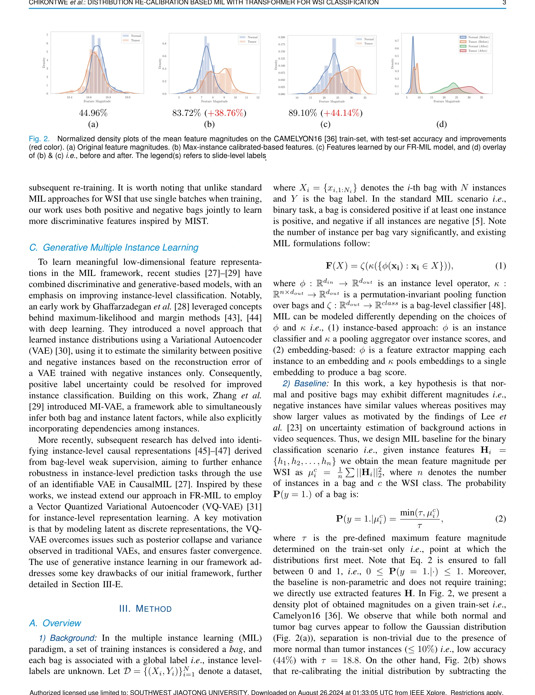
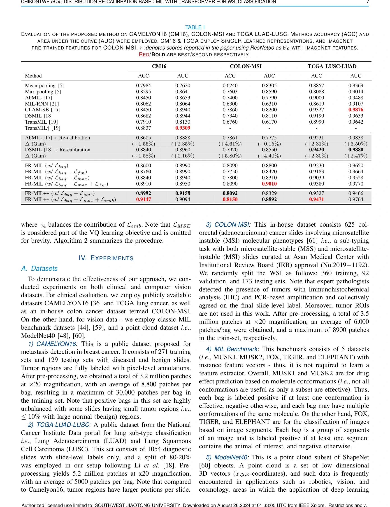
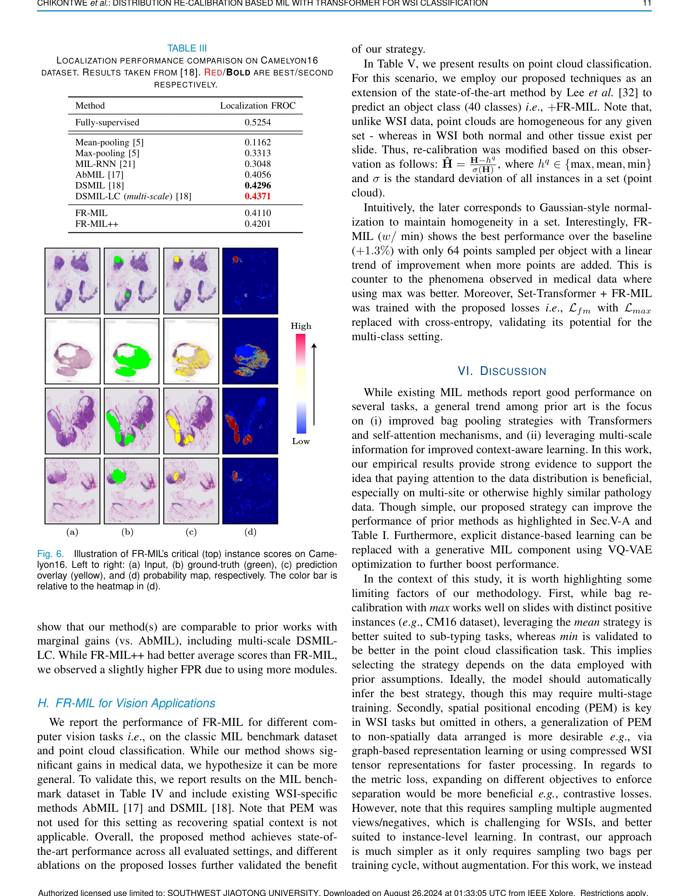
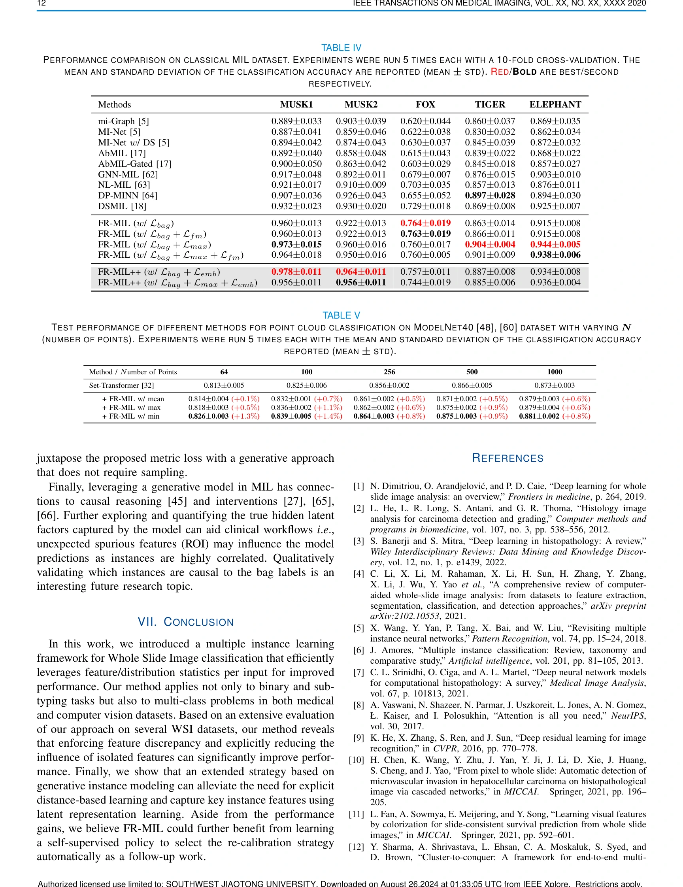
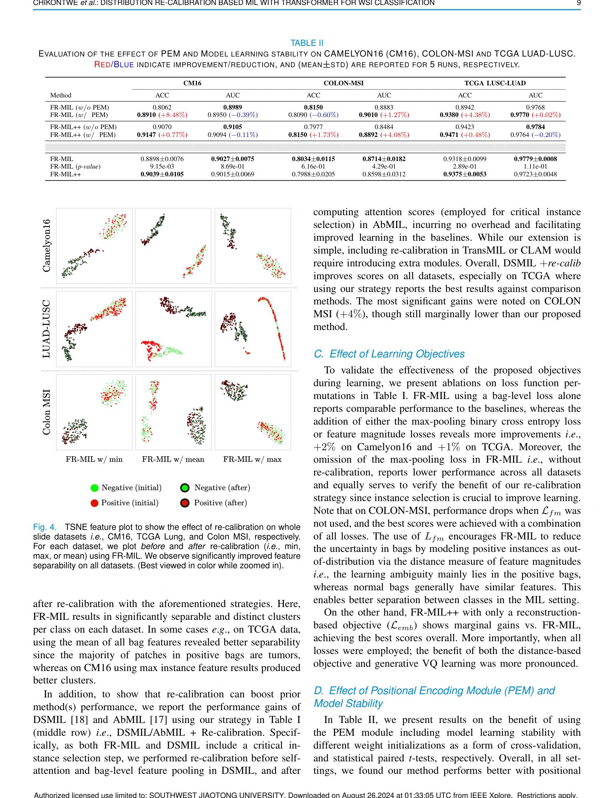
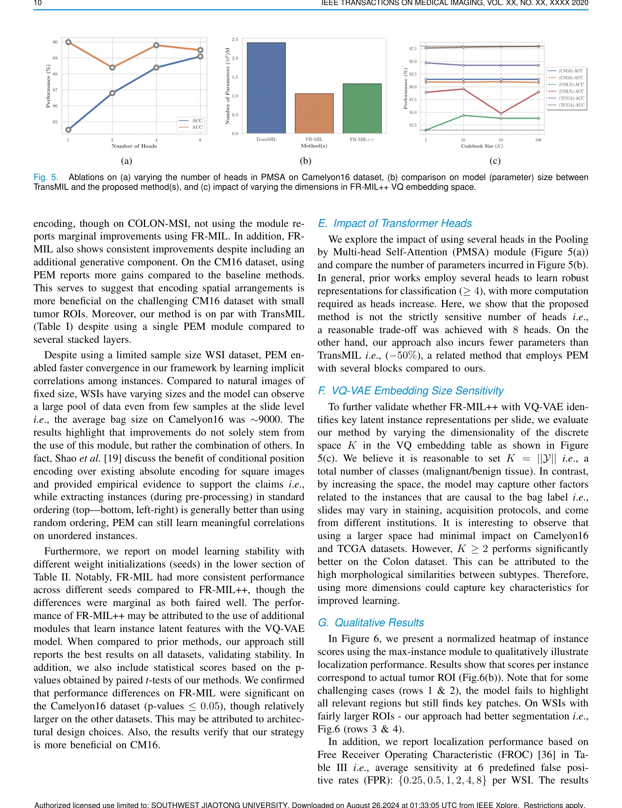

## FR-MIL: Distribution Re-calibration based Multiple Instance Learning with Transformer for Whole Slide Image Classification

> data: CAMELYON16、TCGA Lung、内部 COLON-MSI；经典 MIL 与 ModelNet40
>
> IEEE Transactions on Medical Imaging 2025（2024 年提前在线） · [论文](https://doi.org/10.1109/TMI.2024.3446716) · [作者代码](https://github.com/PhilipChicco/FRMIL)

#### 引言

以关键实例的统计量重校准包内特征分布，结合度量约束、向量量化与位置编码 Transformer 聚合，应对染色和采集差异。

#### 方法

（1）分布重校准：以关键实例统计量平移或调整包内特征分布。

（2）特征分离：用度量目标及 VQ 表征增强不同包的可区分性。

（3）空间聚合：在位置编码模块后使用多头注意力形成切片表示。

<!-- wsi-complete-model -->
##### 模型结构图

**图 3 · 模型结构**（PDF 第 4 页）

> 原文图注：Fig. 3. (a) Overview of the proposed FR-MIL framework, and (b) Intuition of our proposed re-calibration mechanism in WSI with small tumor regions i.e., the model maximizes instance features of otherwise isolated tumors and reduces the influence of normal/background features for improved representation learning. (c) Proposed FR-MIL++ that includes VQ-VAE based learning on key instances to better capture key latent instance representations for improved bag prediction without distance based objectives. Here, different colored H denoted the new updated features after the codeblock (yellow) and the selected to top-instance relating the original bag (red).

[查看原尺寸](assest/FR-MIL/figure-3-complete.webp)

<!-- /wsi-complete-model -->

#### 实验

##### 实验设置

临床任务与通用视觉任务分别评价，分类指标及各任务配置见原表。

##### 主要结果

不仅比较 Transformer 聚合，还比较 max/min/mean 参考实例的重校准方式；作者在 WSI 中更支持 max-instance。

<!-- wsi-complete-results -->
##### 完整实验指标与对照

下列实验原页保留表头、全部行列、子图、误差说明和脚注，点击可查看原尺寸。比较时请对应相同的数据集、特征编码器和训练设置；`±`、置信区间、百分比和小数均保留原文的单位与统计口径。

| 原表/图中指标 | 读取方式 |
| --- | --- |
| ACC / Accuracy | 越高越好；平衡准确率、平均准确率以原表标注为准 |

| 原文页 | 阅读内容 | 图表及正文引用 |
| --- | --- | --- |
| PDF 第 3 页 | 实验结果 | Figure 2 |
| PDF 第 7 页 | 实验结果 | Table I |
| PDF 第 9 页 | 消融与参数分析 | Table II |
| PDF 第 10 页 | 消融与参数分析 | Figure 5、Table II |
| PDF 第 11 页 | 实验结果 | Table III、Table I |
| PDF 第 12 页 | 实验结果 | Table IV、Table V |

**实验原页 · PDF 第 3 页**（图表及正文引用：Figure 2）

[查看原尺寸](assest/FR-MIL/experiment-page-03.webp)

**实验原页 · PDF 第 7 页**（图表及正文引用：Table I）

[查看原尺寸](assest/FR-MIL/experiment-page-07.webp)

**实验原页 · PDF 第 11 页**（图表及正文引用：Table III、Table I）

[查看原尺寸](assest/FR-MIL/experiment-page-11.webp)

**实验原页 · PDF 第 12 页**（图表及正文引用：Table IV、Table V）

[查看原尺寸](assest/FR-MIL/experiment-page-12.webp)

展开消融、参数、数据设置及效率原页

**实验原页 · PDF 第 9 页**（图表及正文引用：Table II）

[查看原尺寸](assest/FR-MIL/experiment-page-09.webp)

**实验原页 · PDF 第 10 页**（图表及正文引用：Figure 5、Table II）

[查看原尺寸](assest/FR-MIL/experiment-page-10.webp)

<!-- /wsi-complete-results -->

##### 消融与讨论

考察分布重校准、特征分离损失、VQ 与空间编码；通用点云实验不能充当临床外部验证。

#### 参考文献

> FR-MIL: Distribution Re-calibration based Multiple Instance Learning with Transformer for Whole Slide Image Classification
>
> IEEE Transactions on Medical Imaging 2025（2024 年提前在线） · [论文](https://doi.org/10.1109/TMI.2024.3446716) · [作者代码](https://github.com/PhilipChicco/FRMIL)
