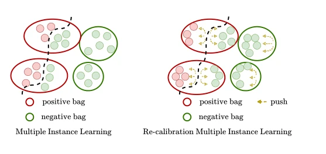

## FR-MIL: Distribution Re-calibration based Multiple Instance Learning with Transformer for Whole Slide Image Classification

> data: CAMELYON16、TCGA Lung、内部 COLON-MSI；经典 MIL 与 ModelNet40
>
> IEEE Transactions on Medical Imaging 2025（2024 年提前在线） · [论文](https://doi.org/10.1109/TMI.2024.3446716) · [作者代码](https://github.com/PhilipChicco/FRMIL)

#### 引言

以关键实例的统计量重校准包内特征分布，结合度量约束、向量量化与位置编码 Transformer 聚合，应对染色和采集差异。

#### 方法

（1）分布重校准：以关键实例统计量平移或调整包内特征分布。

（2）特征分离：用度量目标及 VQ 表征增强不同包的可区分性。

（3）空间聚合：在位置编码模块后使用多头注意力形成切片表示。

原文Fig. 1，PDF 第 1 页。

#### 实验

##### 实验设置

临床任务与通用视觉任务分别评价，分类指标及各任务配置见原表。

##### 主要结果

不仅比较 Transformer 聚合，还比较 max/min/mean 参考实例的重校准方式；作者在 WSI 中更支持 max-instance。

##### 消融与讨论

考察分布重校准、特征分离损失、VQ 与空间编码；通用点云实验不能充当临床外部验证。

#### 参考文献

> FR-MIL: Distribution Re-calibration based Multiple Instance Learning with Transformer for Whole Slide Image Classification
>
> IEEE Transactions on Medical Imaging 2025（2024 年提前在线） · [论文](https://doi.org/10.1109/TMI.2024.3446716) · [作者代码](https://github.com/PhilipChicco/FRMIL)
