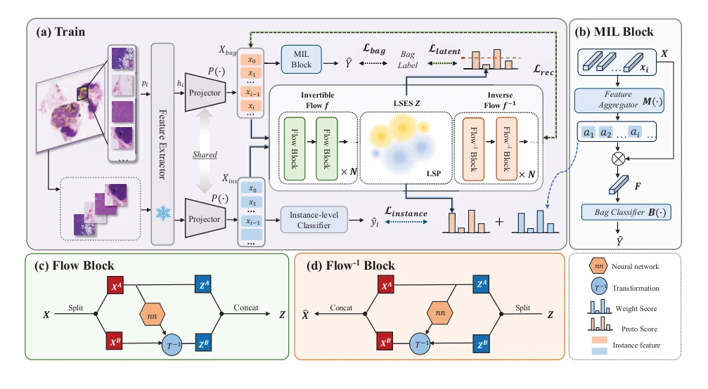
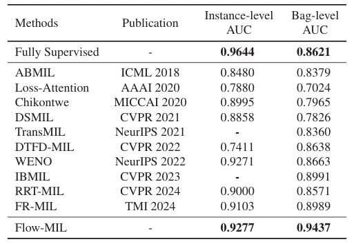

## Flow-MIL: Constructing Highly-expressive Latent Feature Space For Whole Slide Image Classification Using Normalizing Flow

> data: CAMELYON16、PANDA、TCGA-NSCLC
>
> ICCV 2025 · [论文](https://openaccess.thecvf.com/content/ICCV2025/html/Ma_Flow-MIL_Constructing_Highly-expressive_Latent_Feature_Space_For_Whole_Slide_Image_ICCV_2025_paper.html)

#### 引言

用归一化流把 patch 映射到潜在语义空间，再通过高斯混合原型描述类别分布、细化实例伪标签，兼顾包级和实例级预测。

#### 方法

（1）归一化流：将复杂 patch 分布映射到更易建模的潜在语义空间。

（2）语义原型：用高斯混合成分描述类别相关的组织分布。

（3）联合预测：以原型细化实例伪标签，再用潜在特征完成包聚合。

原文Figure 2，PDF 第 4 页。

#### 实验

##### 实验设置

训练用切片标签，patch/像素标注仅用于定位评价；同时区分包级与实例级结果。

##### 主要结果

C16 的实例级/包级 AUC 为 0.9277/0.9437；PANDA 按 Gleason 模式分别报告结果。

原文Table 1，PDF 第 6 页。

##### 消融与讨论

消融归一化流语义空间和高斯混合原型，并检查伪标签细化；局部定位与包分类不存在简单上界对应。

#### 参考文献

> Flow-MIL: Constructing Highly-expressive Latent Feature Space For Whole Slide Image Classification Using Normalizing Flow
>
> ICCV 2025 · [论文](https://openaccess.thecvf.com/content/ICCV2025/html/Ma_Flow-MIL_Constructing_Highly-expressive_Latent_Feature_Space_For_Whole_Slide_Image_ICCV_2025_paper.html)
