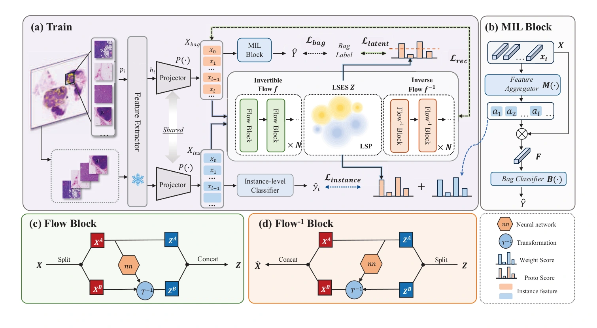
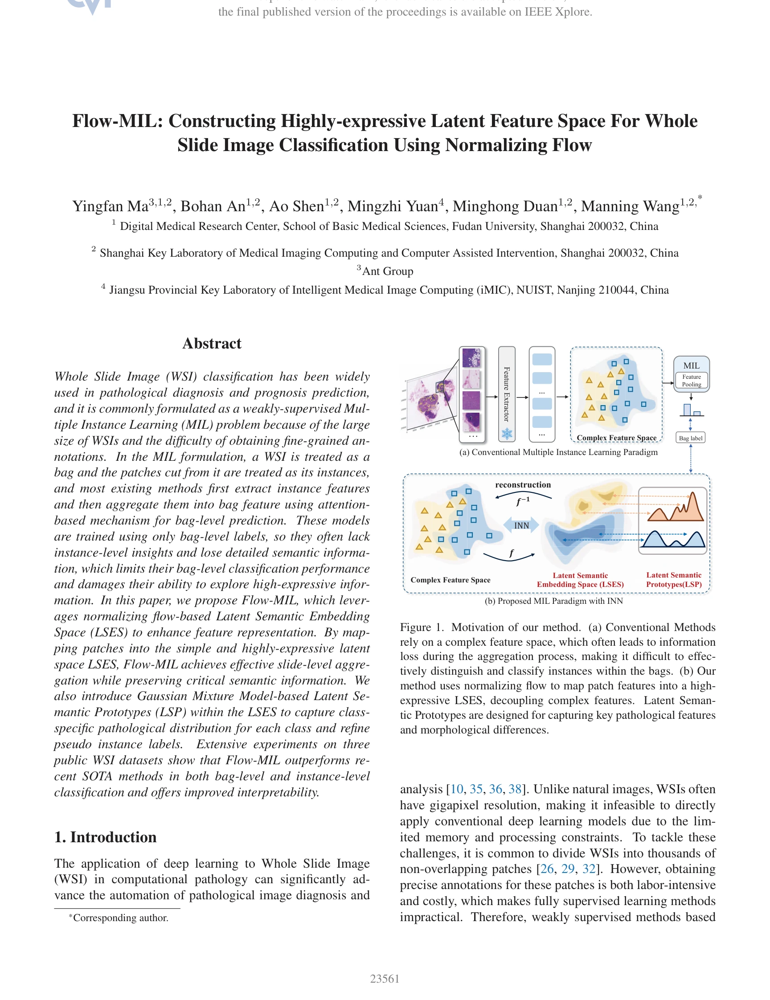
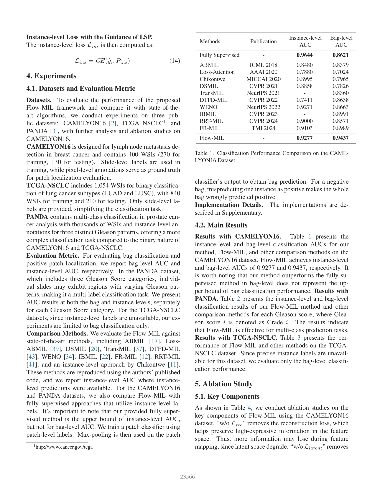
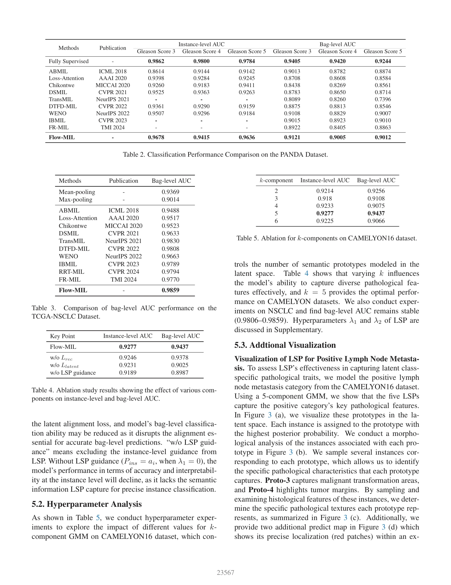
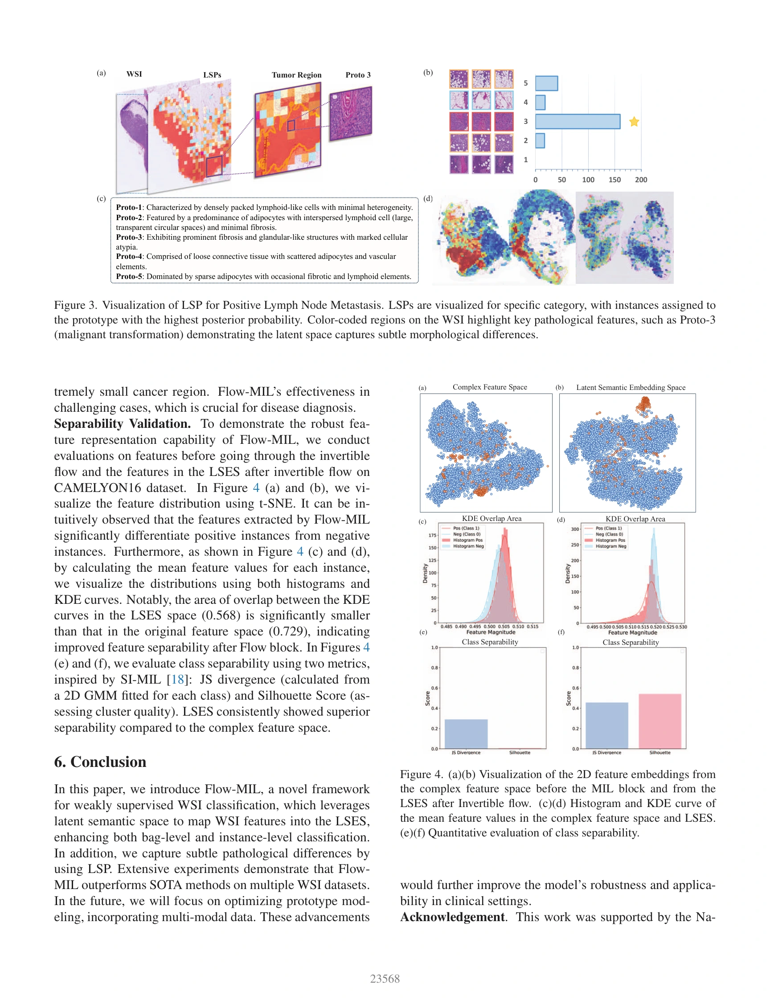
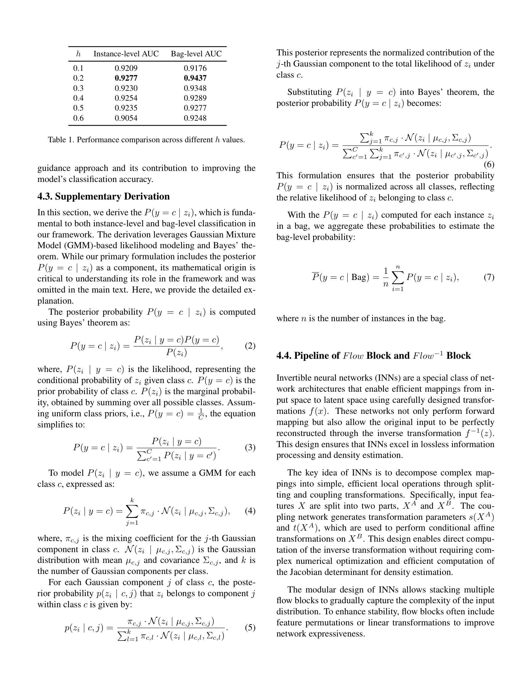

## Flow-MIL: Constructing Highly-expressive Latent Feature Space For Whole Slide Image Classification Using Normalizing Flow

> data: CAMELYON16、PANDA、TCGA-NSCLC
>
> ICCV 2025 · [论文](https://openaccess.thecvf.com/content/ICCV2025/html/Ma_Flow-MIL_Constructing_Highly-expressive_Latent_Feature_Space_For_Whole_Slide_Image_ICCV_2025_paper.html)

#### 引言

用归一化流把 patch 映射到潜在语义空间，再通过高斯混合原型描述类别分布、细化实例伪标签，兼顾包级和实例级预测。

#### 方法

（1）归一化流：将复杂 patch 分布映射到更易建模的潜在语义空间。

（2）语义原型：用高斯混合成分描述类别相关的组织分布。

（3）联合预测：以原型细化实例伪标签，再用潜在特征完成包聚合。

<!-- wsi-complete-model -->
##### 模型结构图

**图 2 · 模型结构**（PDF 第 4 页）

> 原文图注：Figure 2. Overview of the proposed Flow-MIL framework for bag-level and instance-level classification. (a) Flow-MIL dual-branch optimization framework: This illustrates the Flow-MIL architecture, featuring a dual-branch optimization for both bag-level and instance- level classification. (b) MIL block: The conventional MIL block uses an attention mechanism to aggregate instance features into a bag- level feature for classification. (c) The Flow Block maps intermediate features into the LSES using invertible neural networks to preserve semantic information. (d) The Flow−1 Block reconstructs features from the LSES back into the original feature space, ensuring the transformation is invertible.

[查看原尺寸](assest/Flow-MIL/figure-2-complete.webp)

<!-- /wsi-complete-model -->

#### 实验

##### 实验设置

训练用切片标签，patch/像素标注仅用于定位评价；同时区分包级与实例级结果。

##### 主要结果

C16 的实例级/包级 AUC 为 0.9277/0.9437；PANDA 按 Gleason 模式分别报告结果。

<!-- wsi-complete-results -->
##### 完整实验指标与对照

下列实验原页保留表头、全部行列、子图、误差说明和脚注，点击可查看原尺寸。比较时请对应相同的数据集、特征编码器和训练设置；`±`、置信区间、百分比和小数均保留原文的单位与统计口径。

| 原表/图中指标 | 读取方式 |
| --- | --- |
| ROC-AUC / AUROC | 越高越好；若原表明确为 PR-AUC，则按 PR 曲线面积读取 |
| AP / AUPRC / mAP | 越高越好；与 ROC-AUC 不同，保留任务和召回定义 |

| 原文页 | 阅读内容 | 图表及正文引用 |
| --- | --- | --- |
| PDF 第 1 页 | 实验结果 | Figure 1 |
| PDF 第 6 页 | 实验结果 | Table 1 |
| PDF 第 7 页 | 实验结果 | Table 2、Table 3、Table 4、Table 5 |
| PDF 第 8 页 | 实验结果 | Figure 4 |
| PDF 第 13 页 | 实验结果 | Table 1 |

**实验原页 · PDF 第 1 页**（图表及正文引用：Figure 1）

[查看原尺寸](assest/Flow-MIL/experiment-page-01.webp)

**实验原页 · PDF 第 6 页**（图表及正文引用：Table 1）

[查看原尺寸](assest/Flow-MIL/experiment-page-06.webp)

**实验原页 · PDF 第 7 页**（图表及正文引用：Table 2、Table 3、Table 4、Table 5）

[查看原尺寸](assest/Flow-MIL/experiment-page-07.webp)

**实验原页 · PDF 第 8 页**（图表及正文引用：Figure 4）

[查看原尺寸](assest/Flow-MIL/experiment-page-08.webp)

**实验原页 · PDF 第 13 页**（图表及正文引用：Table 1）

[查看原尺寸](assest/Flow-MIL/experiment-page-13.webp)

<!-- /wsi-complete-results -->

##### 消融与讨论

消融归一化流语义空间和高斯混合原型，并检查伪标签细化；局部定位与包分类不存在简单上界对应。

#### 参考文献

> Flow-MIL: Constructing Highly-expressive Latent Feature Space For Whole Slide Image Classification Using Normalizing Flow
>
> ICCV 2025 · [论文](https://openaccess.thecvf.com/content/ICCV2025/html/Ma_Flow-MIL_Constructing_Highly-expressive_Latent_Feature_Space_For_Whole_Slide_Image_ICCV_2025_paper.html)
