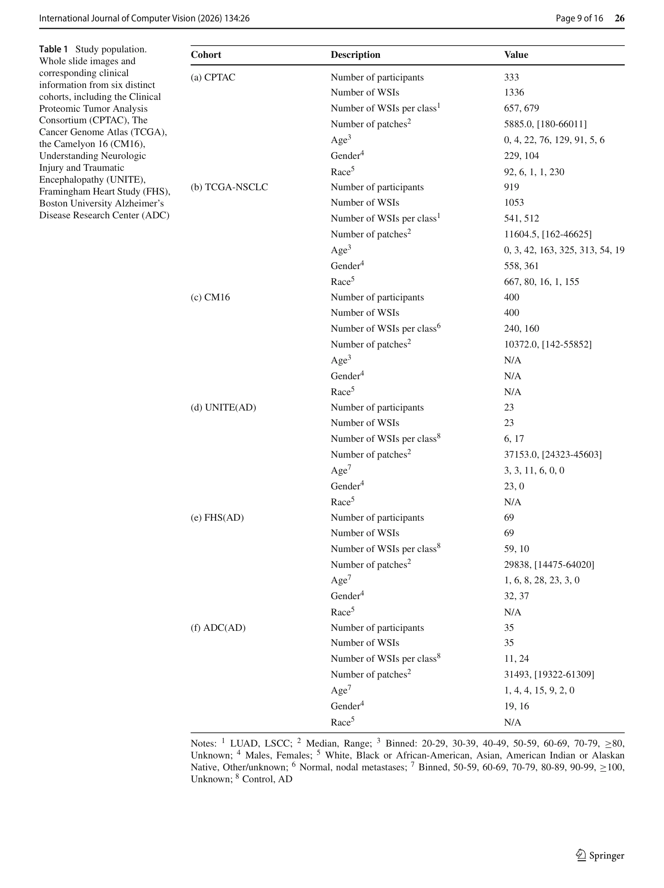
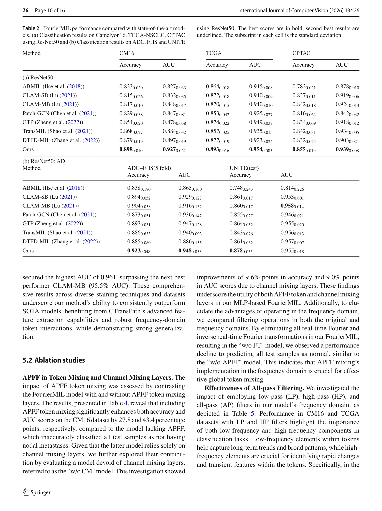
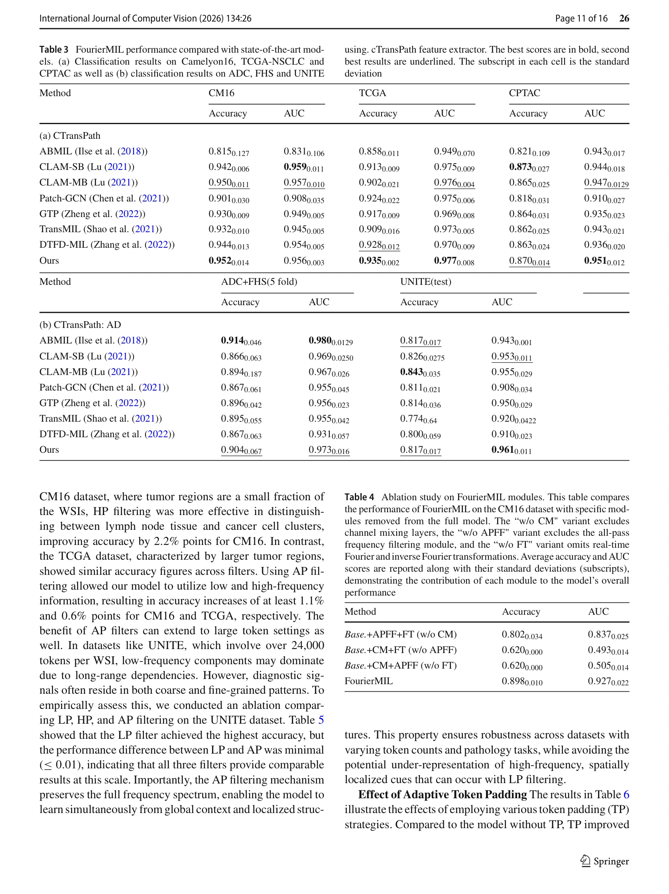
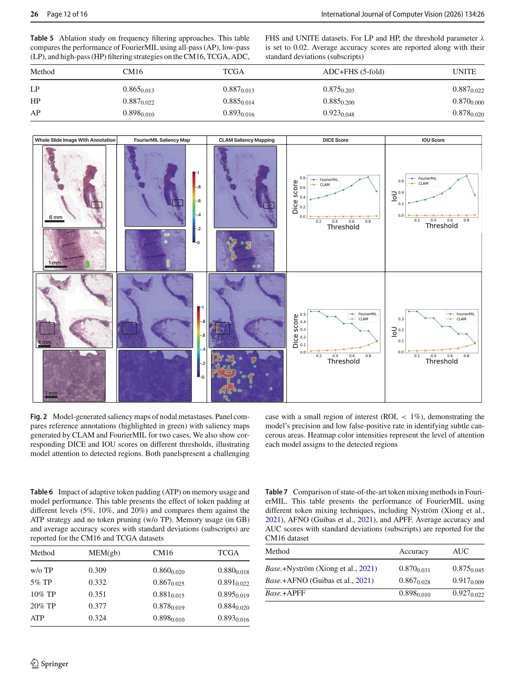

## FourierMIL: Fourier Filtering-based Multiple Instance Learning for Whole Slide Image Analysis

> data: CAMELYON16、TCGA-NSCLC、CPTAC；UNITE、FHS、ADC
>
> International Journal of Computer Vision 2026 · [论文](https://doi.org/10.1007/s11263-025-02679-x) · [作者代码](https://github.com/vkola-lab/ijcv2025)

#### 引言

通过离散 Fourier 变换和频域滤波建模全局、局部依赖，提供无需注意力的 WSI 聚合方案，覆盖不同染色和病理任务。

#### 方法

（1）频域变换：以离散 Fourier 表示实例特征。

（2）滤波交互：通过频域过滤学习局部与全局依赖。

（3）无注意力聚合：将更新信息汇总用于不同染色和病理任务。

<!-- wsi-complete-model -->
##### 模型结构图

**图 1 · 模型结构**（PDF 第 5 页）

> 原文图注：Fig. 1 FourierMIL framework. (a) Each whole slide image is seg- mented into patches, excluding the background, and transformed into feature vectors via ResNet50. The patch tokens sequence is then padded, and a class token is appended, before input into the proposed model. Through a series of token mixing and channel mixing blocks, the output class token is directed to a classification head, consisting of a single lin-

[查看原尺寸](assest/FourierMIL/figure-1-complete.webp)

<!-- /wsi-complete-model -->

#### 实验

##### 实验设置

涵盖 H&E 癌症任务和 AT8 神经病理任务；20×、256×256 patch，另做外部 CPTAC 评价。

##### 主要结果

C16 相对比较方法的最低 ACC/AUC 增益为 1.9/3.0 个百分点，NSCLC 为 1.6/0.5 个百分点。

<!-- wsi-complete-results -->
##### 完整实验指标与对照

下列实验原页保留表头、全部行列、子图、误差说明和脚注，点击可查看原尺寸。比较时请对应相同的数据集、特征编码器和训练设置；`±`、置信区间、百分比和小数均保留原文的单位与统计口径。

| 原表/图中指标 | 读取方式 |
| --- | --- |
| ROC-AUC / AUROC | 越高越好；若原表明确为 PR-AUC，则按 PR 曲线面积读取 |
| ACC / Accuracy | 越高越好；平衡准确率、平均准确率以原表标注为准 |

| 原文页 | 阅读内容 | 图表及正文引用 |
| --- | --- | --- |
| PDF 第 9 页 | 实验结果 | Table 1 |
| PDF 第 10 页 | 实验结果 | Table 2 |
| PDF 第 11 页 | 实验结果 | Table 3、Table 4 |
| PDF 第 12 页 | 实验结果 | Table 5、Table 6、Table 7 |

**实验原页 · PDF 第 9 页**（图表及正文引用：Table 1）

[查看原尺寸](assest/FourierMIL/experiment-page-09.webp)

**实验原页 · PDF 第 10 页**（图表及正文引用：Table 2）

[查看原尺寸](assest/FourierMIL/experiment-page-10.webp)

**实验原页 · PDF 第 11 页**（图表及正文引用：Table 3、Table 4）

[查看原尺寸](assest/FourierMIL/experiment-page-11.webp)

**实验原页 · PDF 第 12 页**（图表及正文引用：Table 5、Table 6、Table 7）

[查看原尺寸](assest/FourierMIL/experiment-page-12.webp)

<!-- /wsi-complete-results -->

##### 消融与讨论

比较频域滤波与常见注意力聚合，区分不同染色、不同组织学任务和内部/外部数据。

#### 参考文献

> FourierMIL: Fourier Filtering-based Multiple Instance Learning for Whole Slide Image Analysis
>
> International Journal of Computer Vision 2026 · [论文](https://doi.org/10.1007/s11263-025-02679-x) · [作者代码](https://github.com/vkola-lab/ijcv2025)
