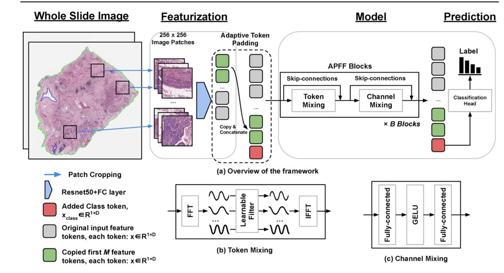
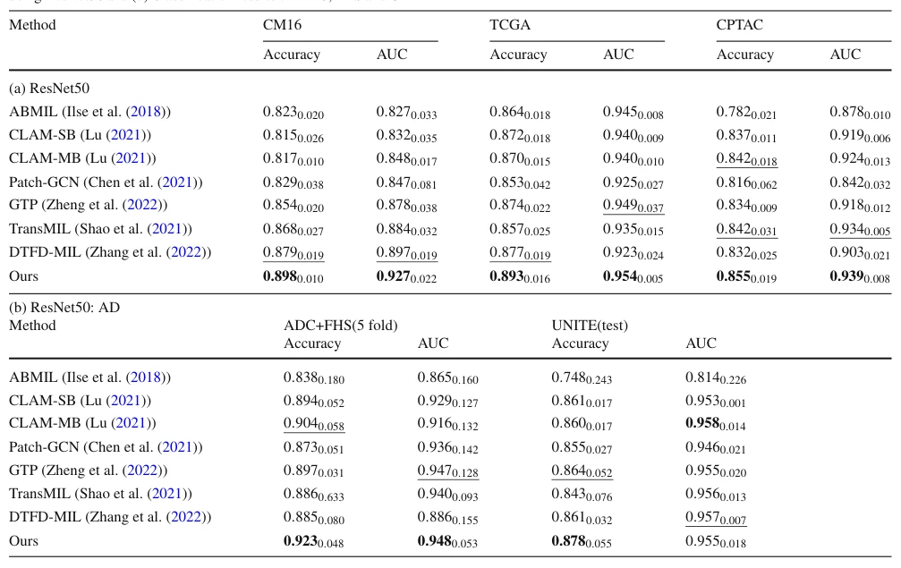

## FourierMIL: Fourier Filtering-based Multiple Instance Learning for Whole Slide Image Analysis

> data: CAMELYON16、TCGA-NSCLC、CPTAC；UNITE、FHS、ADC
>
> International Journal of Computer Vision 2026 · [论文](https://doi.org/10.1007/s11263-025-02679-x) · [作者代码](https://github.com/vkola-lab/ijcv2025)

#### 引言

通过离散 Fourier 变换和频域滤波建模全局、局部依赖，提供无需注意力的 WSI 聚合方案，覆盖不同染色和病理任务。

#### 方法

（1）频域变换：以离散 Fourier 表示实例特征。

（2）滤波交互：通过频域过滤学习局部与全局依赖。

（3）无注意力聚合：将更新信息汇总用于不同染色和病理任务。

原文Fig. 1，PDF 第 5 页。

#### 实验

##### 实验设置

涵盖 H&E 癌症任务和 AT8 神经病理任务；20×、256×256 patch，另做外部 CPTAC 评价。

##### 主要结果

C16 相对比较方法的最低 ACC/AUC 增益为 1.9/3.0 个百分点，NSCLC 为 1.6/0.5 个百分点。

原文Table 2，PDF 第 10 页。

##### 消融与讨论

比较频域滤波与常见注意力聚合，区分不同染色、不同组织学任务和内部/外部数据。

#### 参考文献

> FourierMIL: Fourier Filtering-based Multiple Instance Learning for Whole Slide Image Analysis
>
> International Journal of Computer Vision 2026 · [论文](https://doi.org/10.1007/s11263-025-02679-x) · [作者代码](https://github.com/vkola-lab/ijcv2025)
