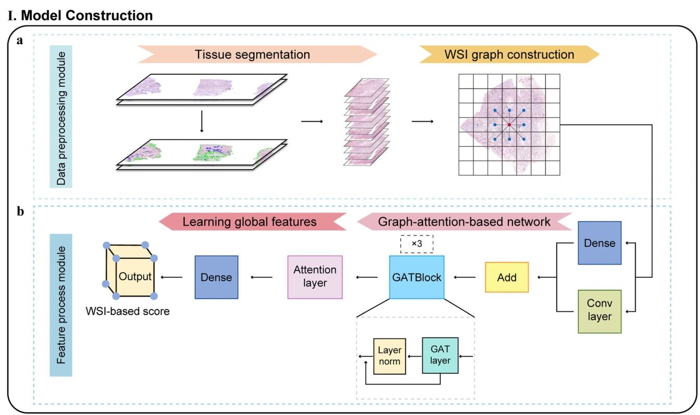
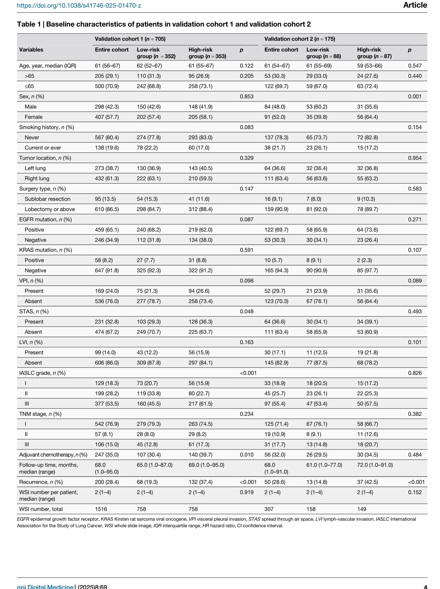
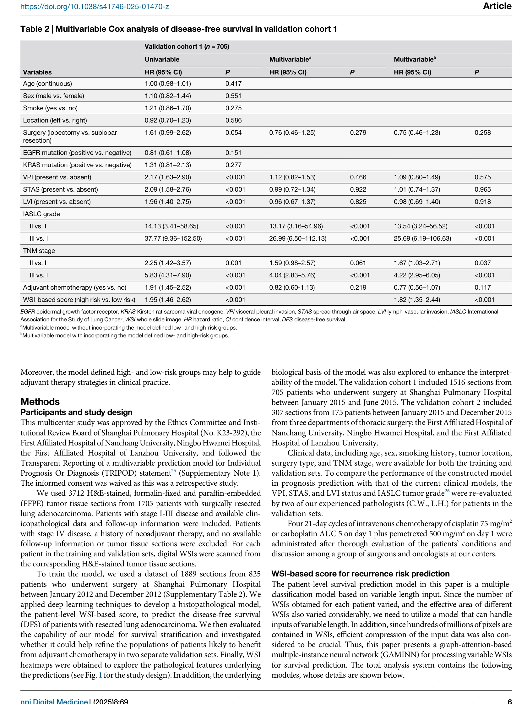
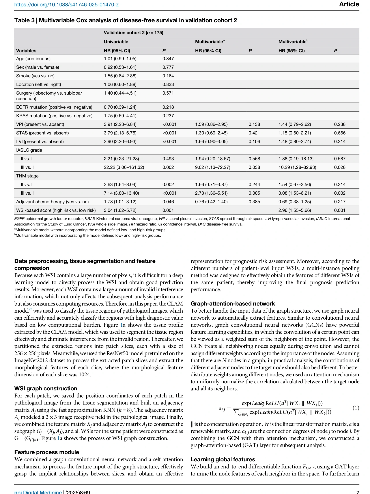
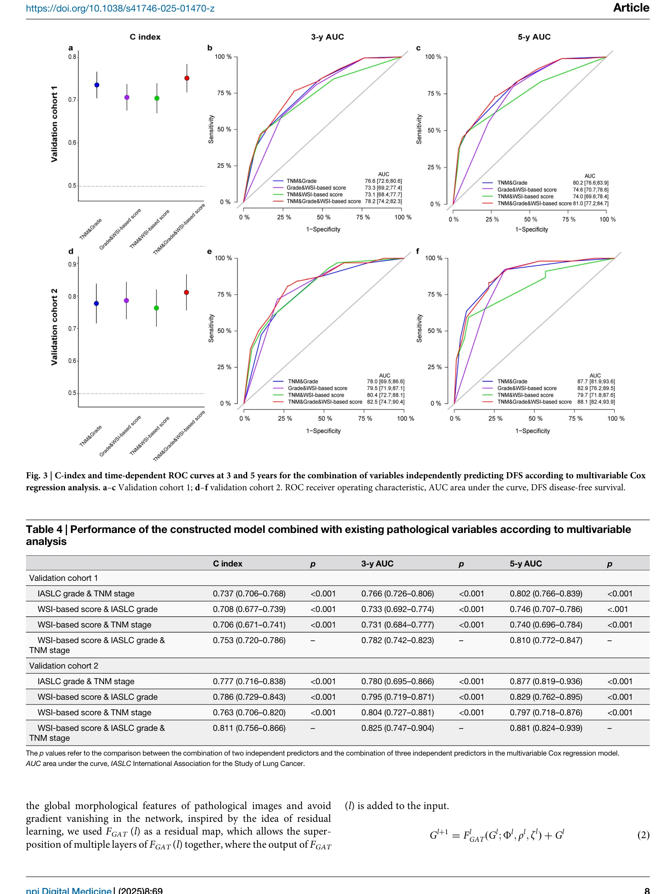

## Whole slide image based deep learning refines prognosis and therapeutic response evaluation in lung adenocarcinoma

> data: 多中心切除肺腺癌：1,705 位患者、3,712 张 H&E 切片
>
> npj Digital Medicine 2025 · [论文](https://doi.org/10.1038/s41746-025-01470-z) · [作者代码](https://github.com/Kim12312/WSI-based-Evaluation)

#### 引言

以肺腺癌 WSI 估计术后复发风险，并在多中心队列评估风险分层与辅助治疗获益关联，研究形态学预测对临床分期的补充价值。

#### 方法

（1）WSI 编码：从肺腺癌组织形态提取实例表示。

（2）注意力 MIL：汇总病理特征产生复发风险。

（3）临床整合：分析其相对 TNM 和其他病理因素的补充价值及治疗关联。

<!-- wsi-complete-model -->
##### 模型结构图

**图 1 · 模型结构**（PDF 第 3 页）

> 原文图注：Fig. 1 | Schematic illustration of the overall study design. a, b Model construction; c efficiency validation; d heatmap visualization. WSI whole slide image, ROC receiver operating characteristic, ACT adjuvant chemotherapy, TLS tertiary lymphoid structure.

[查看原尺寸](assest/GAMINN/figure-1-complete.webp)

<!-- /wsi-complete-model -->

#### 实验

##### 实验设置

纳入 I–III 期且有随访的患者，独立验证队列包含 705 和 175 位患者；比较临床分期及病理因素。

##### 主要结果

论文报告模型风险分层可补充 TNM，并探索辅助化疗获益关联；回顾性关联不等于随机试验疗效证明。

<!-- wsi-complete-results -->
##### 完整实验指标与对照

下列实验原页保留表头、全部行列、子图、误差说明和脚注，点击可查看原尺寸。比较时请对应相同的数据集、特征编码器和训练设置；`±`、置信区间、百分比和小数均保留原文的单位与统计口径。

| 原表/图中指标 | 读取方式 |
| --- | --- |
| ROC-AUC / AUROC | 越高越好；若原表明确为 PR-AUC，则按 PR 曲线面积读取 |
| C-index | 越高越好；用于生存预测，需保留终点及删失设置 |

| 原文页 | 阅读内容 | 图表及正文引用 |
| --- | --- | --- |
| PDF 第 4 页 | 实验结果 | Table 1 |
| PDF 第 6 页 | 实验结果 | Table 2 |
| PDF 第 7 页 | 实验结果 | Table 3 |
| PDF 第 8 页 | 实验结果 | Figure 3、Table 4 |

**实验原页 · PDF 第 4 页**（图表及正文引用：Table 1）

[查看原尺寸](assest/GAMINN/experiment-page-04.webp)

**实验原页 · PDF 第 6 页**（图表及正文引用：Table 2）

[查看原尺寸](assest/GAMINN/experiment-page-06.webp)

**实验原页 · PDF 第 7 页**（图表及正文引用：Table 3）

[查看原尺寸](assest/GAMINN/experiment-page-07.webp)

**实验原页 · PDF 第 8 页**（图表及正文引用：Figure 3、Table 4）

[查看原尺寸](assest/GAMINN/experiment-page-08.webp)

<!-- /wsi-complete-results -->

##### 消融与讨论

阅读 C-index、时间依赖 AUC、KM 曲线与多变量 Cox，注意多个切片属于同一患者。

#### 参考文献

> Whole slide image based deep learning refines prognosis and therapeutic response evaluation in lung adenocarcinoma
>
> npj Digital Medicine 2025 · [论文](https://doi.org/10.1038/s41746-025-01470-z) · [作者代码](https://github.com/Kim12312/WSI-based-Evaluation)
