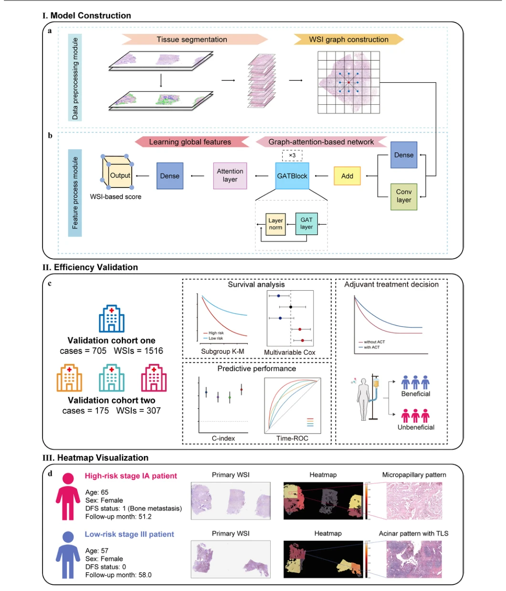
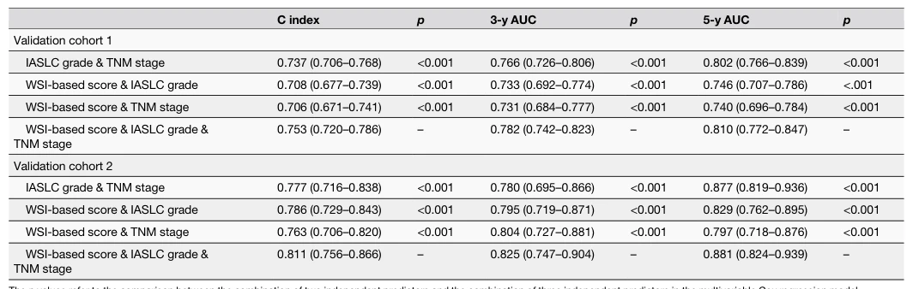

## Whole slide image based deep learning refines prognosis and therapeutic response evaluation in lung adenocarcinoma

> data: 多中心切除肺腺癌：1,705 位患者、3,712 张 H&E 切片
>
> npj Digital Medicine 2025 · [论文](https://doi.org/10.1038/s41746-025-01470-z) · [作者代码](https://github.com/Kim12312/WSI-based-Evaluation)

#### 引言

以肺腺癌 WSI 估计术后复发风险，并在多中心队列评估风险分层与辅助治疗获益关联，研究形态学预测对临床分期的补充价值。

#### 方法

（1）WSI 编码：从肺腺癌组织形态提取实例表示。

（2）注意力 MIL：汇总病理特征产生复发风险。

（3）临床整合：分析其相对 TNM 和其他病理因素的补充价值及治疗关联。

原文Fig. 1，PDF 第 3 页。

#### 实验

##### 实验设置

纳入 I–III 期且有随访的患者，独立验证队列包含 705 和 175 位患者；比较临床分期及病理因素。

##### 主要结果

论文报告模型风险分层可补充 TNM，并探索辅助化疗获益关联；回顾性关联不等于随机试验疗效证明。

原文Table 4，PDF 第 8 页。

##### 消融与讨论

阅读 C-index、时间依赖 AUC、KM 曲线与多变量 Cox，注意多个切片属于同一患者。

#### 参考文献

> Whole slide image based deep learning refines prognosis and therapeutic response evaluation in lung adenocarcinoma
>
> npj Digital Medicine 2025 · [论文](https://doi.org/10.1038/s41746-025-01470-z) · [作者代码](https://github.com/Kim12312/WSI-based-Evaluation)
