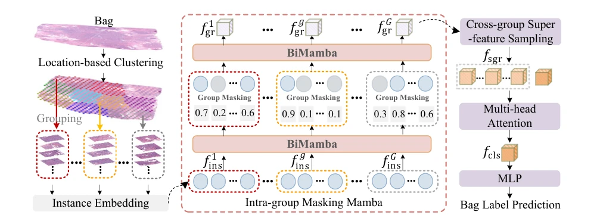
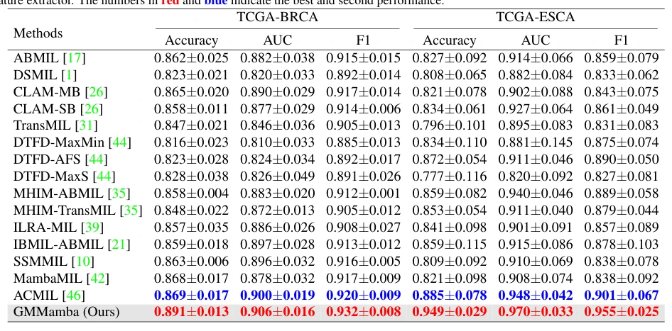

## GMMamba: Group Masking Mamba for Whole Slide Image Classification

> data: TCGA-BRCA、TCGA-ESCA、BRACS、TCGA-Lung
>
> ICCV 2025 · [论文](https://openaccess.thecvf.com/content/ICCV2025/html/Zheng_GMMamba_Group_Masking_Mamba_for_Whole_Slide_Image_Classification_ICCV_2025_paper.html)

#### 引言

在组内 Mamba 中学习稀疏掩码去除冗余，再以跨组超特征采样整合分散病灶，增强切片全局表征。

#### 方法

（1）位置分组：把切片划成较紧凑的局部实例组。

（2）IMM：在双向 Mamba 过程中学习掩码，去除组内低贡献模式。

（3）CSS：跨组采样判别特征，连接分散病灶与全局表示。

原文Figure 3，PDF 第 3 页。

#### 实验

##### 实验设置

按患者划分并做五折评估，报告 ACC/AUC/F1；还把 CSS 接入不同 MIL。

##### 主要结果

除完整 GMMamba 外，CSS 在多类基线上也有收益；需分清模型主表与单模块迁移表。

原文Table 1，PDF 第 6 页。

##### 消融与讨论

考察分组策略、IMM 掩码比例和 CSS 变体，检查冗余去除与跨组信息汇总的互补。

#### 参考文献

> GMMamba: Group Masking Mamba for Whole Slide Image Classification
>
> ICCV 2025 · [论文](https://openaccess.thecvf.com/content/ICCV2025/html/Zheng_GMMamba_Group_Masking_Mamba_for_Whole_Slide_Image_Classification_ICCV_2025_paper.html)
