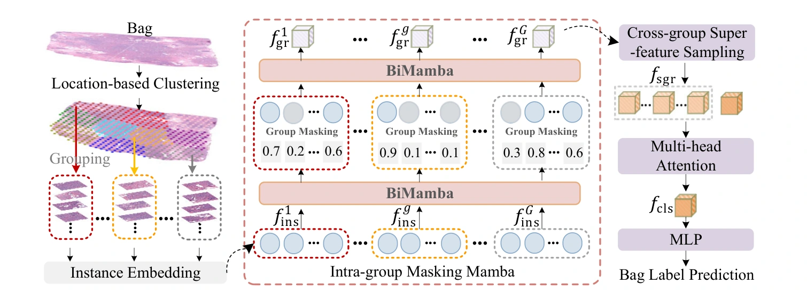
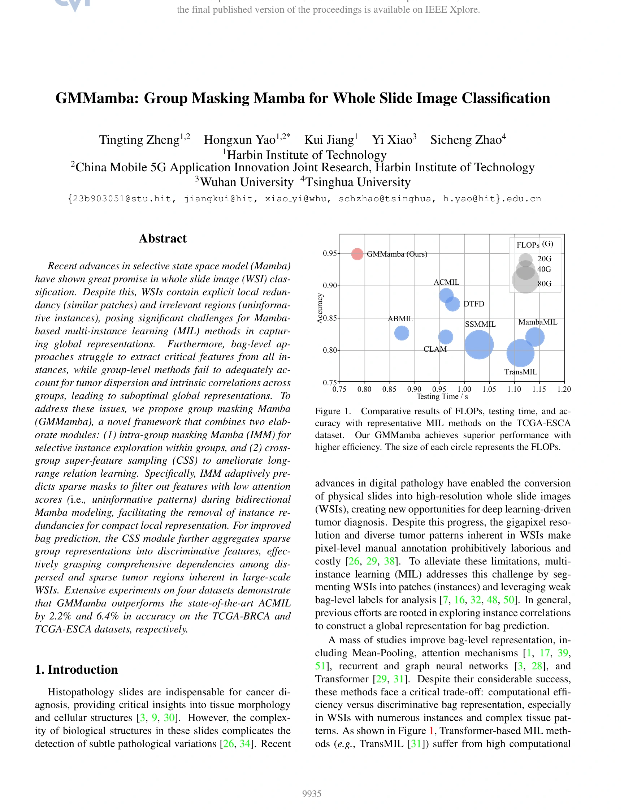
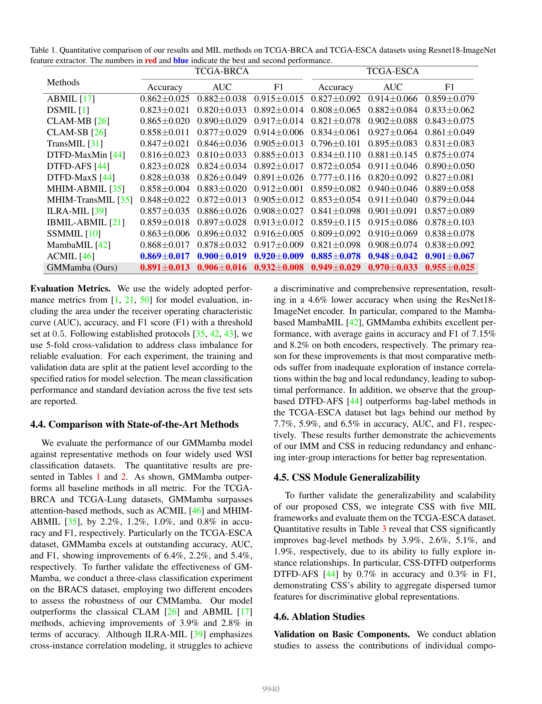
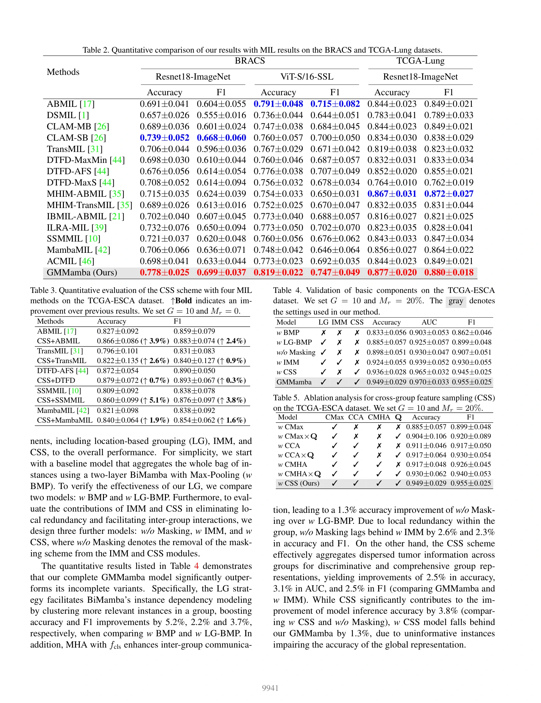
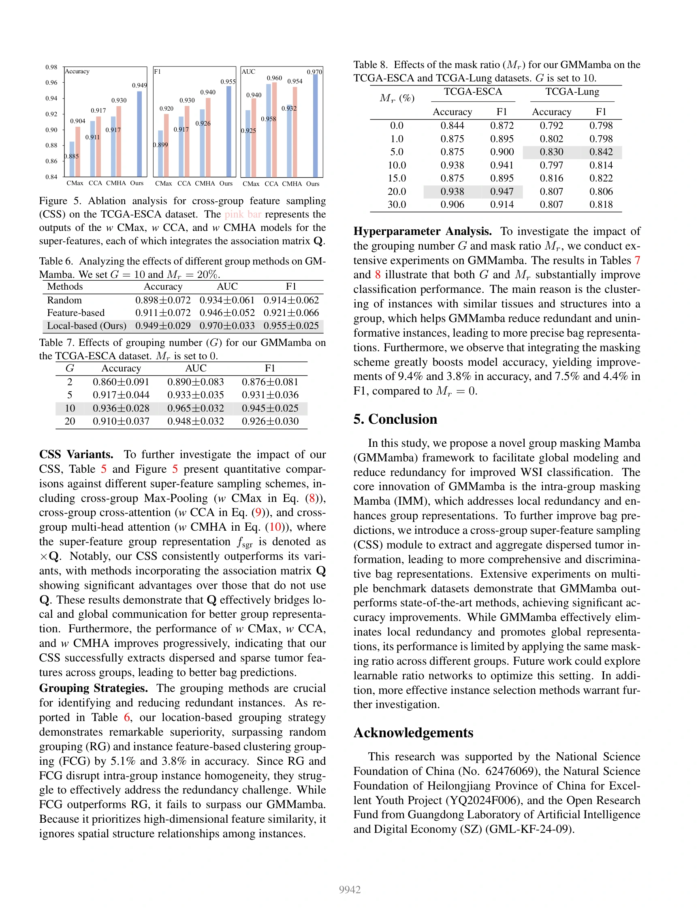

## GMMamba: Group Masking Mamba for Whole Slide Image Classification

> data: TCGA-BRCA、TCGA-ESCA、BRACS、TCGA-Lung
>
> ICCV 2025 · [论文](https://openaccess.thecvf.com/content/ICCV2025/html/Zheng_GMMamba_Group_Masking_Mamba_for_Whole_Slide_Image_Classification_ICCV_2025_paper.html)

#### 引言

在组内 Mamba 中学习稀疏掩码去除冗余，再以跨组超特征采样整合分散病灶，增强切片全局表征。

#### 方法

（1）位置分组：把切片划成较紧凑的局部实例组。

（2）IMM：在双向 Mamba 过程中学习掩码，去除组内低贡献模式。

（3）CSS：跨组采样判别特征，连接分散病灶与全局表示。

<!-- wsi-complete-model -->
##### 模型结构图

**图 3 · 模型结构**（PDF 第 3 页）

> 原文图注：Figure 3. The architecture of our proposed group masking Mamba network (GMMamba) for WSI classification. GMMamba employs a location-based clustering scheme to divide a bag into multiple groups {f g ins}G g=1. The intra-group masking Mamba (IMM) module then predicts attention masks for a bidirectional Mamba (BiMamba) to eliminate redundant instances, facilitating more compact local repre- sentations {f g gr}G g=1. Subsequently, a cross-group super-feature sampling (CSS) module captures discriminative features from {f g gr}G g=1

[查看原尺寸](assest/GMMamba/figure-3-complete.webp)

<!-- /wsi-complete-model -->

#### 实验

##### 实验设置

按患者划分并做五折评估，报告 ACC/AUC/F1；还把 CSS 接入不同 MIL。

##### 主要结果

除完整 GMMamba 外，CSS 在多类基线上也有收益；需分清模型主表与单模块迁移表。

<!-- wsi-complete-results -->
##### 完整实验指标与对照

下列实验原页保留表头、全部行列、子图、误差说明和脚注，点击可查看原尺寸。比较时请对应相同的数据集、特征编码器和训练设置；`±`、置信区间、百分比和小数均保留原文的单位与统计口径。

| 原表/图中指标 | 读取方式 |
| --- | --- |
| ROC-AUC / AUROC | 越高越好；若原表明确为 PR-AUC，则按 PR 曲线面积读取 |
| ACC / Accuracy | 越高越好；平衡准确率、平均准确率以原表标注为准 |
| F1 | 越高越好；保留 macro / weighted / micro 等平均方式 |
| 时间 / FLOPs / 参数量 | 结合硬件、包长度和计时范围比较；小模型不一定推理更快 |

| 原文页 | 阅读内容 | 图表及正文引用 |
| --- | --- | --- |
| PDF 第 1 页 | 实验结果 | Figure 1 |
| PDF 第 6 页 | 实验结果 | Table 1 |
| PDF 第 7 页 | 实验结果 | Table 2、Table 3、Table 4、Table 5 |
| PDF 第 8 页 | 消融与参数分析 | Figure 5、Table 6、Table 7、Table 8 |

**实验原页 · PDF 第 1 页**（图表及正文引用：Figure 1）

[查看原尺寸](assest/GMMamba/experiment-page-01.webp)

**实验原页 · PDF 第 6 页**（图表及正文引用：Table 1）

[查看原尺寸](assest/GMMamba/experiment-page-06.webp)

**实验原页 · PDF 第 7 页**（图表及正文引用：Table 2、Table 3、Table 4、Table 5）

[查看原尺寸](assest/GMMamba/experiment-page-07.webp)

展开消融、参数、数据设置及效率原页

**实验原页 · PDF 第 8 页**（图表及正文引用：Figure 5、Table 6、Table 7、Table 8）

[查看原尺寸](assest/GMMamba/experiment-page-08.webp)

<!-- /wsi-complete-results -->

##### 消融与讨论

考察分组策略、IMM 掩码比例和 CSS 变体，检查冗余去除与跨组信息汇总的互补。

#### 参考文献

> GMMamba: Group Masking Mamba for Whole Slide Image Classification
>
> ICCV 2025 · [论文](https://openaccess.thecvf.com/content/ICCV2025/html/Zheng_GMMamba_Group_Masking_Mamba_for_Whole_Slide_Image_Classification_ICCV_2025_paper.html)
