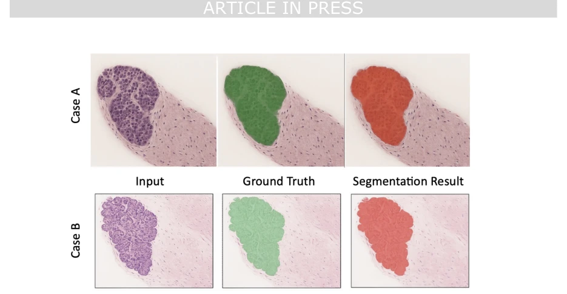
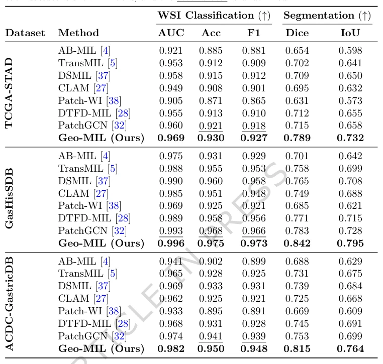

## Geometric multi-instance learning for weakly supervised gastric cancer segmentation

> data: TCGA-STAD、GasHisSDB、ACDC-GastricDB
>
> npj Digital Medicine 2026 · [论文](https://doi.org/10.1038/s41746-025-02287-6)

#### 引言

显式构建组织 patch 图，以拓扑注意力关注诊断相关组织结构，研究仅用切片标签实现胃癌区域分割的方法。

#### 方法

（1）空间构图：显式连接胃组织 patch。

（2）拓扑注意力：优先识别诊断相关组织结构而非孤立高分块。

（3）弱监督分割：结合切片分类和空间约束推断癌区掩码。

原文Fig. 4，PDF 第 14 页。

#### 实验

##### 实验设置

分别包含多中心胃癌切片、良恶性及腺癌细分任务；同时比较分割与切片分类。

##### 主要结果

主表报告三个数据集的定量比较，拓扑注意力的收益要同时看空间分割与分类结果。

原文Table 1，PDF 第 9 页。

##### 消融与讨论

分析图结构、拓扑注意力与分类/分割损失权重，明确数据规模及标注条件。

#### 参考文献

> Geometric multi-instance learning for weakly supervised gastric cancer segmentation
>
> npj Digital Medicine 2026 · [论文](https://doi.org/10.1038/s41746-025-02287-6)
