## Geometric multi-instance learning for weakly supervised gastric cancer segmentation

> data: TCGA-STAD、GasHisSDB、ACDC-GastricDB
>
> npj Digital Medicine 2026 · [论文](https://doi.org/10.1038/s41746-025-02287-6)

#### 引言

显式构建组织 patch 图，以拓扑注意力关注诊断相关组织结构，研究仅用切片标签实现胃癌区域分割的方法。

#### 方法

（1）空间构图：显式连接胃组织 patch。

（2）拓扑注意力：优先识别诊断相关组织结构而非孤立高分块。

（3）弱监督分割：结合切片分类和空间约束推断癌区掩码。

<!-- wsi-complete-model -->
##### 模型结构图

**图 12 · 模型结构**（PDF 第 24 页）

[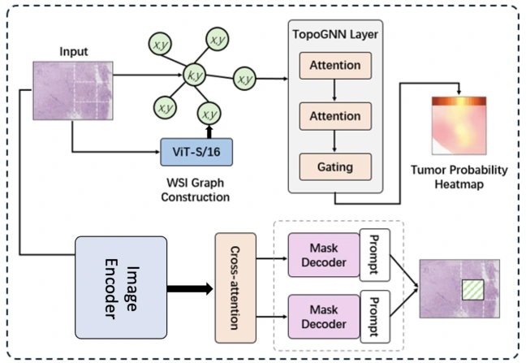](assest/Geo-MIL/figure-12-complete.webp)

> 原文图注：Fig. 12: Overview of the Geo-MIL framework and performance comparison. (Top-Left) The core Geo-MIL architecture, where WSI patches are encoded, formed into a graph, and processed by a TopoGNN layer to generate a tumor probability heatmap. (Middle-Left & Bottom-Left) Diagrams illustrating related concepts in segmentation and attention-based patch processing. (Right) Experimental results comparing Geo-MIL (Ours) against baseline methods on (a) inference speed (FPS) and (b) segmentation accuracy (Dice Score).

[查看原尺寸](assest/Geo-MIL/figure-12-complete.webp)

<!-- /wsi-complete-model -->

#### 实验

##### 实验设置

分别包含多中心胃癌切片、良恶性及腺癌细分任务；同时比较分割与切片分类。

##### 主要结果

主表报告三个数据集的定量比较，拓扑注意力的收益要同时看空间分割与分类结果。

<!-- wsi-complete-results -->
##### 完整实验指标与对照

下列实验原页保留表头、全部行列、子图、误差说明和脚注，点击可查看原尺寸。比较时请对应相同的数据集、特征编码器和训练设置；`±`、置信区间、百分比和小数均保留原文的单位与统计口径。

| 原表/图中指标 | 读取方式 |
| --- | --- |
| ROC-AUC / AUROC | 越高越好；若原表明确为 PR-AUC，则按 PR 曲线面积读取 |
| ACC / Accuracy | 越高越好；平衡准确率、平均准确率以原表标注为准 |
| F1 | 越高越好；保留 macro / weighted / micro 等平均方式 |
| Recall / Sensitivity | 越高越好；与固定敏感度下的特异度区别读取 |
| Dice / IoU | 越高越好；区分像素/实例分割与切片分类 |
| 时间 / FLOPs / 参数量 | 结合硬件、包长度和计时范围比较；小模型不一定推理更快 |

| 原文页 | 阅读内容 | 图表及正文引用 |
| --- | --- | --- |
| PDF 第 9 页 | 实验结果 | Table 1 |
| PDF 第 10 页 | 消融与参数分析 | Table 2 |
| PDF 第 12 页 | 消融与参数分析 | Table 3 |
| PDF 第 14 页 | 实验结果 | Figure 4 |
| PDF 第 15 页 | 实验结果 | Figure 5 |
| PDF 第 16 页 | 实验结果 | Figure 6 |
| PDF 第 17 页 | 实验结果 | Figure 7、Table 4 |
| PDF 第 18 页 | 实验结果 | Figure 8 |
| PDF 第 19 页 | 消融与参数分析 | Figure 9、Figure 10 |
| PDF 第 20 页 | 实验结果 | Table 5、Table 6、Table 7 |

**实验原页 · PDF 第 9 页**（图表及正文引用：Table 1）

[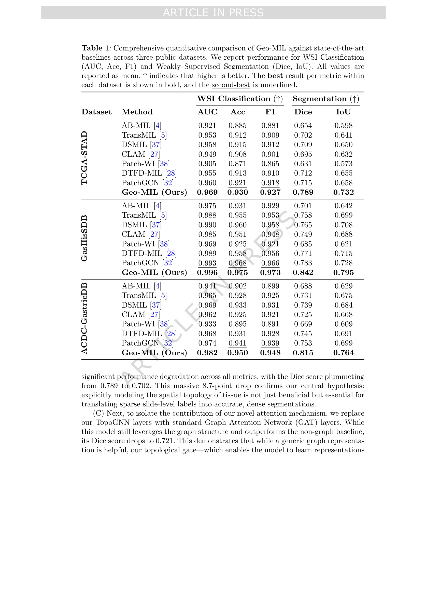](assest/Geo-MIL/experiment-page-09.webp)

[查看原尺寸](assest/Geo-MIL/experiment-page-09.webp)

**实验原页 · PDF 第 14 页**（图表及正文引用：Figure 4）

[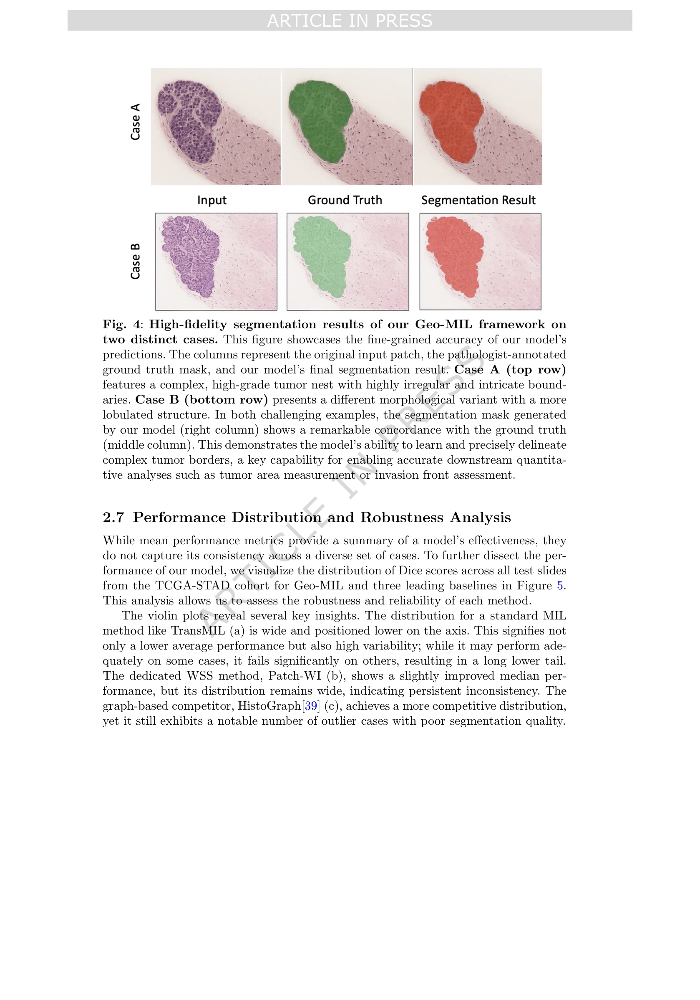](assest/Geo-MIL/experiment-page-14.webp)

[查看原尺寸](assest/Geo-MIL/experiment-page-14.webp)

**实验原页 · PDF 第 15 页**（图表及正文引用：Figure 5）

[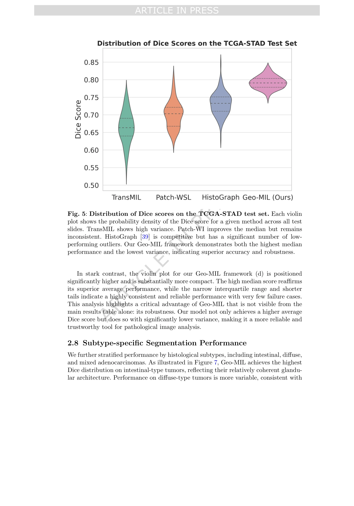](assest/Geo-MIL/experiment-page-15.webp)

[查看原尺寸](assest/Geo-MIL/experiment-page-15.webp)

**实验原页 · PDF 第 16 页**（图表及正文引用：Figure 6）

[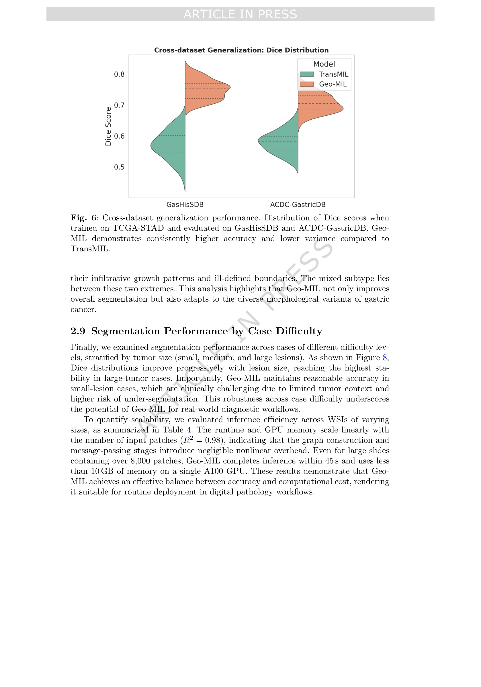](assest/Geo-MIL/experiment-page-16.webp)

[查看原尺寸](assest/Geo-MIL/experiment-page-16.webp)

**实验原页 · PDF 第 17 页**（图表及正文引用：Figure 7、Table 4）

[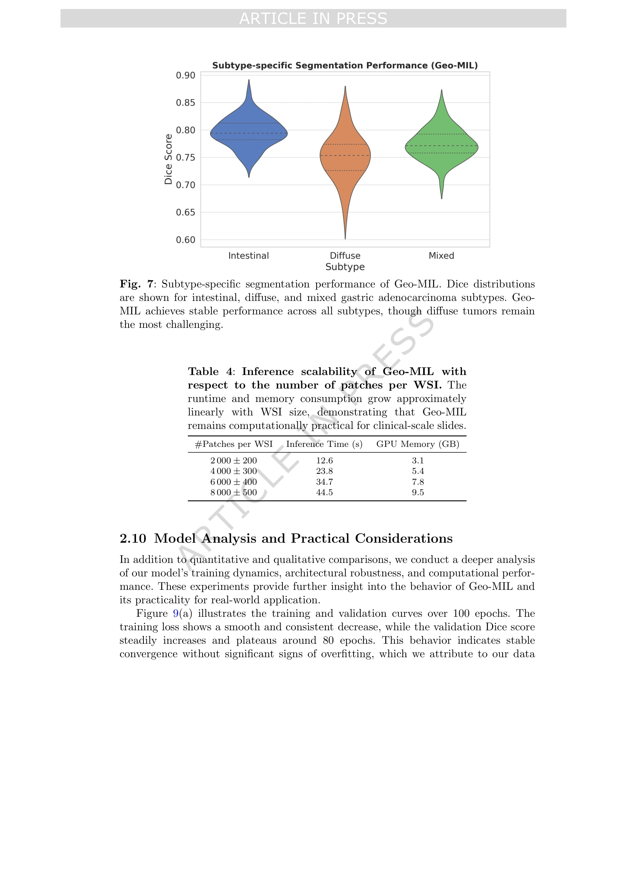](assest/Geo-MIL/experiment-page-17.webp)

[查看原尺寸](assest/Geo-MIL/experiment-page-17.webp)

**实验原页 · PDF 第 18 页**（图表及正文引用：Figure 8）

[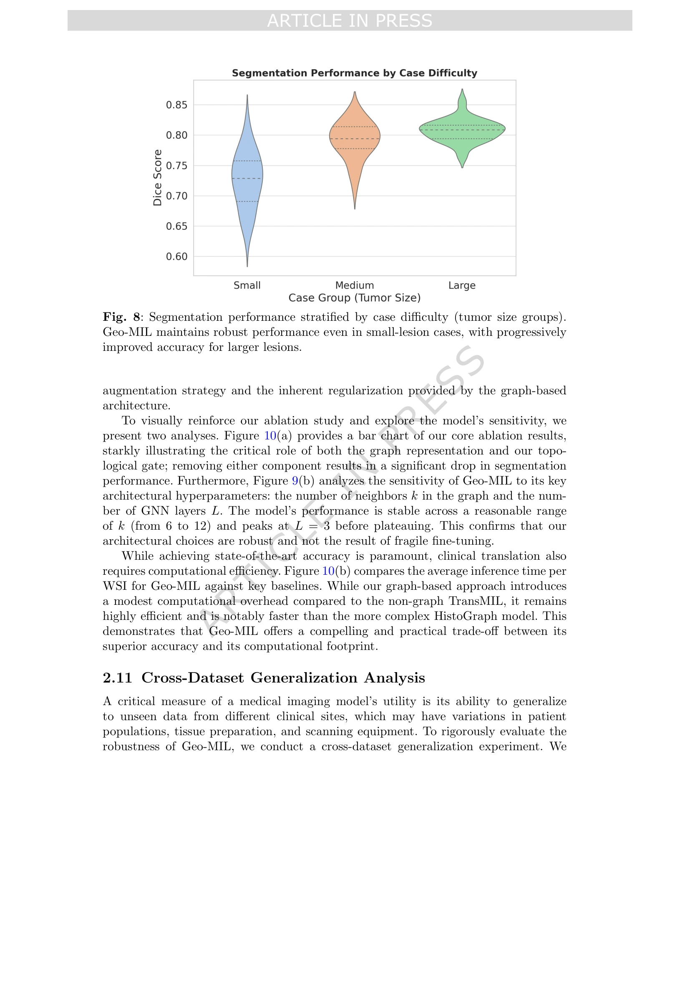](assest/Geo-MIL/experiment-page-18.webp)

[查看原尺寸](assest/Geo-MIL/experiment-page-18.webp)

**实验原页 · PDF 第 20 页**（图表及正文引用：Table 5、Table 6、Table 7）

[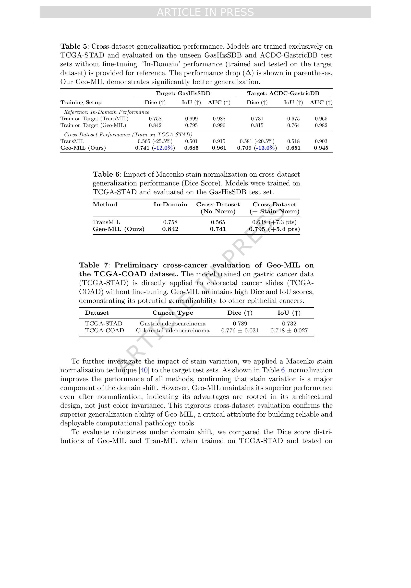](assest/Geo-MIL/experiment-page-20.webp)

[查看原尺寸](assest/Geo-MIL/experiment-page-20.webp)

展开消融、参数、数据设置及效率原页

**实验原页 · PDF 第 10 页**（图表及正文引用：Table 2）

[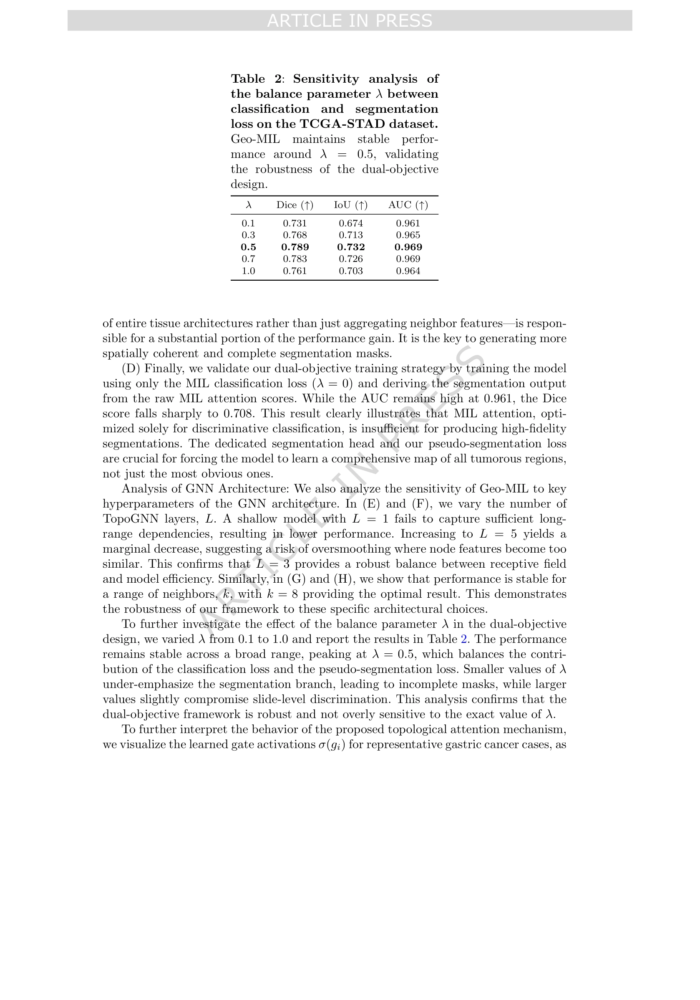](assest/Geo-MIL/experiment-page-10.webp)

[查看原尺寸](assest/Geo-MIL/experiment-page-10.webp)

**实验原页 · PDF 第 12 页**（图表及正文引用：Table 3）

[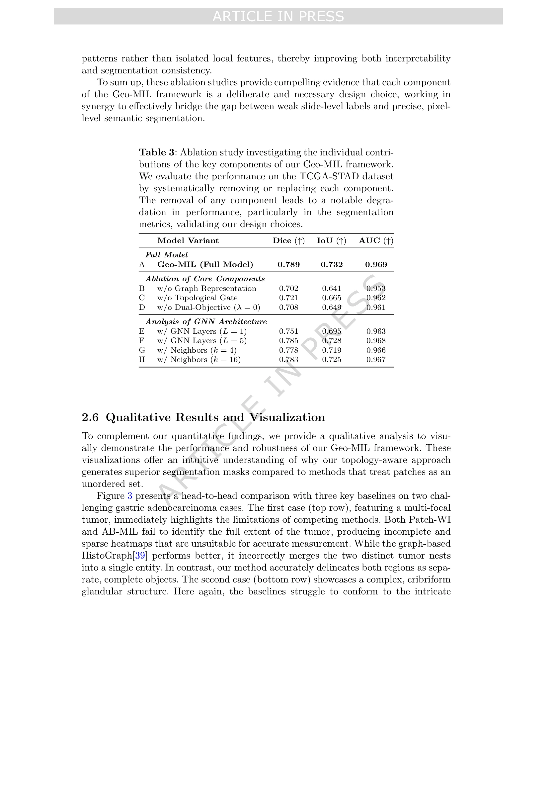](assest/Geo-MIL/experiment-page-12.webp)

[查看原尺寸](assest/Geo-MIL/experiment-page-12.webp)

**实验原页 · PDF 第 19 页**（图表及正文引用：Figure 9、Figure 10）

[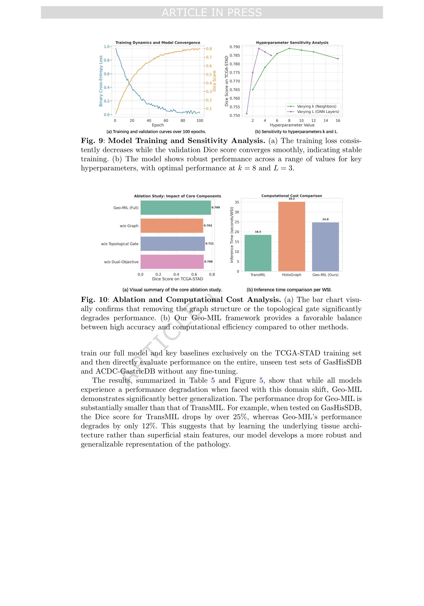](assest/Geo-MIL/experiment-page-19.webp)

[查看原尺寸](assest/Geo-MIL/experiment-page-19.webp)

<!-- /wsi-complete-results -->

##### 消融与讨论

分析图结构、拓扑注意力与分类/分割损失权重，明确数据规模及标注条件。

#### 参考文献

> Geometric multi-instance learning for weakly supervised gastric cancer segmentation
>
> npj Digital Medicine 2026 · [论文](https://doi.org/10.1038/s41746-025-02287-6)
