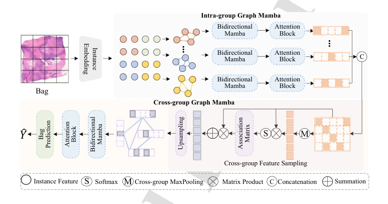
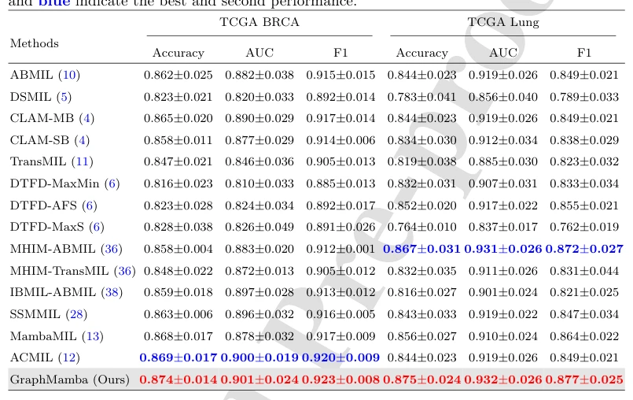

## GraphMamba: Whole slide image classification meets graph-driven selective state space model

> data: TCGA-BRCA、TCGA-Lung、TCGA-ESCA、BRACS
>
> Pattern Recognition 2025 · [论文](https://doi.org/10.1016/j.patcog.2025.111768)

#### 引言

将组内、组间图建模与选择性状态空间模型结合，通过跨组特征采样同时学习局部组织结构和长程关系。

#### 方法

（1）组内图 Mamba：联合局部组织拓扑与序列关系。

（2）跨组采样：提取判别特征以减少冗余。

（3）组间图 Mamba：进一步连接不同组织组，构造完整切片表示。

原文Figure 1，PDF 第 6 页。

#### 实验

##### 实验设置

比较注意力、图与 Mamba 模型，分别报告分类主表及跨组信息消融。

##### 主要结果

主表展示图驱动扫描与跨组采样的组合效果；需区分仅组内建模和跨组全局表示。

原文Table 1，PDF 第 21 页。

##### 消融与讨论

考察组内图 Mamba、跨组采样与组间图 Mamba，同时检查效率与参数量。

#### 参考文献

> GraphMamba: Whole slide image classification meets graph-driven selective state space model
>
> Pattern Recognition 2025 · [论文](https://doi.org/10.1016/j.patcog.2025.111768)
