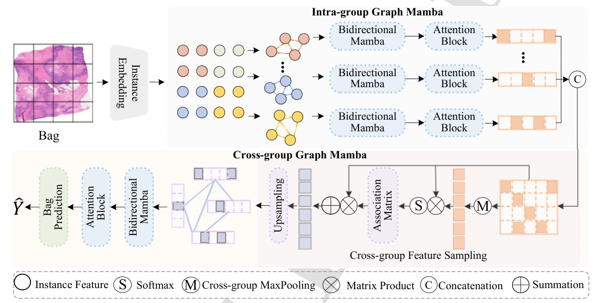
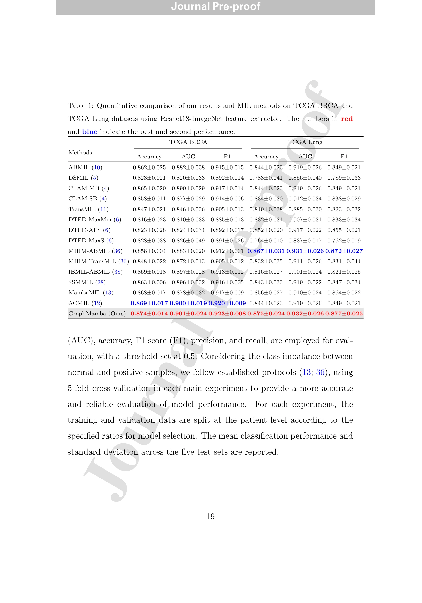
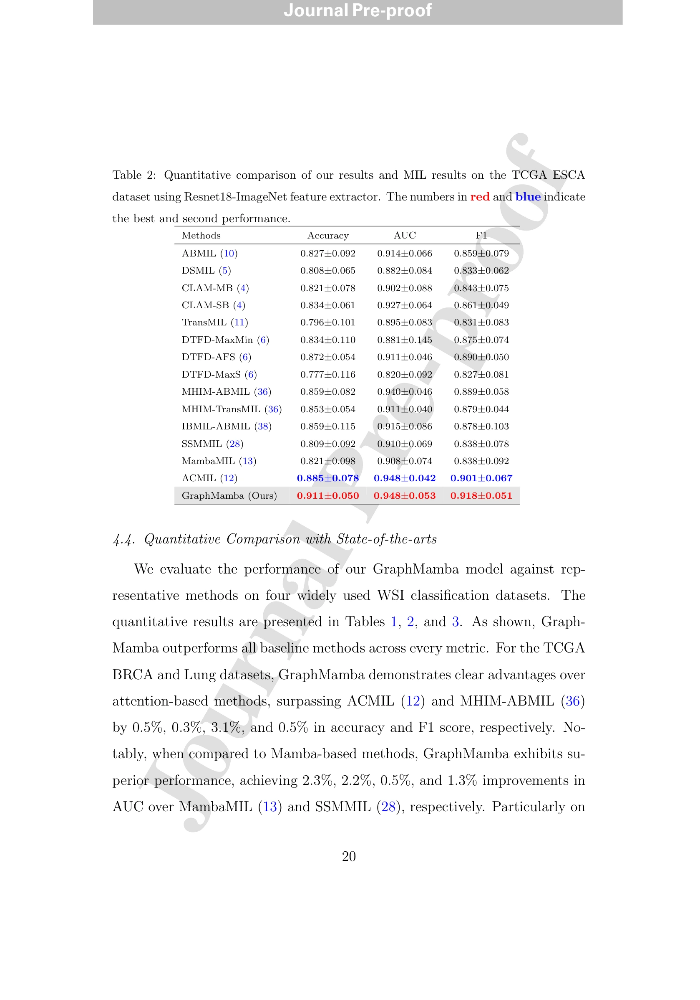
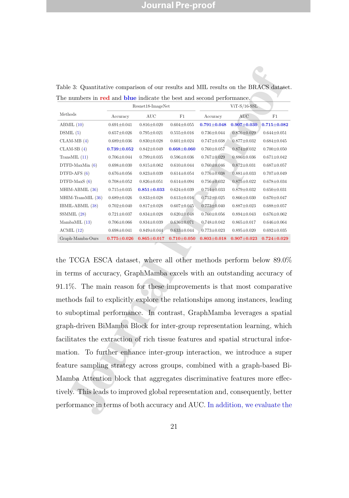
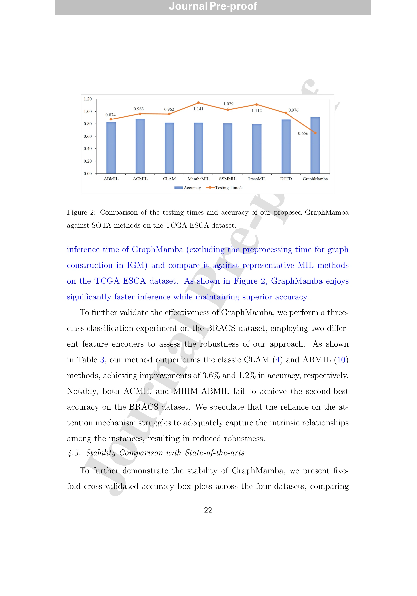
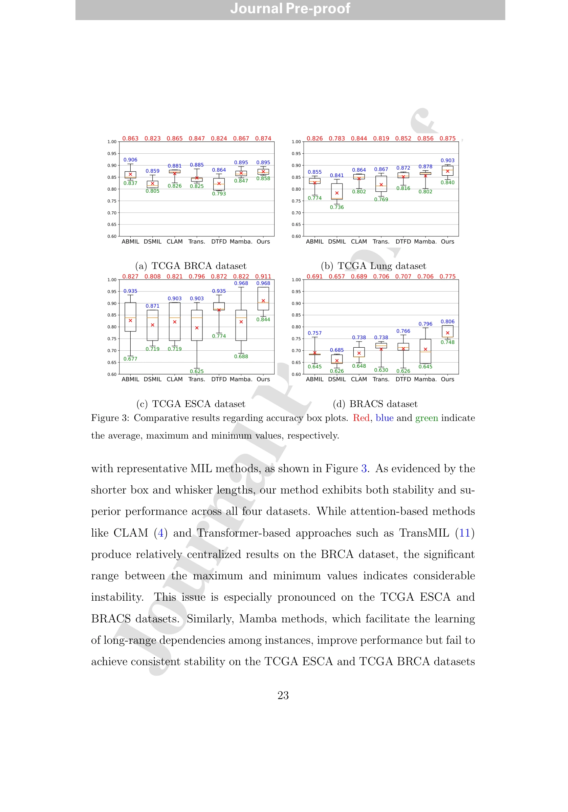
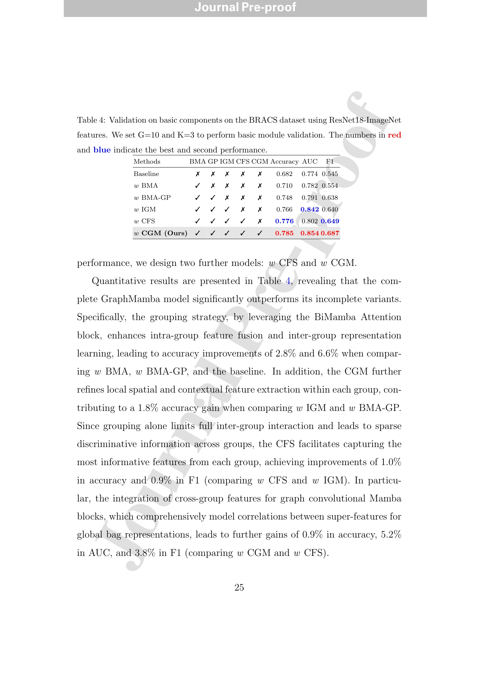
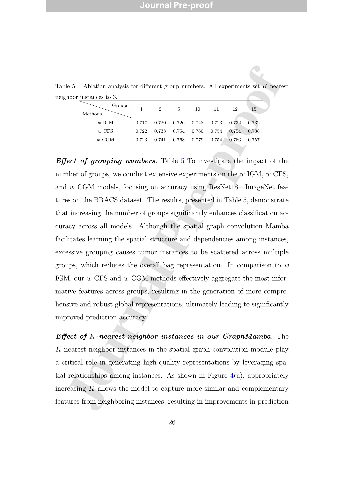

## GraphMamba: Whole slide image classification meets graph-driven selective state space model

> data: TCGA-BRCA、TCGA-Lung、TCGA-ESCA、BRACS
>
> Pattern Recognition 2025 · [论文](https://doi.org/10.1016/j.patcog.2025.111768)

#### 引言

将组内、组间图建模与选择性状态空间模型结合，通过跨组特征采样同时学习局部组织结构和长程关系。

#### 方法

（1）组内图 Mamba：联合局部组织拓扑与序列关系。

（2）跨组采样：提取判别特征以减少冗余。

（3）组间图 Mamba：进一步连接不同组织组，构造完整切片表示。

<!-- wsi-complete-model -->
##### 模型结构图

**图 1 · 模型结构**（PDF 第 6 页）

> 原文图注：Figure 1: The architecture of our proposed graph-driven selective state space model

[查看原尺寸](assest/GraphMamba/figure-1-complete.webp)

<!-- /wsi-complete-model -->

#### 实验

##### 实验设置

比较注意力、图与 Mamba 模型，分别报告分类主表及跨组信息消融。

##### 主要结果

主表展示图驱动扫描与跨组采样的组合效果；需区分仅组内建模和跨组全局表示。

<!-- wsi-complete-results -->
##### 完整实验指标与对照

下列实验原页保留表头、全部行列、子图、误差说明和脚注，点击可查看原尺寸。比较时请对应相同的数据集、特征编码器和训练设置；`±`、置信区间、百分比和小数均保留原文的单位与统计口径。

| 原表/图中指标 | 读取方式 |
| --- | --- |
| ACC / Accuracy | 越高越好；平衡准确率、平均准确率以原表标注为准 |
| 时间 / FLOPs / 参数量 | 结合硬件、包长度和计时范围比较；小模型不一定推理更快 |

| 原文页 | 阅读内容 | 图表及正文引用 |
| --- | --- | --- |
| PDF 第 21 页 | 实验结果 | Table 1 |
| PDF 第 22 页 | 实验结果 | Table 2 |
| PDF 第 23 页 | 实验结果 | Table 3 |
| PDF 第 24 页 | 实验结果 | Figure 2 |
| PDF 第 25 页 | 实验结果 | Figure 3 |
| PDF 第 27 页 | 消融与参数分析 | Table 4 |
| PDF 第 28 页 | 消融与参数分析 | Table 5 |

**实验原页 · PDF 第 21 页**（图表及正文引用：Table 1）

[查看原尺寸](assest/GraphMamba/experiment-page-21.webp)

**实验原页 · PDF 第 22 页**（图表及正文引用：Table 2）

[查看原尺寸](assest/GraphMamba/experiment-page-22.webp)

**实验原页 · PDF 第 23 页**（图表及正文引用：Table 3）

[查看原尺寸](assest/GraphMamba/experiment-page-23.webp)

**实验原页 · PDF 第 24 页**（图表及正文引用：Figure 2）

[查看原尺寸](assest/GraphMamba/experiment-page-24.webp)

**实验原页 · PDF 第 25 页**（图表及正文引用：Figure 3）

[查看原尺寸](assest/GraphMamba/experiment-page-25.webp)

展开消融、参数、数据设置及效率原页

**实验原页 · PDF 第 27 页**（图表及正文引用：Table 4）

[查看原尺寸](assest/GraphMamba/experiment-page-27.webp)

**实验原页 · PDF 第 28 页**（图表及正文引用：Table 5）

[查看原尺寸](assest/GraphMamba/experiment-page-28.webp)

<!-- /wsi-complete-results -->

##### 消融与讨论

考察组内图 Mamba、跨组采样与组间图 Mamba，同时检查效率与参数量。

#### 参考文献

> GraphMamba: Whole slide image classification meets graph-driven selective state space model
>
> Pattern Recognition 2025 · [论文](https://doi.org/10.1016/j.patcog.2025.111768)
