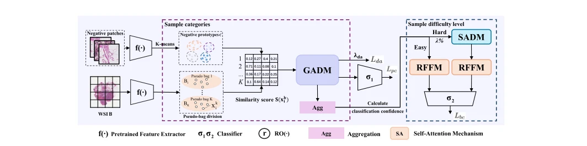
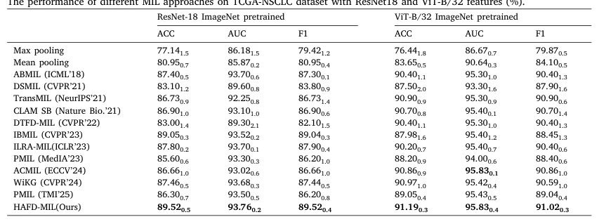

## Improving multi-instance learning with hierarchical attention and frequency-domain hard sample distillation

> data: CAMELYON16、TCGA-NSCLC
>
> Knowledge-Based Systems 2026 · [论文](https://doi.org/10.1016/j.knosys.2026.116286)

#### 引言

以负实例原型划分实例类别，联合分级注意力蒸馏、动态标签注意力损失和频谱困难样本蒸馏，减轻注意力集中及冗余干扰。

#### 方法

（1）分级实例：依据负类原型区分趋阳、趋阴和弱阴性。

（2）频谱蒸馏：从困难实例中保留被普通注意力忽视的信号。

（3）冗余过滤：控制无关特征及注意力集中，联合训练多个目标。

原文Fig. 1，PDF 第 4 页。

#### 实验

##### 实验设置

C16 训练/验证为 9:1，比较三个特征 backbone，另考察冗余过滤噪声分布。

##### 主要结果

ResNet18 特征下 C16 的 ACC/AUC/F1 相对次优增益为 2.58/2.23/2.01 个百分点。

原文Table 1，PDF 第 7 页。

##### 消融与讨论

消融分级注意力、频谱蒸馏及冗余特征过滤；改变噪声分布时均匀分布配置更好，需保留这一条件。

#### 参考文献

> Improving multi-instance learning with hierarchical attention and frequency-domain hard sample distillation
>
> Knowledge-Based Systems 2026 · [论文](https://doi.org/10.1016/j.knosys.2026.116286)
