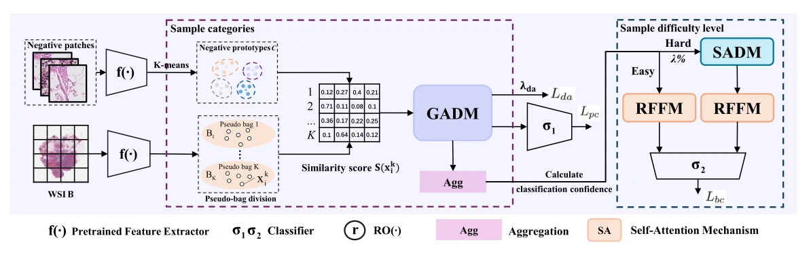
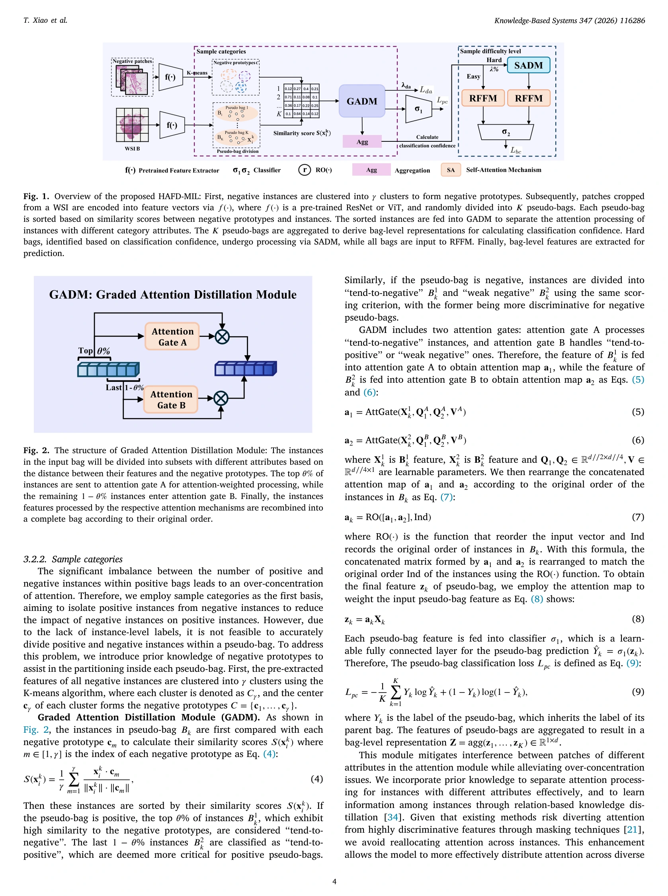
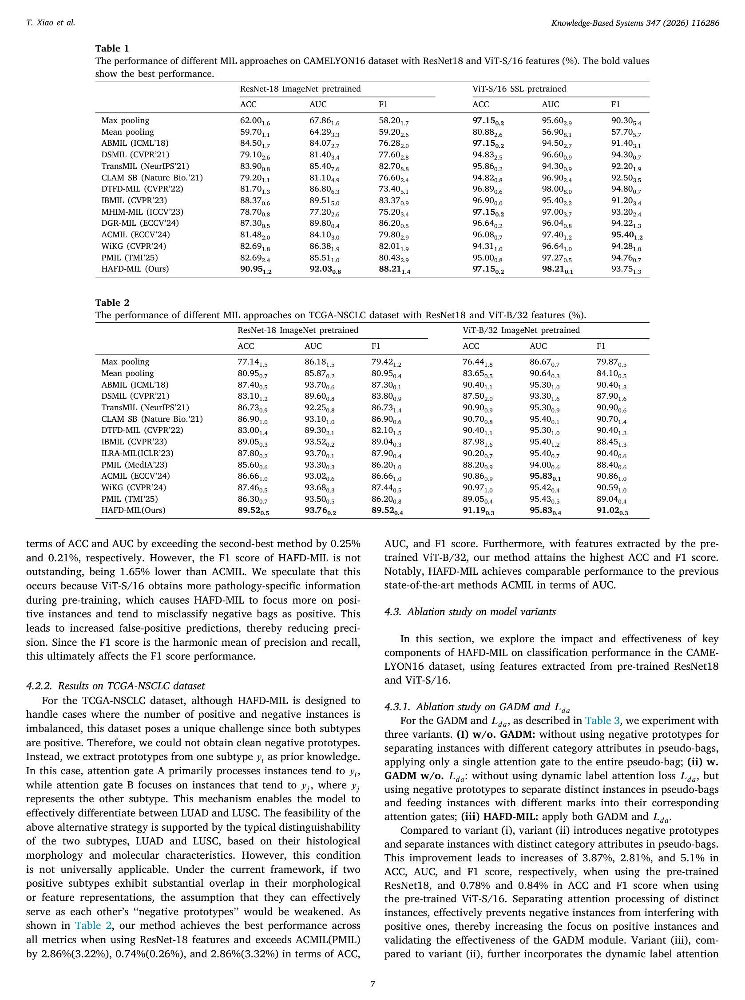
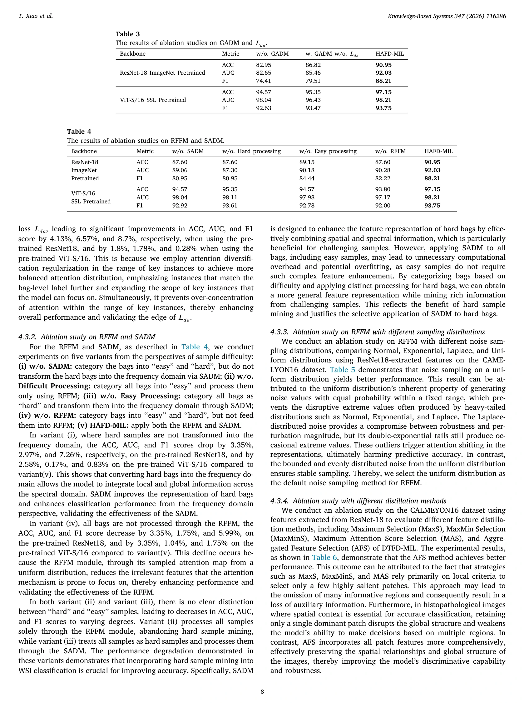
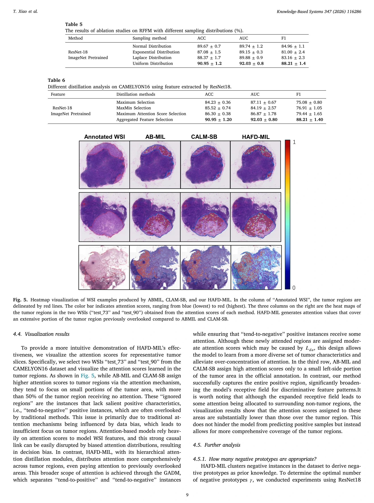
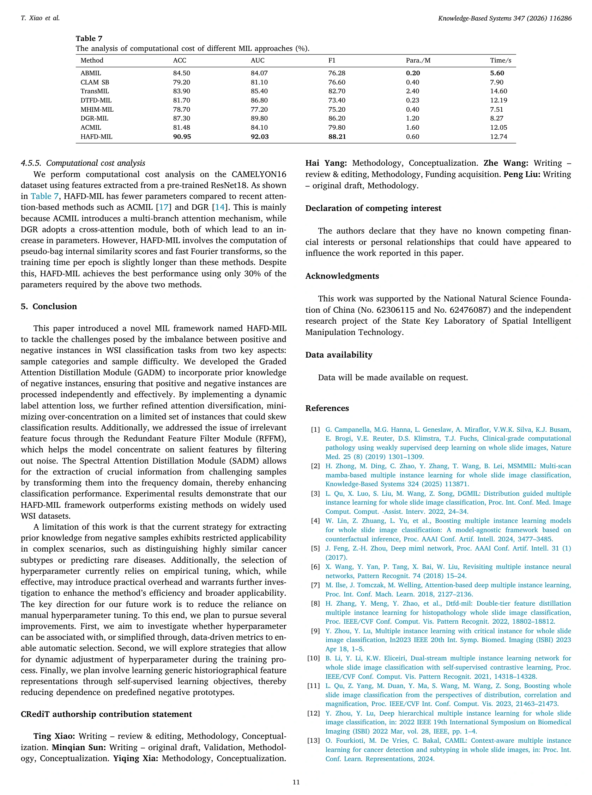

## Improving multi-instance learning with hierarchical attention and frequency-domain hard sample distillation

> data: CAMELYON16、TCGA-NSCLC
>
> Knowledge-Based Systems 2026 · [论文](https://doi.org/10.1016/j.knosys.2026.116286)

#### 引言

以负实例原型划分实例类别，联合分级注意力蒸馏、动态标签注意力损失和频谱困难样本蒸馏，减轻注意力集中及冗余干扰。

#### 方法

（1）分级实例：依据负类原型区分趋阳、趋阴和弱阴性。

（2）频谱蒸馏：从困难实例中保留被普通注意力忽视的信号。

（3）冗余过滤：控制无关特征及注意力集中，联合训练多个目标。

<!-- wsi-complete-model -->
##### 模型结构图

**图 1 · 模型结构**（PDF 第 4 页）

> 原文图注：Fig. 1. Overview of the proposed HAFD-MIL: First, negative instances are clustered into 𝛾 clusters to form negative prototypes. Subsequently, patches cropped from a WSI are encoded into feature vectors via 𝑓(⋅), where 𝑓(⋅) is a pre-trained ResNet or ViT, and randomly divided into 𝐾 pseudo-bags. Each pseudo-bag is sorted based on similarity scores between negative prototypes and instances. The sorted instances are fed into GADM to separate the attention processing of instances with different category attributes. The 𝐾 pseudo-bags are aggregated to derive bag-level representations for calculating classification confidence. Hard bags, identified based on classification confidence, undergo processing via SADM, while all bags are input to RFFM. Finally, bag-level features are extracted for

[查看原尺寸](assest/HAFD-MIL/figure-1-complete.webp)

<!-- /wsi-complete-model -->

#### 实验

##### 实验设置

C16 训练/验证为 9:1，比较三个特征 backbone，另考察冗余过滤噪声分布。

##### 主要结果

ResNet18 特征下 C16 的 ACC/AUC/F1 相对次优增益为 2.58/2.23/2.01 个百分点。

<!-- wsi-complete-results -->
##### 完整实验指标与对照

下列实验原页保留表头、全部行列、子图、误差说明和脚注，点击可查看原尺寸。比较时请对应相同的数据集、特征编码器和训练设置；`±`、置信区间、百分比和小数均保留原文的单位与统计口径。

| 原表/图中指标 | 读取方式 |
| --- | --- |
| ROC-AUC / AUROC | 越高越好；若原表明确为 PR-AUC，则按 PR 曲线面积读取 |
| ACC / Accuracy | 越高越好；平衡准确率、平均准确率以原表标注为准 |
| F1 | 越高越好；保留 macro / weighted / micro 等平均方式 |

| 原文页 | 阅读内容 | 图表及正文引用 |
| --- | --- | --- |
| PDF 第 4 页 | 实验结果 | Figure 2 |
| PDF 第 7 页 | 实验结果 | Table 1、Table 2 |
| PDF 第 8 页 | 消融与参数分析 | Table 3、Table 4 |
| PDF 第 9 页 | 消融与参数分析 | Table 5、Table 6 |
| PDF 第 11 页 | 效率与开销 | Table 7 |

**实验原页 · PDF 第 4 页**（图表及正文引用：Figure 2）

[查看原尺寸](assest/HAFD-MIL/experiment-page-04.webp)

**实验原页 · PDF 第 7 页**（图表及正文引用：Table 1、Table 2）

[查看原尺寸](assest/HAFD-MIL/experiment-page-07.webp)

展开消融、参数、数据设置及效率原页

**实验原页 · PDF 第 8 页**（图表及正文引用：Table 3、Table 4）

[查看原尺寸](assest/HAFD-MIL/experiment-page-08.webp)

**实验原页 · PDF 第 9 页**（图表及正文引用：Table 5、Table 6）

[查看原尺寸](assest/HAFD-MIL/experiment-page-09.webp)

**实验原页 · PDF 第 11 页**（图表及正文引用：Table 7）

[查看原尺寸](assest/HAFD-MIL/experiment-page-11.webp)

<!-- /wsi-complete-results -->

##### 消融与讨论

消融分级注意力、频谱蒸馏及冗余特征过滤；改变噪声分布时均匀分布配置更好，需保留这一条件。

#### 参考文献

> Improving multi-instance learning with hierarchical attention and frequency-domain hard sample distillation
>
> Knowledge-Based Systems 2026 · [论文](https://doi.org/10.1016/j.knosys.2026.116286)
