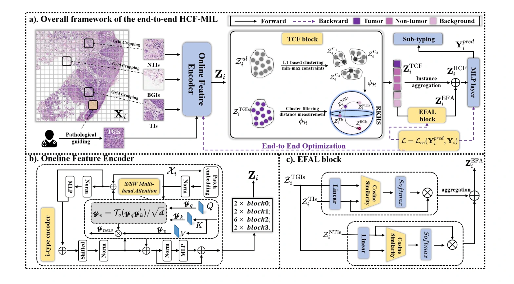
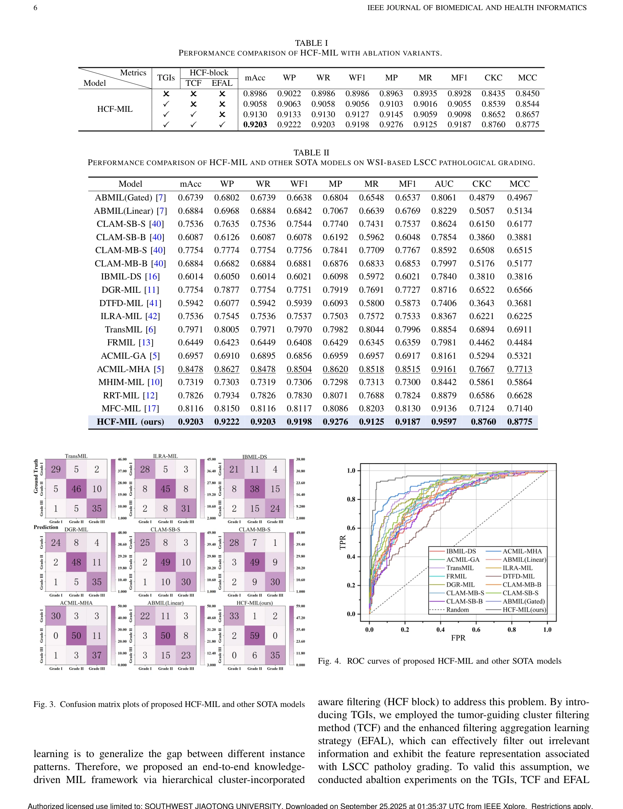
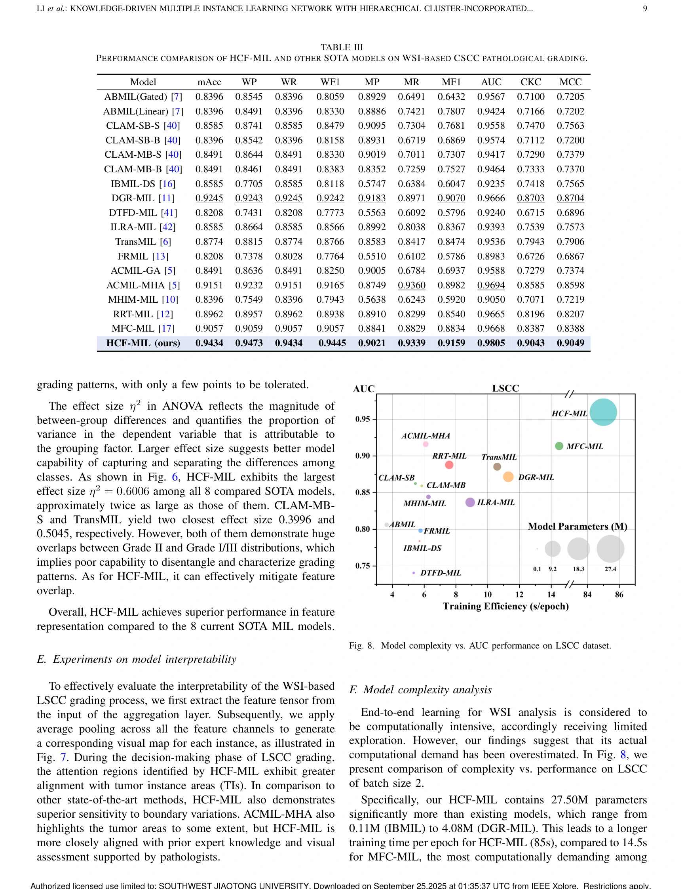
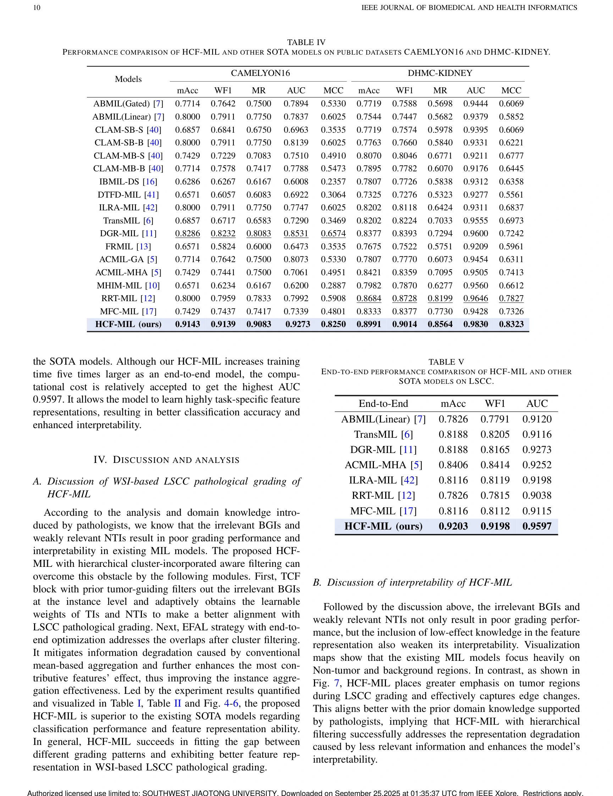

## Knowledge-driven Multiple Instance Learning with Hierarchical Cluster-incorporated Aware Filtering for Larynx Pathological Grading

> data: 内部 LSCC 342 张、CSCC 262 张及对应肿瘤引导图像
>
> IEEE Journal of Biomedical and Health Informatics 2026 · [论文](https://doi.org/10.1109/JBHI.2025.3609838) · [作者代码](https://github.com/Prince-Lee-PathAI/HCF-MIL)

#### 引言

针对喉鳞癌分级，利用肿瘤先验进行分层聚类过滤，再以增强过滤聚合突出代表性实例，提高分级表征的针对性。

#### 方法

（1）肿瘤引导：借助病理先验区分与分级相关、无关的实例。

（2）聚类过滤：减少背景和弱相关非肿瘤信息。

（3）增强聚合：加强代表性个体与分层肿瘤表征，完成端到端分级。

<!-- wsi-complete-model -->
##### 模型结构图

**图 2 · 模型结构**（PDF 第 3 页）

> 原文图注：Fig. 2. Overall flowchart of proposed end-to-end HCF-MIL, where TIs, NTIs, BGIs are for tumor instances, non-tumor instances and background instances, respectively. Xi, Yi denote the WSI and its corresponding bag label. ϕH in TCF block denotes the mapping from Euclidean space to reproducing kernel Hilbert space (RKHS).

[查看原尺寸](assest/HCF-MIL/figure-2-complete.webp)

<!-- /wsi-complete-model -->

#### 实验

##### 实验设置

内部数据按类别 6:4 划分训练/测试；端到端训练 100 epochs，主要使用 Rmsprop。

##### 主要结果

与 17 种 MIL 比较，喉癌分级的 mAcc、宏/加权 F1、AUC 等均有改进；各指标的提升需按原表对应。

<!-- wsi-complete-results -->
##### 完整实验指标与对照

下列实验原页保留表头、全部行列、子图、误差说明和脚注，点击可查看原尺寸。比较时请对应相同的数据集、特征编码器和训练设置；`±`、置信区间、百分比和小数均保留原文的单位与统计口径。

| 原表/图中指标 | 读取方式 |
| --- | --- |
| ROC-AUC / AUROC | 越高越好；若原表明确为 PR-AUC，则按 PR 曲线面积读取 |
| F1 | 越高越好；保留 macro / weighted / micro 等平均方式 |

| 原文页 | 阅读内容 | 图表及正文引用 |
| --- | --- | --- |
| PDF 第 6 页 | 实验结果 | Table I、Table II、Figure 4 |
| PDF 第 9 页 | 实验结果 | Table III、Figure 8 |
| PDF 第 10 页 | 实验结果 | Table IV、Table V |

**实验原页 · PDF 第 6 页**（图表及正文引用：Table I、Table II、Figure 4）

[查看原尺寸](assest/HCF-MIL/experiment-page-06.webp)

**实验原页 · PDF 第 9 页**（图表及正文引用：Table III、Figure 8）

[查看原尺寸](assest/HCF-MIL/experiment-page-09.webp)

**实验原页 · PDF 第 10 页**（图表及正文引用：Table IV、Table V）

[查看原尺寸](assest/HCF-MIL/experiment-page-10.webp)

<!-- /wsi-complete-results -->

##### 消融与讨论

检查肿瘤引导聚类过滤与增强聚合；该方法依赖肿瘤引导信息，不能当作完全相同标注条件下的无先验聚合器。

#### 参考文献

> Knowledge-driven Multiple Instance Learning with Hierarchical Cluster-incorporated Aware Filtering for Larynx Pathological Grading
>
> IEEE Journal of Biomedical and Health Informatics 2026 · [论文](https://doi.org/10.1109/JBHI.2025.3609838) · [作者代码](https://github.com/Prince-Lee-PathAI/HCF-MIL)
