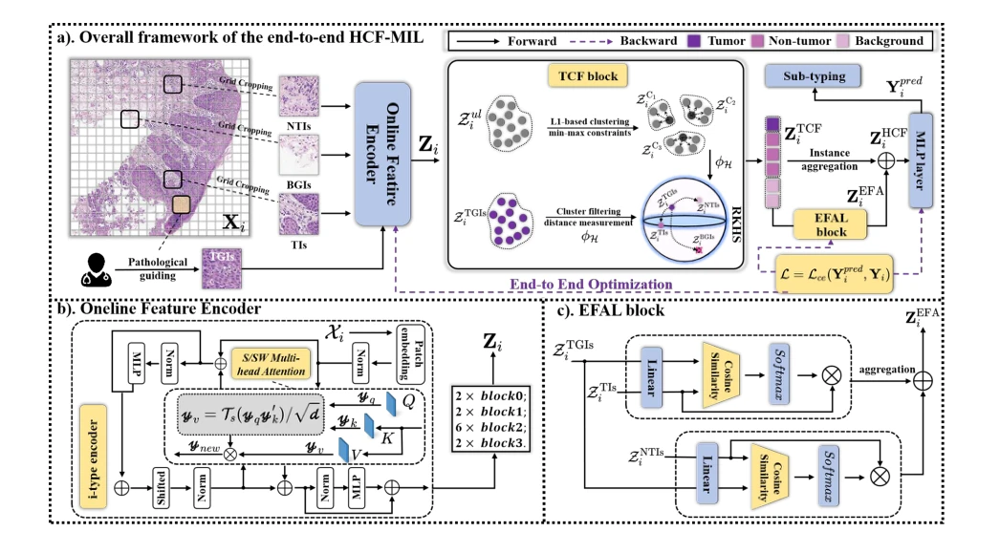
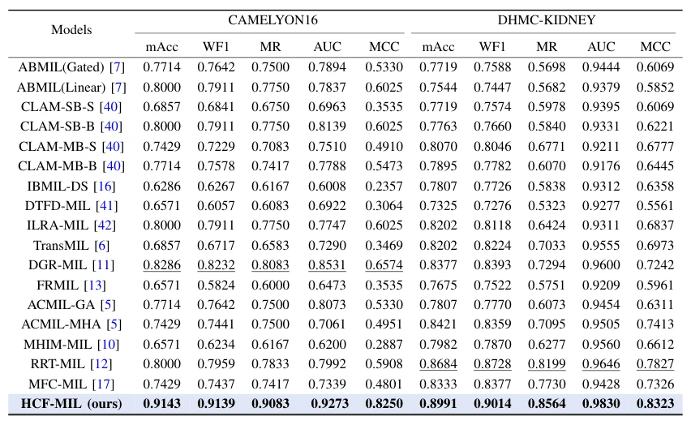

## Knowledge-driven Multiple Instance Learning with Hierarchical Cluster-incorporated Aware Filtering for Larynx Pathological Grading

> data: 内部 LSCC 342 张、CSCC 262 张及对应肿瘤引导图像
>
> IEEE Journal of Biomedical and Health Informatics 2026 · [论文](https://doi.org/10.1109/JBHI.2025.3609838) · [作者代码](https://github.com/Prince-Lee-PathAI/HCF-MIL)

#### 引言

针对喉鳞癌分级，利用肿瘤先验进行分层聚类过滤，再以增强过滤聚合突出代表性实例，提高分级表征的针对性。

#### 方法

（1）肿瘤引导：借助病理先验区分与分级相关、无关的实例。

（2）聚类过滤：减少背景和弱相关非肿瘤信息。

（3）增强聚合：加强代表性个体与分层肿瘤表征，完成端到端分级。

原文Fig. 2，PDF 第 3 页。

#### 实验

##### 实验设置

内部数据按类别 6:4 划分训练/测试；端到端训练 100 epochs，主要使用 Rmsprop。

##### 主要结果

与 17 种 MIL 比较，喉癌分级的 mAcc、宏/加权 F1、AUC 等均有改进；各指标的提升需按原表对应。

原文TABLE IV，PDF 第 10 页。

##### 消融与讨论

检查肿瘤引导聚类过滤与增强聚合；该方法依赖肿瘤引导信息，不能当作完全相同标注条件下的无先验聚合器。

#### 参考文献

> Knowledge-driven Multiple Instance Learning with Hierarchical Cluster-incorporated Aware Filtering for Larynx Pathological Grading
>
> IEEE Journal of Biomedical and Health Informatics 2026 · [论文](https://doi.org/10.1109/JBHI.2025.3609838) · [作者代码](https://github.com/Prince-Lee-PathAI/HCF-MIL)
