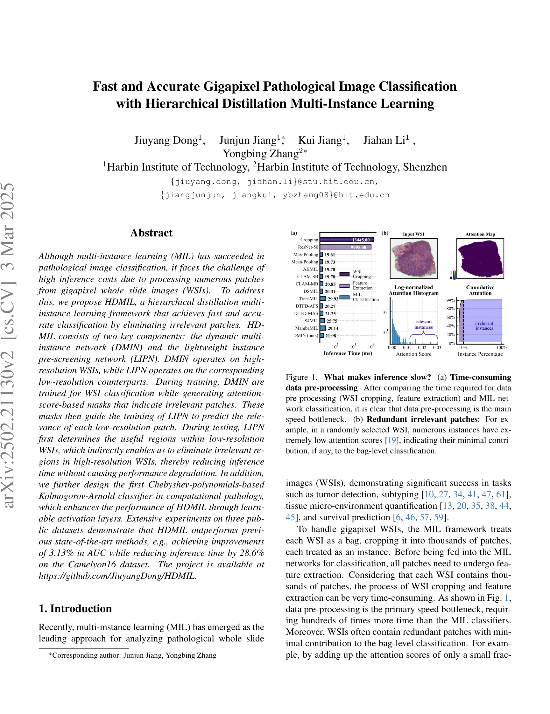
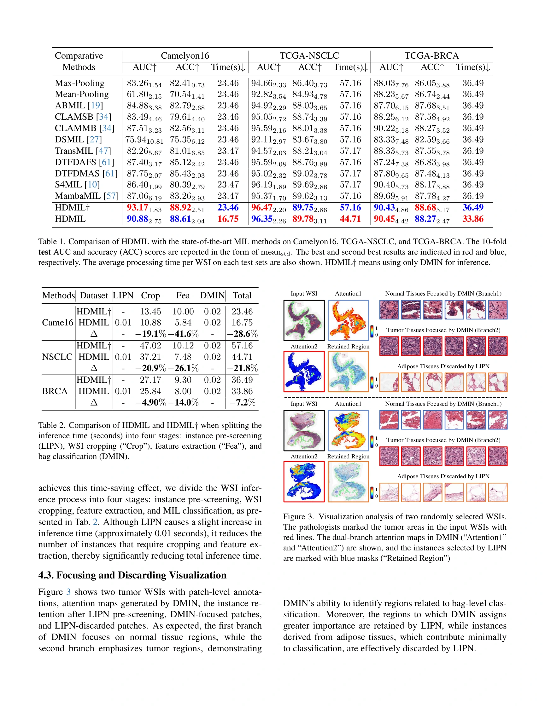
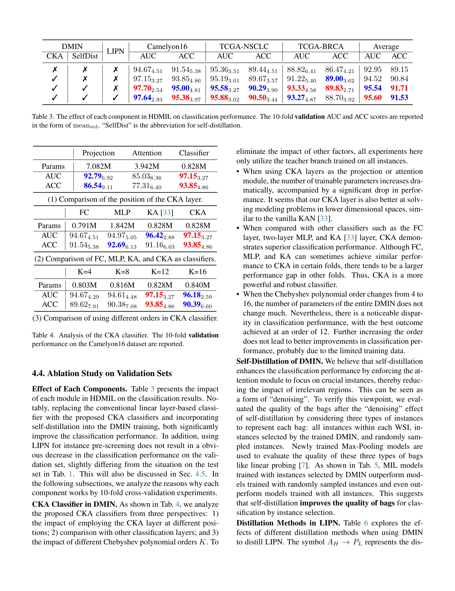
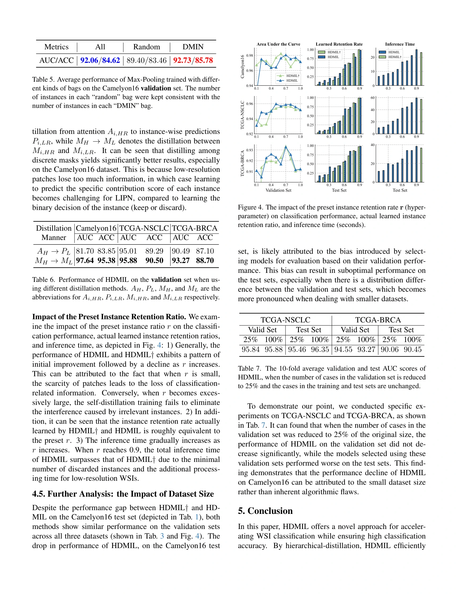

## Fast and Accurate Gigapixel Pathological Image Classification with Hierarchical Distillation Multi-Instance Learning

> data:
>
> **CAMELYON16**
>
>  **TCGA-NSCLC**
>
>  **TCGA-BRCA**
>
> code: [Github]( https://github.com/JiuyangDong/HDMIL)

#### 方法

#### 结果

> 参考文献
>
> Dong, Jiuyang et al. “Fast and Accurate Gigapixel Pathological Image Classification with Hierarchical Distillation Multi-Instance Learning.” *ArXiv* abs/2502.21130 (2025): n. pag.
<!-- wsi-archive-enrichment -->

#### 论文信息与实验补充

> data: CAMELYON16、TCGA-NSCLC、TCGA-BRCA
>
> CVPR 2025 · [论文](https://arxiv.org/abs/2502.21130) · [作者代码](https://github.com/JiuyangDong/HDMIL)

##### 方法补充

（1）DMIN：高倍率动态 MIL 产生分类与相关区域信号。

（2）LIPN：学习低倍率区域是否值得进行高倍率编码，提前过滤无关 patch。

（3）CKA：用 Chebyshev 多项式构建可学习分类函数，增强最终决策。

<!-- wsi-complete-model -->
##### 模型结构图

**图 2 · 模型结构**（PDF 第 4 页）

> 原文图注：Figure 2. Overview of our HDMIL framework. (a) During training, we start by utilize the high-resolution WSI Xi,HR for self-distillation of DMIN, enabling it to classify Xi,HR and generate per-instance mask Mi,HR which indicates the relevance of each region to the bag- level classification. Afterwards we froze DMIN and employ the masks Mi,HR to distill LIPN, which learns the contribution of each region using the low-resolution Xi,LR. (b) During inference, the LIPN can identify which patches within Xi,HR need to be used for classification by evaluating Xi,LR. (c) The self-distillation training of DMIN on the high-resolution Xi,HR.

[查看原尺寸](assest/HDMIL/figure-2-complete.webp)

<!-- /wsi-complete-model -->

##### 实验设置

十次 Monte Carlo 评估；C16 保留官方测试集，TCGA 按病例 8:1:1 划分，另拆分四个推理阶段计时。

##### 主要结果补充

HDMIL† 只运行 DMIN，HDMIL 先用 LIPN；C16 中预筛会略降 AUC，TCGA 上两者差距更小。

<!-- wsi-complete-results -->
##### 完整实验指标与对照

下列实验原页保留表头、全部行列、子图、误差说明和脚注，点击可查看原尺寸。比较时请对应相同的数据集、特征编码器和训练设置；`±`、置信区间、百分比和小数均保留原文的单位与统计口径。

| 原表/图中指标 | 读取方式 |
| --- | --- |
| ROC-AUC / AUROC | 越高越好；若原表明确为 PR-AUC，则按 PR 曲线面积读取 |
| ACC / Accuracy | 越高越好；平衡准确率、平均准确率以原表标注为准 |
| 时间 / FLOPs / 参数量 | 结合硬件、包长度和计时范围比较；小模型不一定推理更快 |

| 原文页 | 阅读内容 | 图表及正文引用 |
| --- | --- | --- |
| PDF 第 1 页 | 实验结果 | Figure 1 |
| PDF 第 6 页 | 实验结果 | Table 1、Table 2 |
| PDF 第 7 页 | 实验结果 | Table 3、Table 4 |
| PDF 第 8 页 | 实验结果 | Table 5、Table 6、Figure 4、Table 7 |

**实验原页 · PDF 第 1 页**（图表及正文引用：Figure 1）

[查看原尺寸](assest/HDMIL/experiment-page-01.webp)

**实验原页 · PDF 第 6 页**（图表及正文引用：Table 1、Table 2）

[查看原尺寸](assest/HDMIL/experiment-page-06.webp)

**实验原页 · PDF 第 7 页**（图表及正文引用：Table 3、Table 4）

[查看原尺寸](assest/HDMIL/experiment-page-07.webp)

**实验原页 · PDF 第 8 页**（图表及正文引用：Table 5、Table 6、Figure 4、Table 7）

[查看原尺寸](assest/HDMIL/experiment-page-08.webp)

<!-- /wsi-complete-results -->

##### 消融与讨论

比较 DMIN、低倍率预筛和 CKA 分类器；速度应包含预筛、裁块、编码与聚合，而非只算分类头。
