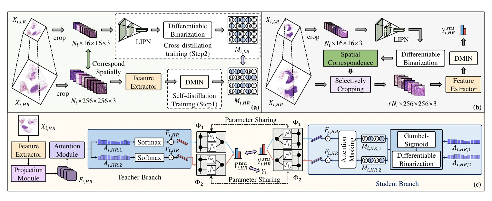

## Fast and Accurate Gigapixel Pathological Image Classification with Hierarchical Distillation Multi-Instance Learning

> data: CAMELYON16、TCGA-NSCLC、TCGA-BRCA
>
> CVPR 2025 · [论文](https://arxiv.org/abs/2502.21130) · [作者代码](https://github.com/JiuyangDong/HDMIL)

#### 引言

HDMIL 在高倍率编码前先用低倍率图像筛掉信息量低的区域，减少需要裁取和编码的 patch。

#### 方法

DMIN 在高倍率分支学习实例重要性和切片预测。LIPN 用这个信号学习低倍率筛选，推理时先选区域再运行高倍率分支。CKA 用 Chebyshev 多项式构建可学习的分类函数。

##### 模型结构图

图 2（PDF 第 4 页）

#### 实验

##### 实验设置

十次 Monte Carlo 评估；C16 保留官方测试集，TCGA 按病例 8:1:1 划分，另拆分四个推理阶段计时。

##### 关键指标 { #key-results }

| 配置 | AUC（%） | ACC（%） | 单张推理耗时（秒） |
| --- | --- | --- | --- |
| 仅 DMIN（HDMIL†） | 93.17 ± 1.83 | 88.92 ± 2.51 | 23.46 |
| LIPN 预筛 + DMIN | 90.88 ± 2.75 | 88.61 ± 2.04 | 16.75 |

数据来源为原文表 1，PDF 第 6 页，CAMELYON16。

##### 结果解读

在 CAMELYON16 上，低倍率预筛把单张推理耗时从 23.46 秒缩短到 16.75 秒，同时 AUC 下降 2.29 个百分点。TCGA 两个任务上的 AUC 差距较小。

##### 消融与讨论

比较 DMIN、低倍率预筛和 CKA 分类器；速度应包含预筛、裁块、编码与聚合，而非只算分类头。
