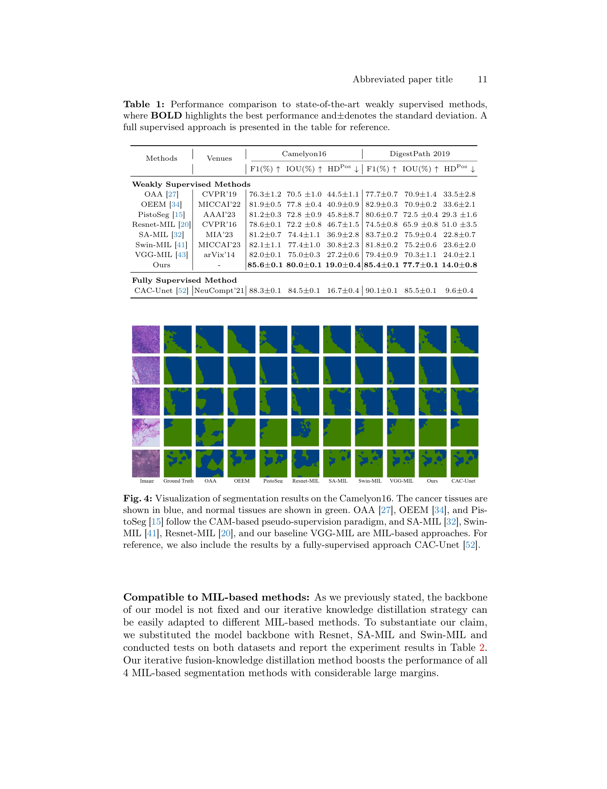
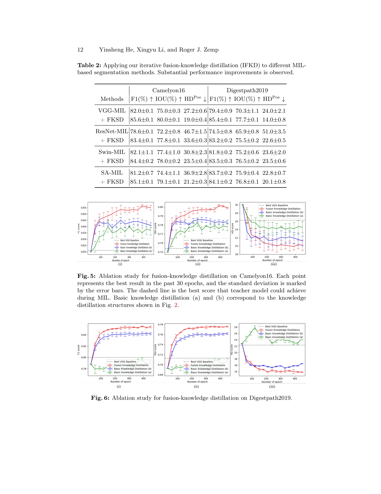
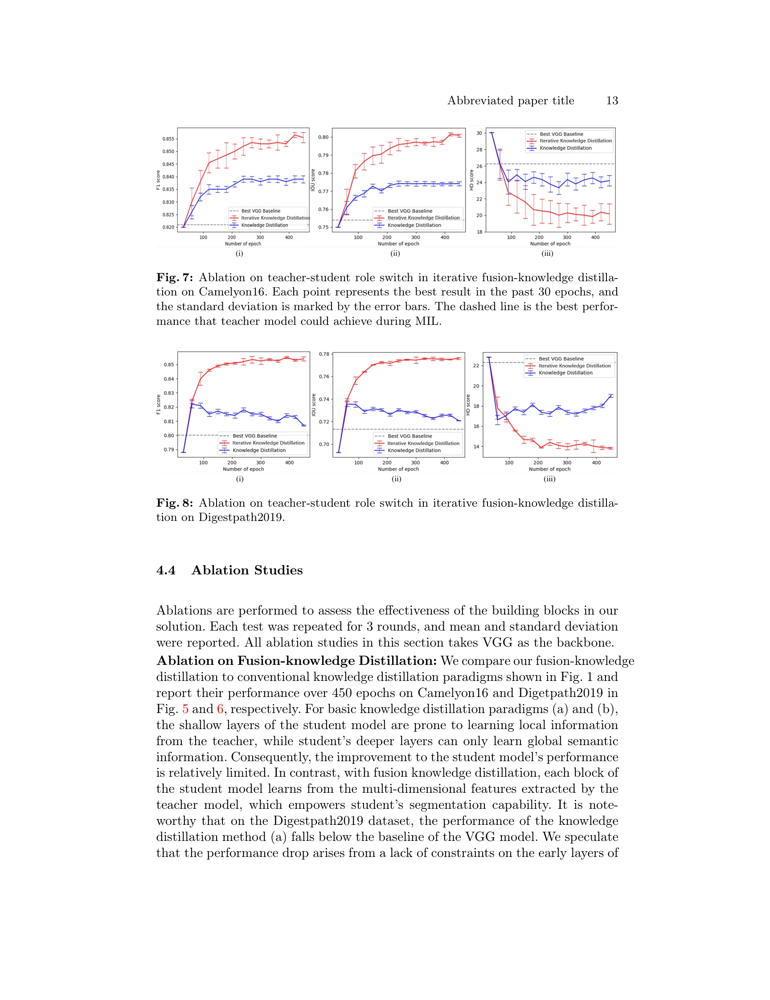
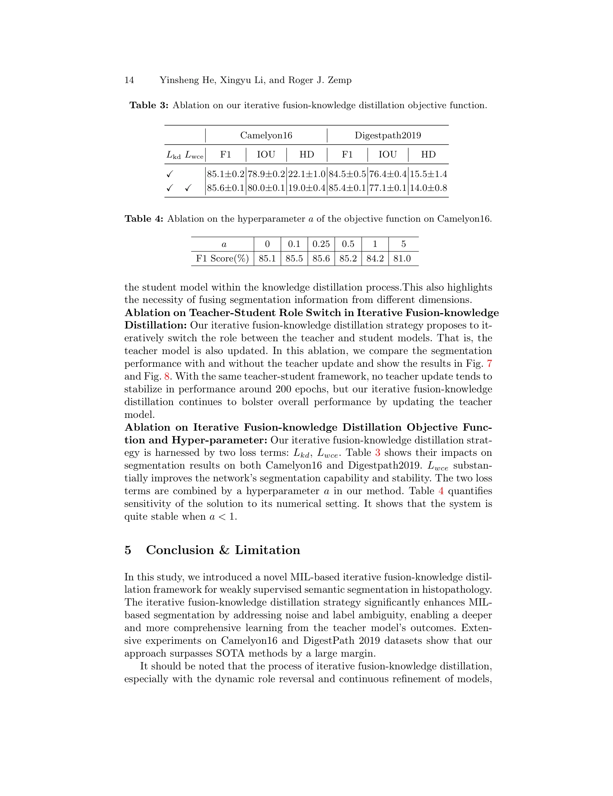

## Enhancing Weakly-Supervised Histopathology Image Segmentation with Knowledge Distillation on MIL-Based Pseudo-Labels

> data: CAMELYON16、DigestPath2019
>
> arXiv 2024 · [论文](https://arxiv.org/abs/2407.10274) · [作者代码](https://github.com/wollf2008/IKD-MIL)

#### 引言

把 MIL 产生的分割结果作为伪掩码，通过迭代融合与师生角色交换进行知识蒸馏，减轻伪标签噪声积累，服务弱监督病理分割。

#### 方法

（1）初始伪掩码：由 MIL 模型提供弱监督分割结果作为教师信号。

（2）融合蒸馏：让学生学习教师的综合预测，减轻单一伪标签噪声。

（3）迭代交换：周期性交换师生角色，并用加权交叉熵控制学习重点。

<!-- wsi-complete-model -->
##### 模型结构图

**图 3 · 模型结构**（PDF 第 6 页）

> 原文图注：Fig. 3: An overview of our proposed weakly-supervised segmentation method. Our method consists of two basic stages. In the first stage, we train a simple teacher model through MIL with input image patches and patch labels. In the second stage, we use iterative knowledge distillation to achieve precise pixel-level segmentation. Note, in the knowledge distillation process, the teacher model is frozen before parameter switch.

[查看原尺寸](assest/IKD-MIL/figure-3-complete.webp)

<!-- /wsi-complete-model -->

#### 实验

##### 实验设置

以弱标签训练分割，报告 F1、IoU、Hausdorff Distance；Adam 初始学习率为 5e-5，重复三次实验。

##### 主要结果

主表比较多种弱监督分割方法，另一表把迭代蒸馏接入不同 MIL 分割基线，验证其可组合性。

<!-- wsi-complete-results -->
##### 完整实验指标与对照

下列实验原页保留表头、全部行列、子图、误差说明和脚注，点击可查看原尺寸。比较时请对应相同的数据集、特征编码器和训练设置；`±`、置信区间、百分比和小数均保留原文的单位与统计口径。

| 原表/图中指标 | 读取方式 |
| --- | --- |
| F1 | 越高越好；保留 macro / weighted / micro 等平均方式 |
| Dice / IoU | 越高越好；区分像素/实例分割与切片分类 |
| ADE / FDE / HD | 越低越好；保留误差定义与单位 |

| 原文页 | 阅读内容 | 图表及正文引用 |
| --- | --- | --- |
| PDF 第 11 页 | 实验结果 | Table 1 |
| PDF 第 12 页 | 实验结果 | Table 2、Figure 5、Figure 6 |
| PDF 第 13 页 | 消融与参数分析 | Figure 7、Figure 8 |
| PDF 第 14 页 | 消融与参数分析 | Table 3、Table 4 |

**实验原页 · PDF 第 11 页**（图表及正文引用：Table 1）

[查看原尺寸](assest/IKD-MIL/experiment-page-11.webp)

**实验原页 · PDF 第 12 页**（图表及正文引用：Table 2、Figure 5、Figure 6）

[查看原尺寸](assest/IKD-MIL/experiment-page-12.webp)

展开消融、参数、数据设置及效率原页

**实验原页 · PDF 第 13 页**（图表及正文引用：Figure 7、Figure 8）

[查看原尺寸](assest/IKD-MIL/experiment-page-13.webp)

**实验原页 · PDF 第 14 页**（图表及正文引用：Table 3、Table 4）

[查看原尺寸](assest/IKD-MIL/experiment-page-14.webp)

<!-- /wsi-complete-results -->

##### 消融与讨论

考察融合蒸馏目标和权重 a；主实验使用 a=0.25，师生参数每 30 epochs 交换。

#### 参考文献

> Enhancing Weakly-Supervised Histopathology Image Segmentation with Knowledge Distillation on MIL-Based Pseudo-Labels
>
> arXiv 2024 · [论文](https://arxiv.org/abs/2407.10274) · [作者代码](https://github.com/wollf2008/IKD-MIL)
