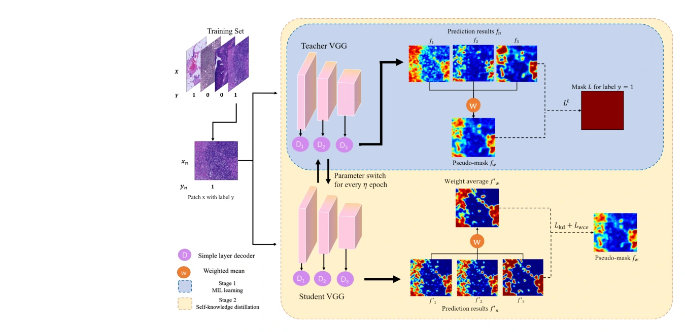

## Enhancing Weakly-Supervised Histopathology Image Segmentation with Knowledge Distillation on MIL-Based Pseudo-Labels

> data: CAMELYON16、DigestPath2019
>
> arXiv 2024 · [论文](https://arxiv.org/abs/2407.10274) · [作者代码](https://github.com/wollf2008/IKD-MIL)

#### 引言

把 MIL 产生的分割结果作为伪掩码，通过迭代融合与师生角色交换进行知识蒸馏，减轻伪标签噪声积累，服务弱监督病理分割。

#### 方法

（1）初始伪掩码：由 MIL 模型提供弱监督分割结果作为教师信号。

（2）融合蒸馏：让学生学习教师的综合预测，减轻单一伪标签噪声。

（3）迭代交换：周期性交换师生角色，并用加权交叉熵控制学习重点。

##### 模型结构图

图 3（PDF 第 6 页）

#### 实验

##### 实验设置

以弱标签训练分割，报告 F1、IoU、Hausdorff Distance；Adam 初始学习率为 5e-5，重复三次实验。

##### 关键指标 { #key-results }

| 数据集 | F1（%） | IoU（%） | HD（阳性）↓ |
| --- | --- | --- | --- |
| CAMELYON16 | 85.6 ± 0.1 | 80.0 ± 0.1 | 19.0 ± 0.4 |
| DigestPath2019 | 85.4 ± 0.1 | 77.7 ± 0.1 | 14.0 ± 0.8 |

数据来源为原文表 1，PDF 第 11 页。

##### 结果解读

主表比较多种弱监督分割方法，另一表把迭代蒸馏接入不同 MIL 分割基线，验证其可组合性。

##### 消融与讨论

考察融合蒸馏目标和权重 a；主实验使用 a=0.25，师生参数每 30 epochs 交换。

#### 参考文献

> Enhancing Weakly-Supervised Histopathology Image Segmentation with Knowledge Distillation on MIL-Based Pseudo-Labels
>
> arXiv 2024 · [论文](https://arxiv.org/abs/2407.10274) · [作者代码](https://github.com/wollf2008/IKD-MIL)
