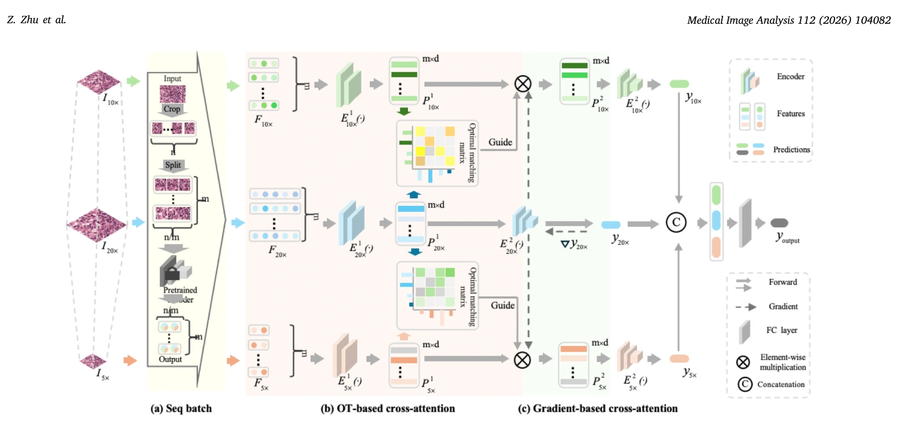
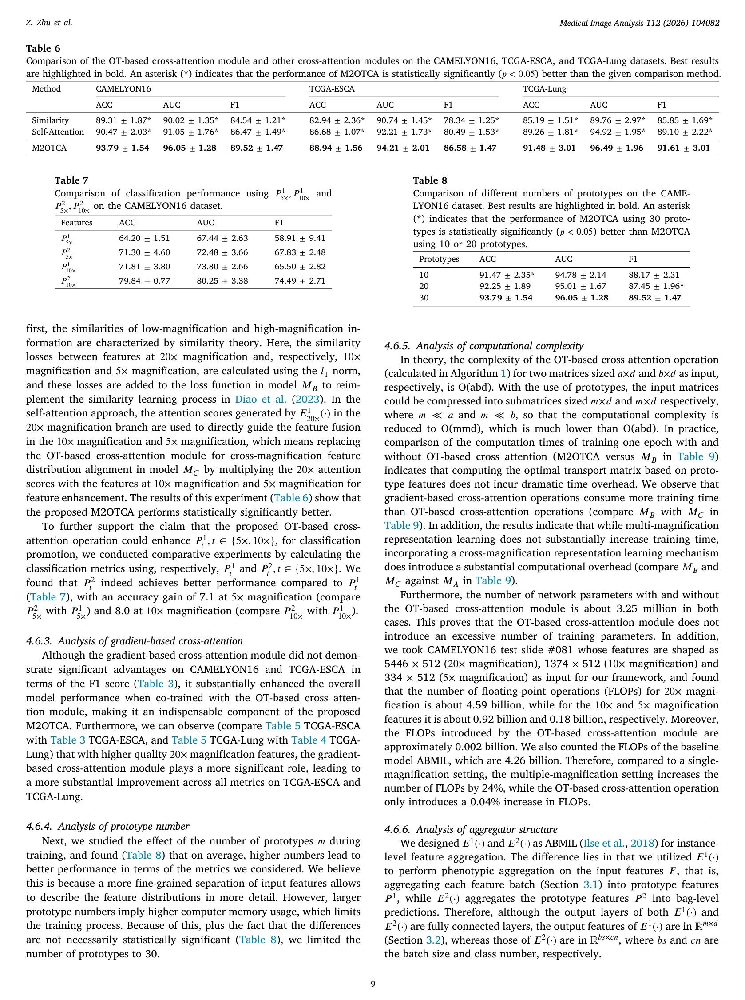
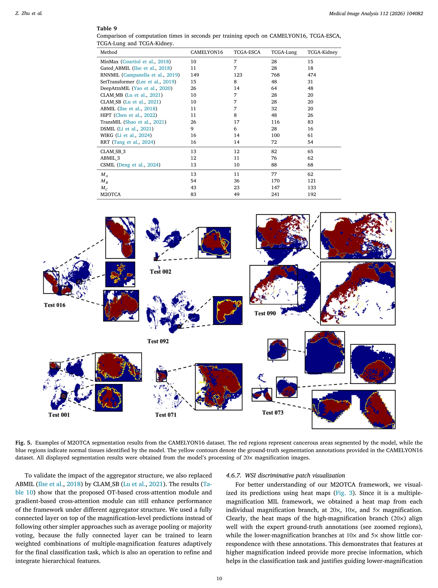
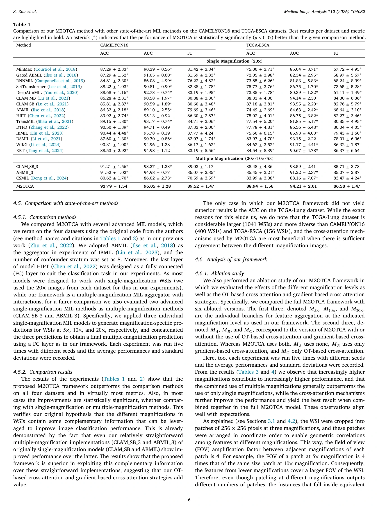
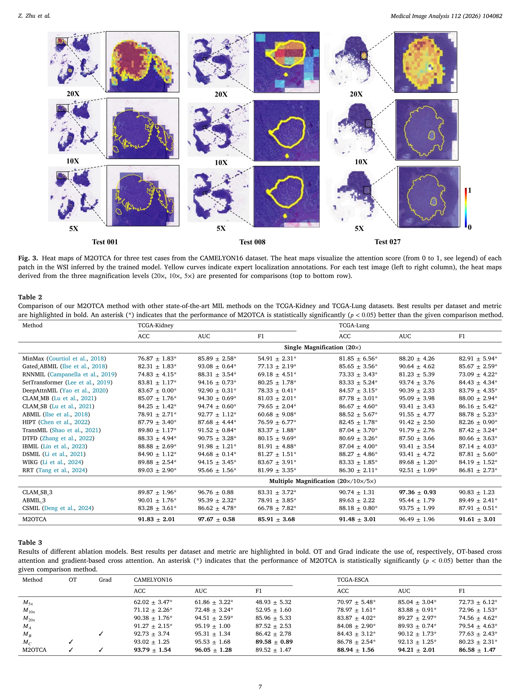
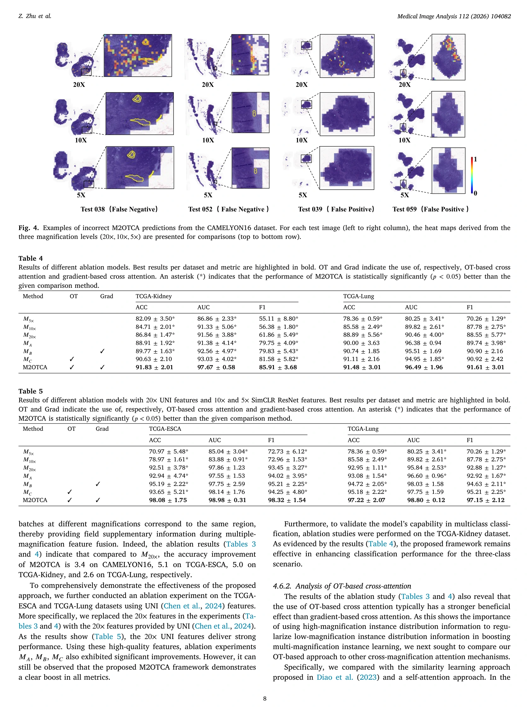
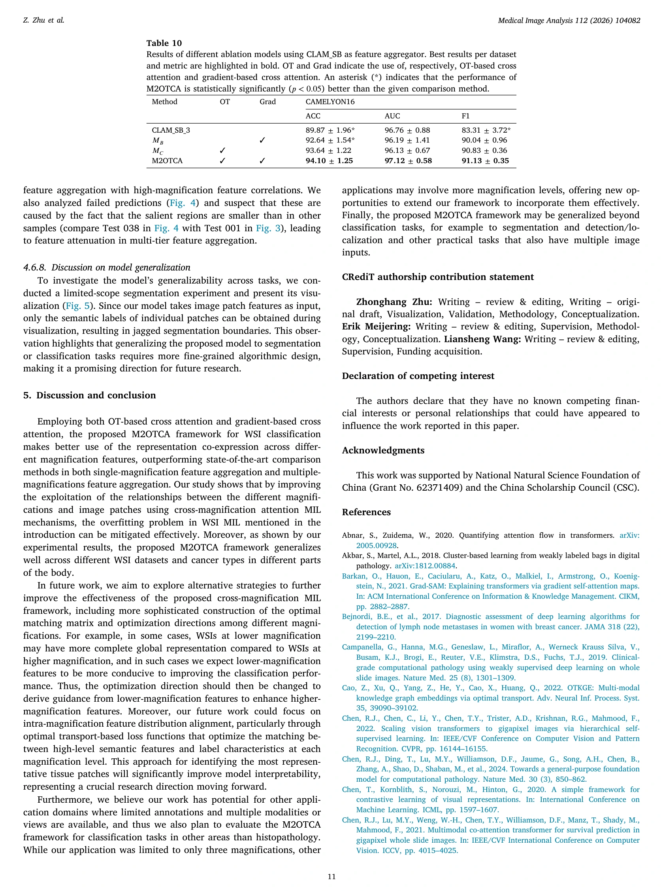

## M2OTCA: Multiple-magnification optimal transport-based cross-attention learning for whole slide image classification

> data: CAMELYON16、TCGA-ESCA、TCGA-Lung、TCGA-Kidney
>
> Medical Image Analysis 2026 · [论文](https://doi.org/10.1016/j.media.2026.104082)

#### 引言

以跨倍率最优传输匹配组织分布，先将实例压缩成区域结构原型，再用原型梯度增强低倍率特征，实现多倍率协同预测。

#### 方法

（1）结构原型：压缩每个倍率中的组织实例分布。

（2）OT 注意力：在不同倍率原型间建立分布匹配。

（3）梯度注意力：以高倍率原型梯度强化低倍率表示，再综合各倍率预测。

<!-- wsi-complete-model -->
##### 模型结构图

**图 2 · 模型结构**（PDF 第 4 页）

> 原文图注：Fig. 2. Overview of the proposed multiple-magnification OT-based cross-attention MIL architecture. (a) The three magnifications of the WSI, at 20×, 10×, 5×, are denoted as 𝐼20×, 𝐼10×, 𝐼5×, which are separated into 𝑚 sequential batches, from which feature sequential batches 𝐹20×, 𝐹10×, 𝐹5× are extracted, which are the input to each magnification branch. (b) OT-based cross-attention computes the optimal matching flow between high magnification prototypes 𝑃1 20× derived from 𝐹20× and low magnification prototypes 𝑃1 10× and 𝑃1 5× derived from 𝐹1 10× and 𝐹1 5× for identifying informative instances with global structure consistency across different magnifications. (c) Gradient-based attention is applied to obtain class-specific guidance from high magnification prototypes to emphasize low magnification prototypes. After aggregating enhanced instances, features from the three magnifications are concatenated for final prediction with a fully connected (FC) layer.

[查看原尺寸](assest/M2OTCA/figure-2-complete.webp)

<!-- /wsi-complete-model -->

#### 实验

##### 实验设置

联合 5×/10×/20×，以跨倍率结构原型减少 OT 成本，对比多倍率 MIL。

##### 主要结果

完整模型的证据来自多倍率与跨注意力组合，而不是简单拼接三种倍率。

<!-- wsi-complete-results -->
##### 完整实验指标与对照

下列实验原页保留表头、全部行列、子图、误差说明和脚注，点击可查看原尺寸。比较时请对应相同的数据集、特征编码器和训练设置；`±`、置信区间、百分比和小数均保留原文的单位与统计口径。

| 原表/图中指标 | 读取方式 |
| --- | --- |
| ROC-AUC / AUROC | 越高越好；若原表明确为 PR-AUC，则按 PR 曲线面积读取 |
| ACC / Accuracy | 越高越好；平衡准确率、平均准确率以原表标注为准 |
| F1 | 越高越好；保留 macro / weighted / micro 等平均方式 |

| 原文页 | 阅读内容 | 图表及正文引用 |
| --- | --- | --- |
| PDF 第 6 页 | 数据与实验设置 | Table 1 |
| PDF 第 7 页 | 消融与参数分析 | Table 2、Table 3 |
| PDF 第 8 页 | 消融与参数分析 | Table 4、Table 5 |
| PDF 第 9 页 | 实验结果 | Table 6、Table 7、Table 8 |
| PDF 第 10 页 | 实验结果 | Table 9、Figure 5 |
| PDF 第 11 页 | 消融与参数分析 | Table 10 |

**实验原页 · PDF 第 9 页**（图表及正文引用：Table 6、Table 7、Table 8）

[查看原尺寸](assest/M2OTCA/experiment-page-09.webp)

**实验原页 · PDF 第 10 页**（图表及正文引用：Table 9、Figure 5）

[查看原尺寸](assest/M2OTCA/experiment-page-10.webp)

展开消融、参数、数据设置及效率原页

**实验原页 · PDF 第 6 页**（图表及正文引用：Table 1）

[查看原尺寸](assest/M2OTCA/experiment-page-06.webp)

**实验原页 · PDF 第 7 页**（图表及正文引用：Table 2、Table 3）

[查看原尺寸](assest/M2OTCA/experiment-page-07.webp)

**实验原页 · PDF 第 8 页**（图表及正文引用：Table 4、Table 5）

[查看原尺寸](assest/M2OTCA/experiment-page-08.webp)

**实验原页 · PDF 第 11 页**（图表及正文引用：Table 10）

[查看原尺寸](assest/M2OTCA/experiment-page-11.webp)

<!-- /wsi-complete-results -->

##### 消融与讨论

比较三个单倍率分支，并分别移除 OT 交叉注意力和梯度交叉注意力，检查两种跨尺度机制的贡献。

#### 参考文献

> M2OTCA: Multiple-magnification optimal transport-based cross-attention learning for whole slide image classification
>
> Medical Image Analysis 2026 · [论文](https://doi.org/10.1016/j.media.2026.104082)
