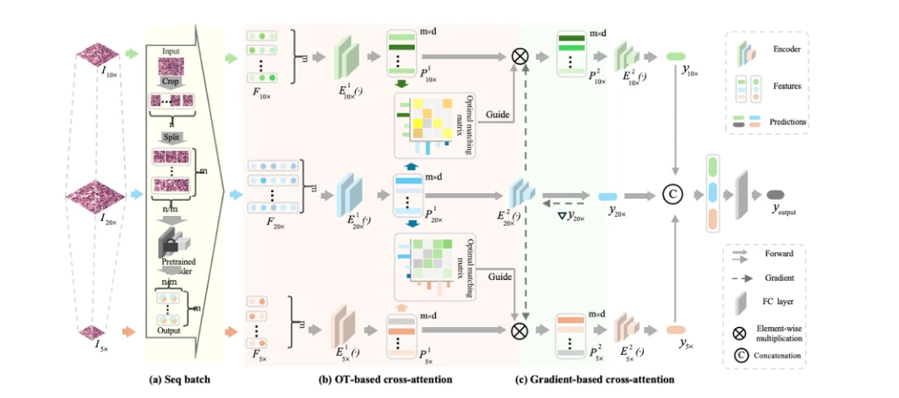

## M2OTCA: Multiple-magnification optimal transport-based cross-attention learning for whole slide image classification

> data: CAMELYON16、TCGA-ESCA、TCGA-Lung、TCGA-Kidney
>
> Medical Image Analysis 2026 · [论文](https://doi.org/10.1016/j.media.2026.104082)

#### 引言

以跨倍率最优传输匹配组织分布，先将实例压缩成区域结构原型，再用原型梯度增强低倍率特征，实现多倍率协同预测。

#### 方法

（1）结构原型：压缩每个倍率中的组织实例分布。

（2）OT 注意力：在不同倍率原型间建立分布匹配。

（3）梯度注意力：以高倍率原型梯度强化低倍率表示，再综合各倍率预测。

原文Fig. 2，PDF 第 4 页。

#### 实验

##### 实验设置

联合 5×/10×/20×，以跨倍率结构原型减少 OT 成本，对比多倍率 MIL。

##### 主要结果

完整模型的证据来自多倍率与跨注意力组合，而不是简单拼接三种倍率。

##### 消融与讨论

比较三个单倍率分支，并分别移除 OT 交叉注意力和梯度交叉注意力，检查两种跨尺度机制的贡献。

#### 参考文献

> M2OTCA: Multiple-magnification optimal transport-based cross-attention learning for whole slide image classification
>
> Medical Image Analysis 2026 · [论文](https://doi.org/10.1016/j.media.2026.104082)
