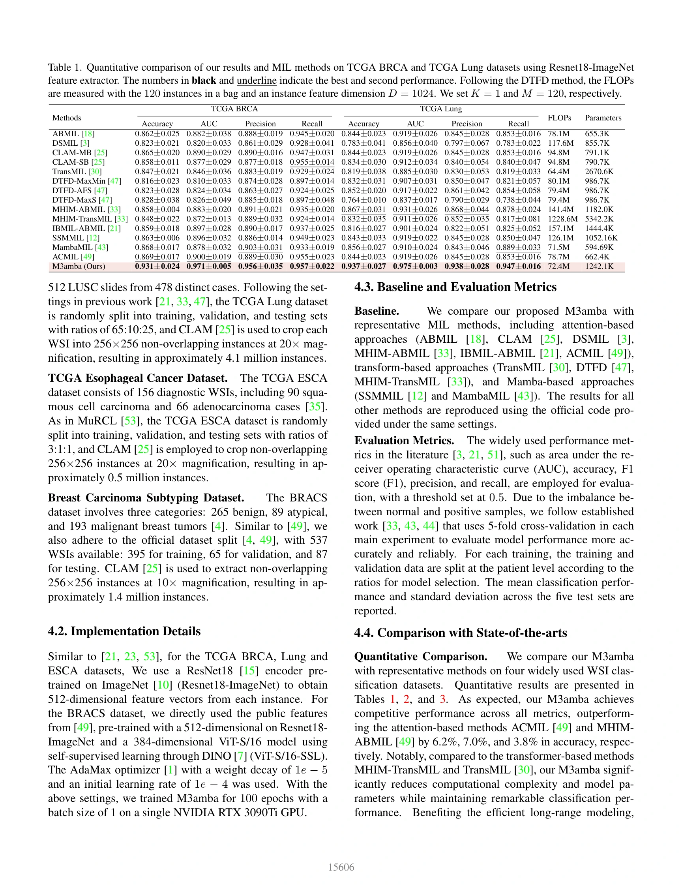
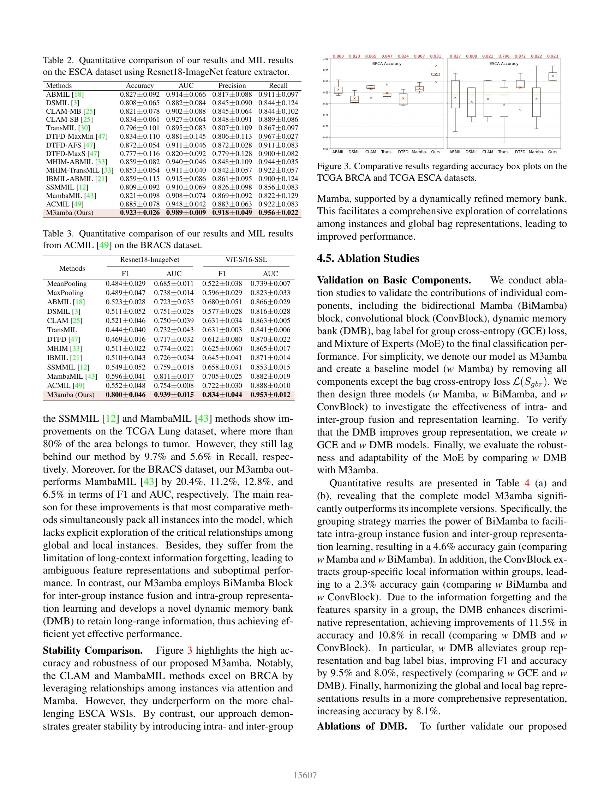
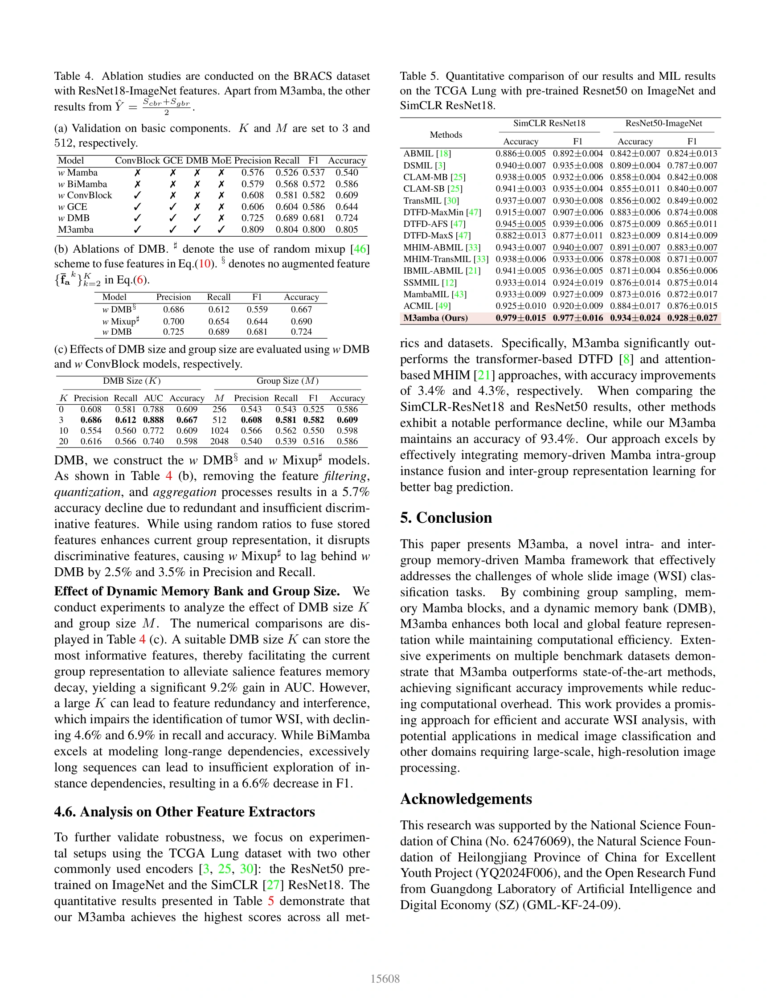

## M3amba: Memory Mamba is All You Need for Whole Slide Image Classification

> data: TCGA-BRCA、TCGA Lung、TCGA-ESCA、BRACS
>
> CVPR 2025 · [论文](https://openaccess.thecvf.com/content/CVPR2025/html/Zheng_M3amba_Memory_Mamba_is_All_You_Need_for_Whole_Slide_CVPR_2025_paper.html)

#### 引言

通过动态记忆库保留跨组历史信息，并结合组内双向 Mamba 和跨组注意力，缓解长序列状态空间建模中的上下文遗忘。

#### 方法

（1）组内 BiMamba：在局部组内双向建模组织联系。

（2）动态记忆：持续保留和更新历史组的信息。

（3）跨组融合：用注意力与专家模块结合当前及历史表示，形成全局预测。

<!-- wsi-complete-model -->
##### 模型结构图

**图 2 · 模型结构**（PDF 第 3 页）

> 原文图注：Figure 2. The architecture of our proposed memory-driven memory Mamba network (M3amba) for WSI classification. M3amba randomly samples group instance features at time t. And then, the memory Mamba block introduces a bidirectional Mamba (BiMamba) and a linear attention block (BiMamba Block) to explore relations among instances. To alleviate key information forgetting and enhance discriminative features within the group, we employ cross-attention to refine and fuse historical information from a dynamic memory bank (DMB) into the current group representation f t cgr, and then predict the group class probability using a multi-layer perceptron (MLP). Meanwhile, f t cgr

[查看原尺寸](assest/M3amba/figure-2-complete.webp)

<!-- /wsi-complete-model -->

#### 实验

##### 实验设置

同时比较注意力、Transformer 与 Mamba 方法，并报告模型参数与计算复杂度。

##### 主要结果

摘要报告 BRCA 和 Lung 的 ACC 增益分别为 6.2、7.0 个百分点；这些增益依赖相应比较基线。

<!-- wsi-complete-results -->
##### 完整实验指标与对照

下列实验原页保留表头、全部行列、子图、误差说明和脚注，点击可查看原尺寸。比较时请对应相同的数据集、特征编码器和训练设置；`±`、置信区间、百分比和小数均保留原文的单位与统计口径。

| 原表/图中指标 | 读取方式 |
| --- | --- |
| ACC / Accuracy | 越高越好；平衡准确率、平均准确率以原表标注为准 |
| 时间 / FLOPs / 参数量 | 结合硬件、包长度和计时范围比较；小模型不一定推理更快 |

| 原文页 | 阅读内容 | 图表及正文引用 |
| --- | --- | --- |
| PDF 第 6 页 | 实验结果 | Table 1 |
| PDF 第 7 页 | 实验结果 | Table 2、Table 3、Figure 3 |
| PDF 第 8 页 | 实验结果 | Table 4、Table 5 |

**实验原页 · PDF 第 6 页**（图表及正文引用：Table 1）

[查看原尺寸](assest/M3amba/experiment-page-06.webp)

**实验原页 · PDF 第 7 页**（图表及正文引用：Table 2、Table 3、Figure 3）

[查看原尺寸](assest/M3amba/experiment-page-07.webp)

**实验原页 · PDF 第 8 页**（图表及正文引用：Table 4、Table 5）

[查看原尺寸](assest/M3amba/experiment-page-08.webp)

<!-- /wsi-complete-results -->

##### 消融与讨论

消融 BiMamba、卷积块、动态记忆库、组监督及 MoE，重点检查跨组历史信息的作用。

#### 参考文献

> M3amba: Memory Mamba is All You Need for Whole Slide Image Classification
>
> CVPR 2025 · [论文](https://openaccess.thecvf.com/content/CVPR2025/html/Zheng_M3amba_Memory_Mamba_is_All_You_Need_for_Whole_Slide_CVPR_2025_paper.html)
