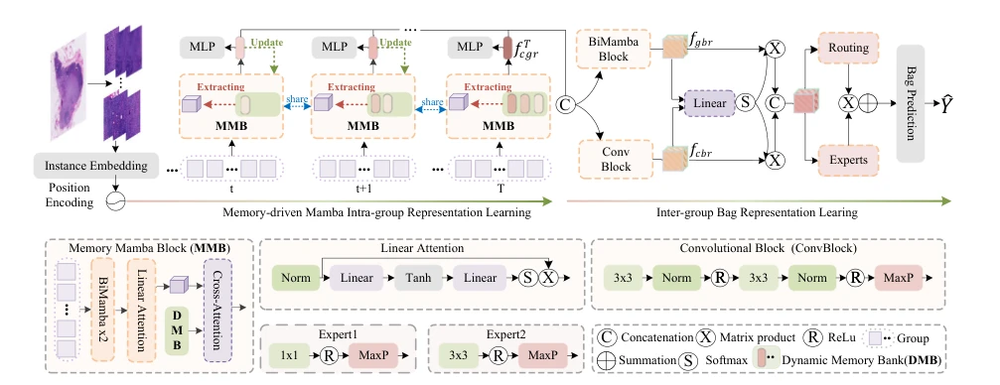
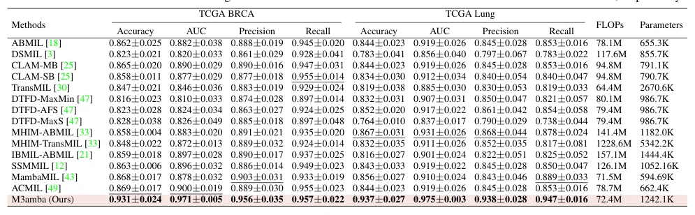

## M3amba: Memory Mamba is All You Need for Whole Slide Image Classification

> data: TCGA-BRCA、TCGA Lung、TCGA-ESCA、BRACS
>
> CVPR 2025 · [论文](https://openaccess.thecvf.com/content/CVPR2025/html/Zheng_M3amba_Memory_Mamba_is_All_You_Need_for_Whole_Slide_CVPR_2025_paper.html)

#### 引言

通过动态记忆库保留跨组历史信息，并结合组内双向 Mamba 和跨组注意力，缓解长序列状态空间建模中的上下文遗忘。

#### 方法

（1）组内 BiMamba：在局部组内双向建模组织联系。

（2）动态记忆：持续保留和更新历史组的信息。

（3）跨组融合：用注意力与专家模块结合当前及历史表示，形成全局预测。

原文Figure 2，PDF 第 3 页。

#### 实验

##### 实验设置

同时比较注意力、Transformer 与 Mamba 方法，并报告模型参数与计算复杂度。

##### 主要结果

摘要报告 BRCA 和 Lung 的 ACC 增益分别为 6.2、7.0 个百分点；这些增益依赖相应比较基线。

原文Table 1，PDF 第 6 页。

##### 消融与讨论

消融 BiMamba、卷积块、动态记忆库、组监督及 MoE，重点检查跨组历史信息的作用。

#### 参考文献

> M3amba: Memory Mamba is All You Need for Whole Slide Image Classification
>
> CVPR 2025 · [论文](https://openaccess.thecvf.com/content/CVPR2025/html/Zheng_M3amba_Memory_Mamba_is_All_You_Need_for_Whole_Slide_CVPR_2025_paper.html)
