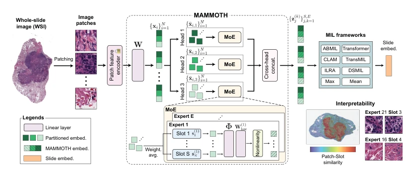
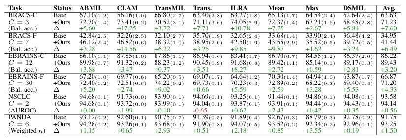

## Mixture of Mini Experts: Overcoming the Linear Layer Bottleneck in Multiple Instance Learning

> data: 19 项分类任务及论文中的分子标志物/生存队列
>
> ICLR 2026 · [论文](https://openreview.net/pdf/35d5ec46cd31922fabf8a7c39324e89ce8ee9f4e.pdf) · [作者代码](https://github.com/mahmoodlab/mammoth)

#### 引言

针对通用 patch 特征到任务特征的线性层瓶颈，引入多头微型专家混合与低秩变换，可增强不同 MIL 聚合方式。

#### 方法

（1）微型专家：用参数高效的低秩变换替代单一线性映射。

（2）多头路由：根据 patch 表型选择互补任务适配方式。

（3）聚合解耦：保持后续 MIL 聚合器，使收益可跨不同模型验证。

原文Figure 2，PDF 第 4 页。

#### 实验

##### 实验设置

二分类用 AUC、多分类用平衡 ACC、分级用加权 Kappa；比较八类 MIL 加/不加 MAMMOTH。

##### 主要结果

分类 152 个配置中 130 个改善；生存 32 个配置中 30 个改善，平均 C-index 增益 2.78 个百分点。

原文Table 1，PDF 第 7 页。

##### 消融与讨论

比较普通线性层与低秩微专家变换；弱形态学信号的生物标志物仍可能不稳定。

#### 参考文献

> Mixture of Mini Experts: Overcoming the Linear Layer Bottleneck in Multiple Instance Learning
>
> ICLR 2026 · [论文](https://openreview.net/pdf/35d5ec46cd31922fabf8a7c39324e89ce8ee9f4e.pdf) · [作者代码](https://github.com/mahmoodlab/mammoth)
