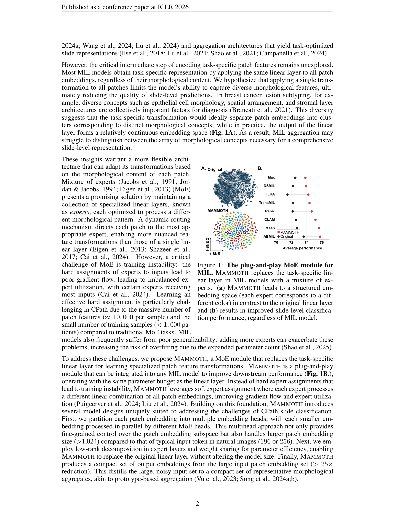
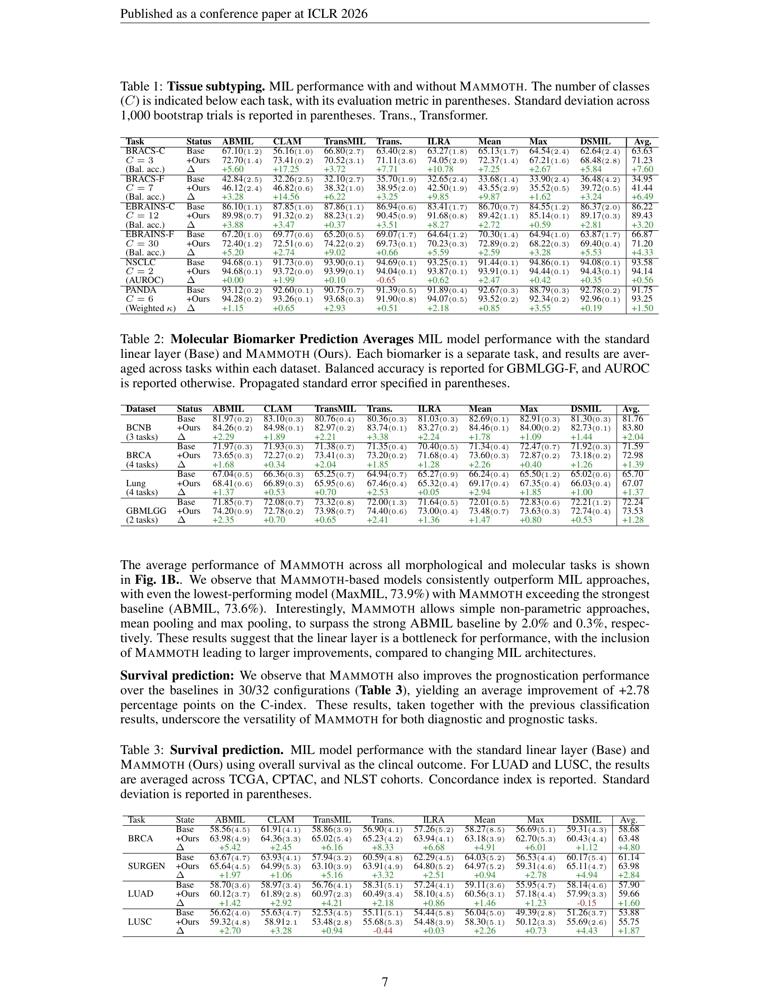
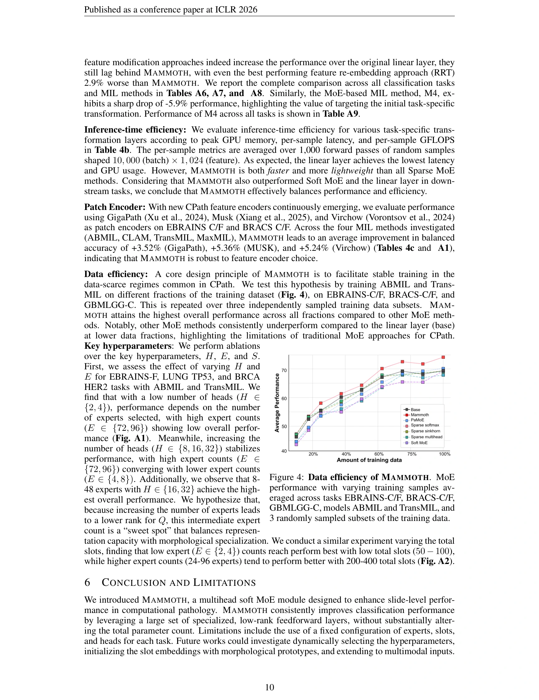
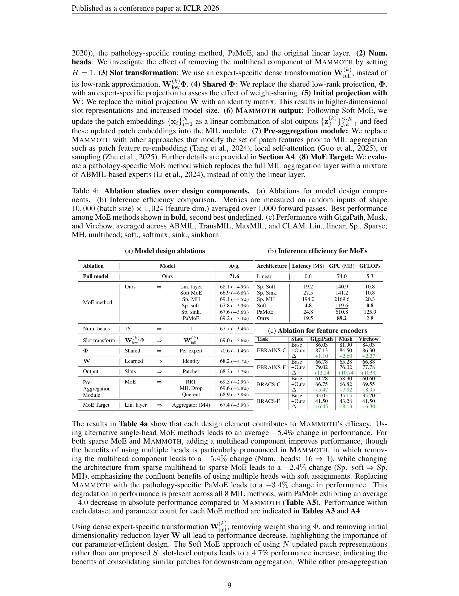

## Mixture of Mini Experts: Overcoming the Linear Layer Bottleneck in Multiple Instance Learning

> data: 19 项分类任务及论文中的分子标志物/生存队列
>
> ICLR 2026 · [论文](https://openreview.net/pdf/35d5ec46cd31922fabf8a7c39324e89ce8ee9f4e.pdf) · [作者代码](https://github.com/mahmoodlab/mammoth)

#### 引言

针对通用 patch 特征到任务特征的线性层瓶颈，引入多头微型专家混合与低秩变换，可增强不同 MIL 聚合方式。

#### 方法

（1）微型专家：用参数高效的低秩变换替代单一线性映射。

（2）多头路由：根据 patch 表型选择互补任务适配方式。

（3）聚合解耦：保持后续 MIL 聚合器，使收益可跨不同模型验证。

<!-- wsi-complete-model -->
##### 模型结构图

**图 2 · 模型结构**（PDF 第 4 页）

> 原文图注：Figure 2: MAMMOTH architecture MAMMOTH replaces the initial linear layer of MIL models, transforming generic patch features into task-optimized features with a multiheaded soft MoE. Patch features are routed to different combinations of slots and experts for task- and morphology-specific processing. The MoE outputs are concatenated and fed into the MIL model.

[查看原尺寸](assest/MAMMOTH/figure-2-complete.webp)

<!-- /wsi-complete-model -->

#### 实验

##### 实验设置

二分类用 AUC、多分类用平衡 ACC、分级用加权 Kappa；比较八类 MIL 加/不加 MAMMOTH。

##### 主要结果

分类 152 个配置中 130 个改善；生存 32 个配置中 30 个改善，平均 C-index 增益 2.78 个百分点。

<!-- wsi-complete-results -->
##### 完整实验指标与对照

下列实验原页保留表头、全部行列、子图、误差说明和脚注，点击可查看原尺寸。比较时请对应相同的数据集、特征编码器和训练设置；`±`、置信区间、百分比和小数均保留原文的单位与统计口径。

| 原表/图中指标 | 读取方式 |
| --- | --- |
| ROC-AUC / AUROC | 越高越好；若原表明确为 PR-AUC，则按 PR 曲线面积读取 |
| ACC / Accuracy | 越高越好；平衡准确率、平均准确率以原表标注为准 |
| C-index | 越高越好；用于生存预测，需保留终点及删失设置 |
| Kappa / QWK | 越高越好；加权方式与类别顺序以原表为准 |

| 原文页 | 阅读内容 | 图表及正文引用 |
| --- | --- | --- |
| PDF 第 2 页 | 实验结果 | Figure 1 |
| PDF 第 7 页 | 实验结果 | Table 1、Table 2、Table 3 |
| PDF 第 9 页 | 消融与参数分析 | Table 4 |
| PDF 第 10 页 | 实验结果 | Figure 4 |

**实验原页 · PDF 第 2 页**（图表及正文引用：Figure 1）

[查看原尺寸](assest/MAMMOTH/experiment-page-02.webp)

**实验原页 · PDF 第 7 页**（图表及正文引用：Table 1、Table 2、Table 3）

[查看原尺寸](assest/MAMMOTH/experiment-page-07.webp)

**实验原页 · PDF 第 10 页**（图表及正文引用：Figure 4）

[查看原尺寸](assest/MAMMOTH/experiment-page-10.webp)

展开消融、参数、数据设置及效率原页

**实验原页 · PDF 第 9 页**（图表及正文引用：Table 4）

[查看原尺寸](assest/MAMMOTH/experiment-page-09.webp)

<!-- /wsi-complete-results -->

##### 消融与讨论

比较普通线性层与低秩微专家变换；弱形态学信号的生物标志物仍可能不稳定。

#### 参考文献

> Mixture of Mini Experts: Overcoming the Linear Layer Bottleneck in Multiple Instance Learning
>
> ICLR 2026 · [论文](https://openreview.net/pdf/35d5ec46cd31922fabf8a7c39324e89ce8ee9f4e.pdf) · [作者代码](https://github.com/mahmoodlab/mammoth)
