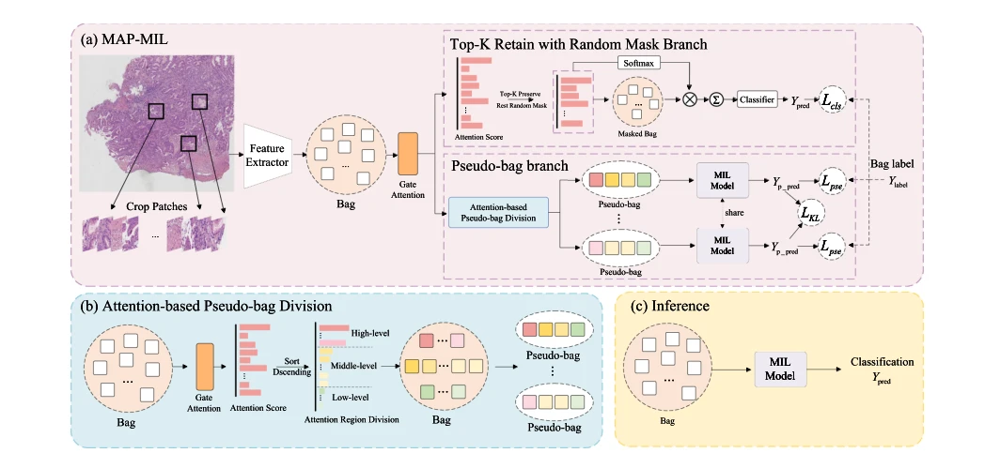

## MAP-MIL: Dual-branch collaborative learning of mask enhancement and pseudo-bag generation for whole slide image classification

> data: GastricCancerv2.0、CAMELYON16、TCGA-LUNG；MUSK1/2、Elephant
>
> Expert Systems with Applications 2026 · [论文](https://doi.org/10.1016/j.eswa.2025.130525) · [作者代码](https://github.com/Pikachu-one/MAP-MIL)

#### 引言

让掩码增强分支和注意力引导的伪包分支协同学习，结合伪包间一致性约束，减少冗余实例并扩大训练样本多样性。

#### 方法

（1）掩码分支：保留 Top-K 实例并随机遮蔽其他实例，减少冗余。

（2）伪包分支：按门控注意力构建多样训练子包。

（3）一致性目标：约束伪包间学习，使两分支协同优化。

原文Fig. 2，PDF 第 4 页。

#### 实验

##### 实验设置

比较不同编码器，包括 CTransPath，并额外在经典 MIL 数据上检验双分支结构。

##### 主要结果

CTransPath 配置下 C16 的 ACC/AUC/F1 为 98.44%/99.40%/97.92%；不能与其他编码器结果混合引用。

##### 消融与讨论

消融掩码分支、注意力引导伪包和包间一致性；内部胃癌集与公开任务的结果分别解释。

#### 参考文献

> MAP-MIL: Dual-branch collaborative learning of mask enhancement and pseudo-bag generation for whole slide image classification
>
> Expert Systems with Applications 2026 · [论文](https://doi.org/10.1016/j.eswa.2025.130525) · [作者代码](https://github.com/Pikachu-one/MAP-MIL)
